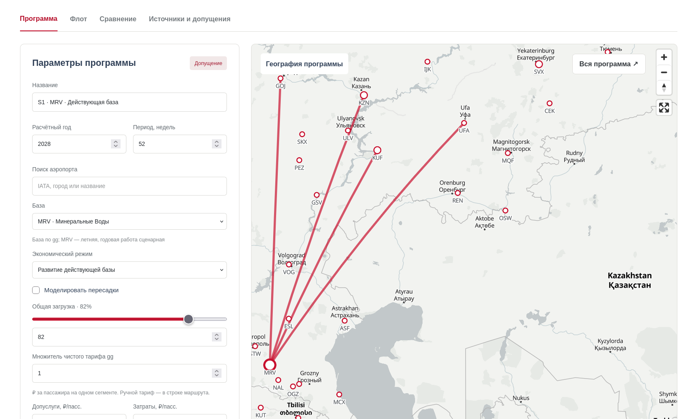

<div align="center">

# Red Wings · стратегия роста

**Команда WeSeekDp · Кейс 5**

Развиваем региональную сеть, проверяем экономику маршрутов<br>
и находим дополнительный доход на существующих рейсах.

[Маршрутный калькулятор](https://26b48574.nip.io) · [Презентация](presentation/slides.md) · [Расчёты](analysis/HUB_STRATEGY.md) · [Быстрый старт](#быстрый-старт)

</div>

---

## Идея проекта

Стратегическая цель — **второе место Red Wings на российском авиарынке**. Первый рассчитанный шаг — развитие действующей базы в **Минеральных Водах**, затем тиражирование программы на другие базы. Грузовые перевозки и пакет «перелёт + трансфер + отель» дополняют экономику сети.

Сравниваем два варианта: **S1** — развивать действующие базы, **S2** — открыть новый региональный хаб. В сохранённом расчёте выбран **S1**: прямые рейсы из MRV в Самару, Нижний Новгород, Казань и Уфу.

| Показатель | Сохранённый сценарий S1 · полный 2028 год |
| :--- | ---: |
| Новые направления | **4** |
| Дополнительные пассажирские сегменты | **118,9 тыс./год** |
| Расчётный результат после расходов программы | **632,2 млн RUB/год** |
| Преимущество перед новым хабом в NUX | **248,1 млн RUB/год** |
| Самолёты под программу | **2 рабочих + 1 резервный** |

Сегмент — один перелёт пассажира. Расчётный результат здесь — до инвестиций и налогов, а не чистая бухгалтерская прибыль. Коммерческие параметры — допущения модели.

**Статус расчётов:** вместимость SSJ100 в Python-оценщике изменена на **100 кресел**. Сохранённые отчёты после этой правки не пересчитывались; таблица выше отражает предыдущий сохранённый расчёт.

## Что внутри

| Часть проекта | Что можно посмотреть |
| :--- | :--- |
| **[Маршрутный калькулятор](calculator/README.md)** | Карта сети, параметры маршрутов, загрузка, распределение флота, экономика, груз и экспорт сценариев |
| **[Презентация на Slidev](presentation/slides.md)** | Рынок и ресурсы → сравнение стратегий → выбранная сеть → груз → мультимодальность → этапы роста |
| **[Стратегия и экономика](analysis/HUB_STRATEGY.md)** | Формулы, расходы, расписание, чувствительность и сравнение S1 / S2 |
| **[Отбор аэропортов](analysis/HUB_CANDIDATES.md)** | 24 аэропорта, критерии отбора и шесть финалистов |
| **[Исследование грузов](data/cargo_research/README.md)** | Грузы на пассажирских рейсах, рынок, ограничения и сценарные расчёты |
| **[Мультимодальный продукт](data/multimodal_research/README.md)** | Корпоративные поездки, заказной трансфер, размещение, экономика заказа и пилот |
| **[Рыночная позиция](data/redwings_research/market_position_2025/README.md)** | Пассажиры, доля рынка, региональная сеть, грузовой бизнес и сравнение видов транспорта |
| **[Данные аэропортов](data/airport_research/README.md)** | Статистика 2024–2025, маршруты, инфраструктура, источники и происхождение значений |

<details>
<summary><strong>Посмотреть интерфейс калькулятора</strong></summary>



Калькулятор позволяет менять сценарий и видеть, как параметры влияют на сеть и её экономику. Формулы и границы модели описаны в [документации](calculator/docs/MODEL.md).

</details>

## Быстрый старт

Инструменты закреплены в [`mise.toml`](mise.toml): **Python 3.14 · Node.js 24 · pnpm 12.15.0**. Команды ниже выполняются из корня репозитория при установленном [mise](https://mise.jdx.dev).

### Калькулятор

```sh
mise run calculator:install
mise run calculator:dev
```

Адрес приложения появится в терминале, обычно — `http://127.0.0.1:3000`.

### Презентация

```sh
mise run sync
mise run presentation:dev
```

Слайды редактируются в [`presentation/slides.md`](presentation/slides.md), общие стили — в [`presentation/style.css`](presentation/style.css). Восьмой слайд подключён из [отдельного файла](presentation/slides/growth-2036.md). Формат — **16:9**.

Экспорт в PDF:

```sh
mise run presentation:pdf
```

Результат сохраняется в `artifacts/redwings.pdf`. Экспорт требует браузер Playwright Chromium; зависимость указана в пакете презентации.

### Проверки и сборка

```sh
mise run calculator:build
mise exec -- pnpm -C calculator typecheck
mise exec -- pnpm -C calculator lint
mise exec -- pnpm -C presentation build
```

### Пересчёт маршрутной модели

```sh
mise exec -- python analysis/calculate.py
```

Скрипт использует стандартную библиотеку Python и перезаписывает только **`analysis/HUB_CANDIDATES.md` и `analysis/HUB_STRATEGY.md`**. Исходные CSV, презентация и этот README сохраняются.

## Логика долгосрочного роста

1. **Запустить S1 в MRV.** Проверить спрос и экономику четырёх прямых направлений.
2. **Тиражировать программу.** В расширении модели к 2036 году — 24 маршрута на шести базах и около 1,16 млн дополнительных сегментов в год. При неизменном остальном бизнесе это даёт около 3,86 млн пассажиров компании в год.
3. **Расширять весь пассажирский бизнес.** Выход на №2 — долгосрочная цель. Ориентир 13,8 млн пассажиров относится к масштабу «Победы» за 2025 год и должен расти вместе с конкурентами; текущая программа сама по себе достижение этой цели не доказывает.

Груз добавляет выручку свободной ёмкости, а трансферы и размещение — сервис и дополнительный доход с поездки. Их финансовый эффект не складывается с пассажиропотоком. Расширение на 2036 год и примеры на слайдах — сценарии, а не подтверждённые поставки, контракты или прогнозы продаж.

## Данные и воспроизводимость

- Статистика аэропортов и перевозчиков — за **2024–2025 годы**; более поздние сведения о сети и флоте имеют собственные даты среза.
- Источники, восстановленные значения и сценарные допущения разделены в [методике](data/airport_research/documentation/METHODOLOGY.md) и [происхождении данных](data/airport_research/documentation/DATA_LINEAGE.csv).
- Тарифы, загрузка и расходы проверяются чувствительностью; наличие самолёта в списке парка не означает его доступность для новой программы.
- [Методика калькулятора](calculator/docs/MODEL.md) и [его источники](calculator/docs/DATA_SOURCES.md) описывают отдельную интерактивную модель.

---

<div align="center">

**WeSeekDp** · от исследования рынка к проверяемой маршрутной стратегии

</div>
