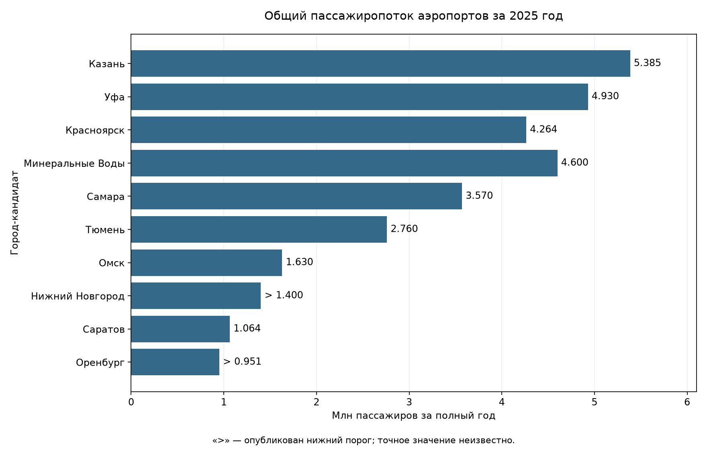
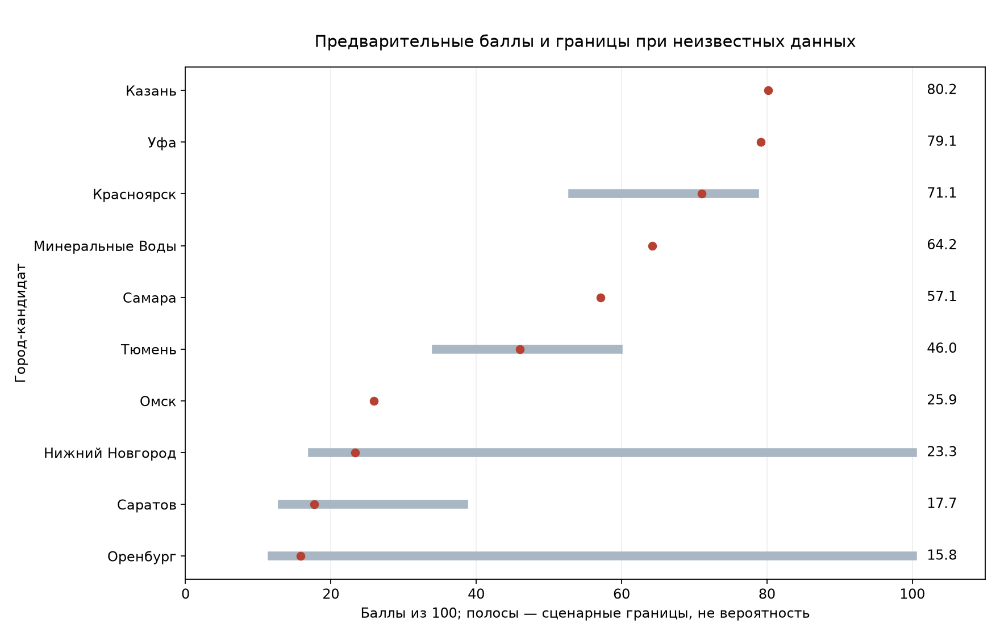
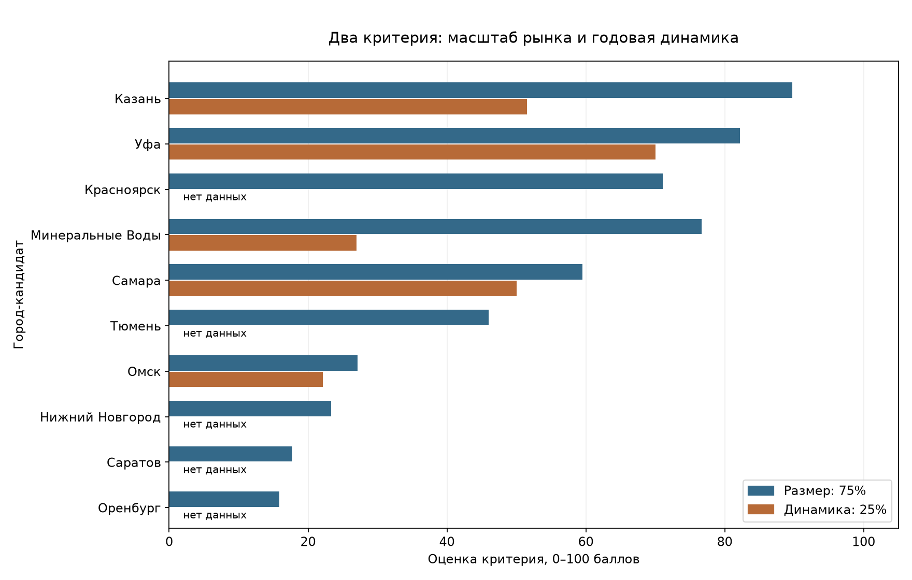

# TASK-02 — Предварительный рейтинг городов для нового хаба Red Wings

**При выбранных правилах первые три города — Казань, Уфа, Красноярск.** Это приоритет для дальнейшей проверки, а не доказательство пригодности хаба. Недостающие сведения допускают изменение состава тройки. Дата интерпретации базы — 10 ноября 2026 года; новые данные не загружались.

## 1. Зачем выбираем город

Региональный хаб — аэропорт, где рейсы соединяются так, чтобы пассажир мог удобно пересесть между регионами. База — место размещения самолётов и экипажей; пересадки для неё не обязательны. Большой поток помогает заполнять рейсы местными пассажирами, но не гарантирует удобных стыковок, свободных слотов и прибыльности. Нужны расписание, экономика и спрос между конкретными городами — их здесь не моделируем. Выбор H1/H2 остаётся за пределами задачи.

Red Wings перевезла в 2025 году 2.7 млн человек всего (S08: data/processed/airlines/metrics.csv:5; html class=post; occurrence=2; normalized_text_chars=776:794 (core:5)). Это масштаб компании, а не доля или спрос отдельного города; в баллы показатель не включён.

## 2. Какие города сравниваем

Взяты все города из аэропортового блока, у которых есть общий фактический поток за полный 2025 год, кроме Екатеринбурга: по условию кейса там уже действует региональный хаб Red Wings. Получилось 10 кандидатов. Это лонглист в пределах доступной базы, а не обзор всех аэропортов России. Название аэропорта оставлено на уровне исходной записи, без дополнения официальными именами по памяти. IATA скопирован только из однозначной строки расписания данного города; для Тюмени код в заданных таблицах не установлен.

| Город | Аэропорт / IATA | Поток, период и точность | Динамика 2025/2024 | Источник потока |
|---|---|---|---|---|
| Казань | Казань / KZN | 5 384 816 человек; 2025; опубликованное значение | 0.30% | S38: data/processed/airports/metrics.csv:152; lines 176-176 (core:129) |
| Уфа | Уфа / UFA | 4 929 715 человек; 2025; опубликованное значение | 4.00% | S26: data/processed/airports/metrics.csv:33; lines 4-4 (core:23) |
| Красноярск | Красноярск / KJA | 4 263 566 человек; 2025; опубликованное значение | нет сопоставимого 2024 | S31: data/processed/airports/metrics.csv:58; lines 11-11 (core:48) |
| Минеральные Воды | Минеральные Воды / MRV | 4 600 000 человек; 2025; опубликованное значение | -4.60% | S41: data/processed/airports/metrics.csv:183; lines 4-4 (core:150) |
| Самара | Самара (Курумоч) / KUF | 3 570 000 человек; 2025; опубликованное значение | 0.00% | S36: data/processed/airports/metrics.csv:118; lines 1-1 (core:108) |
| Тюмень | Тюмень (Рощино) / код не установлен | 2 760 338 человек; 2025; опубликованное значение | нет сопоставимого 2024 | S28: data/processed/airports/metrics.csv:41; lines 9-9 (core:31) |
| Омск | Омск / OMS | 1 629 761 человек; 2025; опубликованное значение | -5.58% | S23: data/processed/airports/metrics.csv:2; lines 3-3 (core:2) |
| Нижний Новгород | Нижний Новгород / GOJ | 1 400 000 человек; 2025; более | нет сопоставимого 2024 | S39: data/processed/airports/metrics.csv:154; lines 1-1 (core:131) |
| Саратов | Саратов (Гагарин) / GSV | 1 064 000 человек; 2025; опубликованное значение | нет сопоставимого 2024 | S34: data/processed/airports/metrics.csv:104; lines 1-1 (core:94) |
| Оренбург | Оренбург / REN | 951 000 человек; 2025; более | нет сопоставимого 2024 | S35: data/processed/airports/metrics.csv:110; lines 1-1 (core:100) |

«Опубликованное значение» сохраняет точность источника: запись 3 570 000 не гарантирует подсчёт до человека. «Более» — нижний порог. Не восстанавливаем общий поток из суммы внутренних и международных сегментов: опубликованные суммы могут не совпадать с итогом.

Иркутск оставлен в резерве: 3 078 468 человек за январь–сентябрь 2025 года (S32: data/processed/airports/metrics.csv:78; lines 7-7 (core:68)). Девять месяцев не год, умножения на 12/9 нет. Екатеринбург — ориентир существующего хаба: около 8 385 000 человек за 2025 год (S40; полная ссылка в city_inputs.csv). Оба не получают места в рейтинге новых городов.

Подтверждённые маршрутные примеры ниже показывают присутствие на конкретной паре в источнике, а не полную конкуренцию аэропорта. published_schedule — публикация расписания, historical_route — историческое сообщение, announced_route — анонс. Ни один тип сам по себе не подтверждает выполнение на дату анализа. Диапазоны расписаний без года сохранены дословно. Отсутствие записи об авиакомпании не означает её отсутствия.

| Город | Red Wings и конкуренция: примеры свидетельств | Источники годовой динамики |
|---|---|---|
| Казань | Red Wings: Red Wings, Екатеринбург → Казань; published_schedule; 29 окт / 26 дек. S19: data/processed/flights/scheduled_departures_winter_2026_27.csv:89; table 1, tr 111 (core:89) Другой перевозчик: ЮТэйр, Саратов → Казань; published_schedule; 07 дек / 07 дек. S20: data/processed/flights/scheduled_departures_winter_2026_27.csv:481; table 1, tr 9 (core:481) | S38: data/processed/airports/metrics.csv:153; lines 176-176 (core:130) |
| Уфа | Red Wings: Red Wings, Екатеринбург → Уфа; published_schedule; 24 ноя / 24 ноя. S19: data/processed/flights/scheduled_departures_winter_2026_27.csv:402; table 1, tr 469 (core:402) Другой перевозчик: ЮТэйр, Екатеринбург → Уфа; published_schedule; 10 ноя / 15 ноя. S19: data/processed/flights/scheduled_departures_winter_2026_27.csv:400; table 1, tr 467 (core:400) | S26: data/processed/airports/metrics.csv:36; lines 12-12 (core:26) |
| Красноярск | Red Wings: маршрутного свидетельства в выбранной базе не найдено; присутствие неизвестно Другой перевозчик: Россия, Екатеринбург → Красноярск; published_schedule; 27 окт / 23 мар. S19: data/processed/flights/scheduled_departures_winter_2026_27.csv:108; table 1, tr 134 (core:108) | Годовая динамика неизвестна |
| Минеральные Воды | Red Wings: маршрутного свидетельства в выбранной базе не найдено; присутствие неизвестно Другой перевозчик: Аэрофлот, Екатеринбург → Минеральные Воды; published_schedule; 26 окт / 03 янв. S19: data/processed/flights/scheduled_departures_winter_2026_27.csv:124; table 1, tr 154 (core:124) | S41: data/processed/airports/metrics.csv:184; lines 4-4 (core:151) |
| Самара | Red Wings: Red Wings, Екатеринбург → Самара; published_schedule; 24 ноя / 24 ноя. S19: data/processed/flights/scheduled_departures_winter_2026_27.csv:316; table 1, tr 368 (core:316) Другой перевозчик: ЮТэйр, Екатеринбург → Самара; published_schedule; 30 окт / 01 янв. S19: data/processed/flights/scheduled_departures_winter_2026_27.csv:308; table 1, tr 360 (core:308) | S36: data/processed/airports/metrics.csv:118; lines 1-1 (core:108) + S37: data/processed/airports/metrics.csv:137; lines 1-1 (core:119) |
| Тюмень | Red Wings: маршрутного свидетельства в выбранной базе не найдено; присутствие неизвестно Другой перевозчик: Россия, Красноярск → Тюмень; historical_route; summer_2026. S58: data/processed/airlines/routes.csv:70; html class=news__detail; occurrence=1; normalized_text_chars=910:954 (core:610) | Годовая динамика неизвестна |
| Омск | Red Wings: Red Wings, Екатеринбург → Омск; published_schedule; 27 окт / 18 дек. S19: data/processed/flights/scheduled_departures_winter_2026_27.csv:267; table 1, tr 313 (core:267) Другой перевозчик: Россия, Красноярск → Омск; historical_route; summer_2026. S58: data/processed/airlines/routes.csv:67; html class=news__detail; occurrence=1; normalized_text_chars=910:954 (core:607) | S23: data/processed/airports/metrics.csv:2; lines 3-3 (core:2) + S24: data/processed/airports/metrics.csv:15; lines 6-6 (core:5) |
| Нижний Новгород | Red Wings: Red Wings, Екатеринбург → Нижний Новгород; published_schedule; 25 окт / 20 дек. S19: data/processed/flights/scheduled_departures_winter_2026_27.csv:223; table 1, tr 261 (core:223) Другие перевозчики: маршрутного свидетельства в выбранной базе не найдено; присутствие неизвестно | Годовая динамика неизвестна |
| Саратов | Red Wings: Red Wings, Екатеринбург → Саратов; published_schedule; 30 окт / 25 дек. S19: data/processed/flights/scheduled_departures_winter_2026_27.csv:352; table 1, tr 408 (core:352) Другой перевозчик: Shirak Avia, Саратов → Ереван; published_schedule; 02 дек / 24 мар. S20: data/processed/flights/scheduled_departures_winter_2026_27.csv:479; table 1, tr 6 (core:479) | Годовая динамика неизвестна |
| Оренбург | Red Wings: Red Wings, Екатеринбург → Оренбург; published_schedule; 28 окт / 24 мар. S19: data/processed/flights/scheduled_departures_winter_2026_27.csv:268; table 1, tr 315 (core:268) Другие перевозчики: маршрутного свидетельства в выбранной базе не найдено; присутствие неизвестно | Годовая динамика неизвестна |

Для части городов опубликован размер сети за полный 2025 год:

| Город | Направлений, опубликованный итог 2025 | Источник |
|---|---|---|
| Самара | 47 | S36: data/processed/airports/metrics.csv:135; lines 5-5 (core:117) |
| Тюмень | 47 | S28: data/processed/airports/metrics.csv:45; lines 13-13 (core:35) |
| Нижний Новгород | 26 | S39: data/processed/airports/metrics.csv:159; lines 2-2 (core:136) |
| Саратов | 14 | S34: data/processed/airports/metrics.csv:108; lines 2-2 (core:98) |
| Оренбург | 12 | S35: data/processed/airports/metrics.csv:116; lines 3-3 (core:106) |

Эти итоги показывают уже имеющиеся связи с другими городами. Они не доказывают возможность пересадок: неизвестны частоты и согласованность рейсов. Охват и определение направления у публикаций могут отличаться. Поэтому не переносим значения на остальные города и не используем их как третий критерий. У Омска есть доля перевозок в обход Москвы за 2024 год, но это другой период и не показатель размера сети; она остаётся контекстом во входной таблице.

Все использованные аэропортовые записи и маршрутные свидетельства сохранены в [city_inputs.csv](../results/cities/city_inputs.csv), включая периоды, исходные ограничения, source_id, source_file, source_row, source_locator и физическую строку core. «core:N» в таблицах означает строку соответствующего файла core; файл первичного извлечения указан перед ним.

## 3. Как считаем рейтинг

Размер рынка — главный доступный ориентир для местной загрузки рейсов. Динамика помогает увидеть, расширяется ли рынок, но одно изменение за год не является прогнозом. Веса — аналитическое решение, а не установленные закономерности отрасли.

| Критерий | Вес | Смысл и расчёт | Нормализация и пропуски |
|---|---|---|---|
| Общий поток аэропорта за 2025 год | 75% | Фактический размер обслуженного рынка, P человек | S = min(100, 100 × P / 6 000 000). 6 млн — круглая опорная шкала, не порог успеха. Для «более» берём опубликованный порог только как условную точку; верхняя оценка S допускает 100 |
| Общая годовая динамика 2025 к 2024 | 25% | Опубликованный общий прирост либо 100 × (P2025/P2024 − 1) для двух сопоставимых итогов | G = max(0, min(100, 5 × (g + 10))). −10% даёт 0, отсутствие роста — 50, +10% — 100. Пределы симметричны, выбраны для понятной шкалы |

Сначала используем опубликованную общую годовую динамику. При её отсутствии вычисляем её только из двух полных лет: Омск и Самара. У Самары одинаковые опубликованные округлённые итоги дают 0% **на точности публикации**. Рост международного сегмента не заменяет рост всего аэропорта. Динамика Иркутска за девять месяцев не включена в годовую шкалу.

При двух известных критериях B = 0,75 × S + 0,25 × G. При пропуске G условный балл B = S: известные веса перенормируются на их сумму. Это оценка по доступной части, она не означает нулевого или среднего роста. Покрытие — сумма исходных весов известных критериев: 100% либо 75%. Это полнота двух критериев, а не всей информации о хабе.

Дополнительно считаем нижнюю и верхнюю границы полного балла: неизвестный G может лежать от 0 до 100. Для нижних порогов потока неизвестный S может лежать от рассчитанного порога до 100. Крайние баллы используются исключительно как сценарии, в исходные пропуски не записываются. Лучшее место = 1 + число городов, чей минимальный балл выше максимального балла данного города. Худшее = число кандидатов минус число городов, чей максимальный балл ниже его минимального. Это консервативные границы внутри данных 10 кандидатов, не вероятностные интервалы. Для «более» граница может быть недостижимым пределом, что лишь расширяет диапазон. Округлённым публикациям не назначаем выдуманные интервалы ошибки; границы условны на их точности.

**Пример Уфы:** P = 4 929 715 человек, g = +4%. S = 82,16; G = 70; B = 0,75 × 82,16 + 0,25 × 70 = 79.12. Источники — S26 для обеих метрик, точные локаторы приведены выше. Расчёт ведётся без промежуточного округления.

Сеть и конкуренция не превращены в третий балл: расписания подробно покрывают только два аэропорта, а число публикаций зависит от сбора данных. Не считаем записи, направления из выборочных сообщений или число упоминаний перевозчика показателем преимущества. Региональный потенциал рассматриваем как гипотезу по имеющимся парам, без оценки необслуженного спроса. Нет сопоставимых сведений о долях конкурентов, пересадках, зоне охвата и ограничениях инфраструктуры.

## 4. Что показывают данные

**Размер рынка.** У Казани крупнейший опубликованный годовой итог среди новых кандидатов с известным значением, далее Уфа. Оренбург и Нижний Новгород представлены нижними порогами, поэтому длина их столбца не устанавливает точный размер. Иркутск исключён из диаграммы из-за неполного года. Источники — строки потока из раздела 2, одинаковые с входами расчёта.

**Общая оценка.** Красная точка — условный балл по известным критериям; полоса — границы при неизвестных значениях. Широкие полосы показывают, почему позицию нельзя считать доказанной. У нижних порогов неизвестны и рост, и верх размера. Это не доверительные интервалы статистической модели.

**Отдельные критерии.** У Уфы выше оценка динамики, у Казани — размера; при базовых весах преимущество размера перевешивает. Минеральные Воды теряют баллы из-за опубликованного снижения общего потока. Пропуски роста подписаны «нет данных», столбцы с нулём для них не строятся. Все три графика программно построены из тех же объектов, которые записываются в CSV; единицы и смысл баллов различаются с исходными пассажирами.

## 5. Итоговый рейтинг

Места упорядочены по условному баллу; при равенстве — по названию города. Все позиции имеют **низкую уверенность для решения об открытии хаба**. Даже полное покрытие двух критериев не закрывает вопрос конкуренции, пересадок и затрат. Места в диапазоне относятся к базовым весам и только этим 10 городам.

| Место | Город | S, баллы | G, баллы | B, баллы | Покрытие | Возможные места | Ограничения |
|---|---|---|---|---|---|---|---|
| 1 | Казань | 89.75 | 51.50 | 80.19 | 100% | 1–3 | нет полной оценки конкуренции и пересадок |
| 2 | Уфа | 82.16 | 70.00 | 79.12 | 100% | 2–4 | нет полной оценки конкуренции и пересадок |
| 3 | Красноярск | 71.06 | — | 71.06 | 75% | 3–8 | нет годовой динамики; нет полной оценки конкуренции и пересадок |
| 4 | Минеральные Воды | 76.67 | 27.00 | 64.25 | 100% | 3–6 | нет полной оценки конкуренции и пересадок |
| 5 | Самара | 59.50 | 50.00 | 57.12 | 100% | 4–8 | нет полной оценки конкуренции и пересадок |
| 6 | Тюмень | 46.01 | — | 46.01 | 75% | 4–9 | нет годовой динамики; нет полной оценки конкуренции и пересадок |
| 7 | Омск | 27.16 | 22.11 | 25.90 | 100% | 7–10 | нет полной оценки конкуренции и пересадок |
| 8 | Нижний Новгород | 23.33 | — | 23.33 | 75% | 1–10 | нет годовой динамики; поток — нижний порог; верх неизвестен; нет полной оценки конкуренции и пересадок |
| 9 | Саратов | 17.73 | — | 17.73 | 75% | 6–10 | нет годовой динамики; нет полной оценки конкуренции и пересадок |
| 10 | Оренбург | 15.85 | — | 15.85 | 75% | 1–10 | нет годовой динамики; поток — нижний порог; верх неизвестен; нет полной оценки конкуренции и пересадок |

Машиночитаемые результаты: [критерии](../results/cities/criteria_scores.csv), [рейтинг](../results/cities/city_ranking.csv). Пустая ячейка означает неизвестность. Границы не охватывают возвращение Иркутска или добавление других городов, изменение точности публикаций и будущие качественные критерии.

## 6. Топ-3 — предварительный

**Уфа, второе место.** Высокий годовой поток сочетается с опубликованным ростом +4%. Преимущество — размер местного рынка и положительная динамика, обе метрики одного источника S26. Маршрутные примеры подтверждают публикации Red Wings и ЮТэйр на паре с Екатеринбургом (таблица выше), но не полноту сети. Риски — неизвестные доли перевозчиков, способность организовать пересадки и затраты. При уменьшении веса размера до 60% Уфа выходит на первое место. Проверка новых данных других городов тоже может изменить состав тройки.

**Казань, первое место.** Крупнейший опубликованный поток среди точечных годовых итогов кандидатов компенсирует слабый рост +0,3% (S38). Есть расписание Red Wings и ЮТэйр на отдельных парах. Преимущество — масштаб, риск — почти неизменный общий поток: он не доказывает возможность быстро нарастить новые перевозки. Неизвестны пересадочные потоки, ёмкость конкурентов и сезонность. При весе масштаба 90% Казань сохраняет первое место; при весе 60% уступает Уфе.

**Красноярск.** Поток 4 263 566 человек за 2025 год (S31) даёт высокий балл размера; общий годовой рост неизвестен и в условный балл не включён. Это наиболее уязвимая позиция тройки: перенормирование веса оставляет только размер. S31 также содержит 1 395 375 пассажиров у «России» и 857 078 у «Аэрофлота» (source_locator и source_row сохранены в city_inputs.csv), что подтверждает существенное присутствие конкурентов, но не автоматически их долю в доступном для нового хаба спросе. Наблюдения расписаний показывают отдельные пары, а присутствие Red Wings из отсутствия записи не исключается. При слабой общей динамике город может уступить другим кандидатам. Неизвестны фактические пересадки, доступная ниша и условия работы нового перевозчика.

## 7. Проверка устойчивости

Меняем долю размера с 75% до 60% и 90%; остаток отдаём динамике. Это проверка приоритета более крупного рынка против более быстрого роста. Формулы, шкалы и правило пропусков сохраняются.

| Город | Место: размер 60% | Место: размер 75% | Место: размер 90% |
|---|---|---|---|
| Казань | 2 | 1 | 1 |
| Уфа | 1 | 2 | 2 |
| Красноярск | 3 | 3 | 4 |
| Минеральные Воды | 4 | 4 | 3 |
| Самара | 5 | 5 | 5 |
| Тюмень | 6 | 6 | 6 |
| Омск | 7 | 7 | 7 |
| Нижний Новгород | 8 | 8 | 8 |
| Саратов | 9 | 9 | 9 |
| Оренбург | 10 | 10 | 10 |

При 60% размера тройка — Уфа, Казань, Красноярск. При 75% — Казань, Уфа, Красноярск. При 90% — Казань, Уфа, Минеральные Воды: Красноярск становится четвёртым. **Топ-3 неустойчив даже к изменению весов.** У городов с пропуском динамики условная оценка после перенормирования остаётся равной размеру, а у Минеральных Вод повышение веса размера уменьшает штраф за снижение потока. Это ещё одна причина проверять полноту данных до решения. Диапазоны возможных мест пересекаются, а нижние пороги потока допускают сильный пересмотр позиций. Неизвестный рост Красноярска, Тюмени, Саратова, Оренбурга и Нижнего Новгорода способен изменить состав тройки. Дополнительные критерии сети и конкуренции могут изменить результат ещё сильнее; их веса сейчас не имитируем.

## 8. Что дальше

Следующий этап должен проверить конкретные пары, а не сразу проектировать хаб:

- Уфа — Екатеринбург: в S19 есть Red Wings и ЮТэйр. Нужны календарь фактических выполнений, ёмкости и тарифы конкурентов, местный O&D и доля пересадок, чтобы понять характер конкуренции.
- Казань — Екатеринбург и Казань — Саратов: опубликованные свидетельства S19/S20 позволяют начать проверку действующих связей. Нужны актуальные частоты, помесячные потоки, O&D и расписания; наличие соединения в выборке не доказывает ни свободной ниши, ни нехватки предложения.
- Красноярск — Омск, Красноярск — Уфа: в S31 есть годовая динамика этих линий, а S58 содержит исторические маршрутные сообщения. Нужны уровни потока по тем же периодам, действующие перевозчики, ёмкости и структура пересадок. Проценты роста не заменяют размеры рынка.
- Для проверки альтернативы из Омска: Омск — Новосибирск, 106 309 человек на линии за 2025 год, S23 (точная запись в city_inputs.csv). Нужны конечные O&D, доля пересадок через Новосибирск и распределение по месяцам. Это поток линии с неизвестной стороной учёта, не прогноз спроса новой линии.

Общие недостающие данные: единый годовой ряд всех кандидатов, доли и ёмкости перевозчиков, конечные пункты поездок, фактические выполнения, инфраструктурные ограничения, условия аэропортов и субсидий. В этой задаче спрос, финансы, расписание нового хаба и H1/H2 не рассчитываются.

### Воспроизводимость и проверки

Запуск из корня: `uv run --frozen python scripts/rank_cities.py` (Python 3.14; matplotlib закреплён в uv.lock). Скрипт читает только четыре CSV core и создаёт три таблицы, три PNG и этот отчёт; исходные файлы и исследовательские отчёты не меняет. Он проверяет 10 уникальных городов, общий поток за полный 2025 год и единицы, допустимые типы наблюдений, источники до строки исходного обработанного CSV, пропуски и формулы баллов, веса и границы мест, наличие ссылок на PNG. Проверка повторяемости: повторить запуск и сравнить SHA-256 всех семи результатов. Успешное сообщение скрипта означает выполненные проверки данных; визуальное чтение PNG выполняется отдельно.
