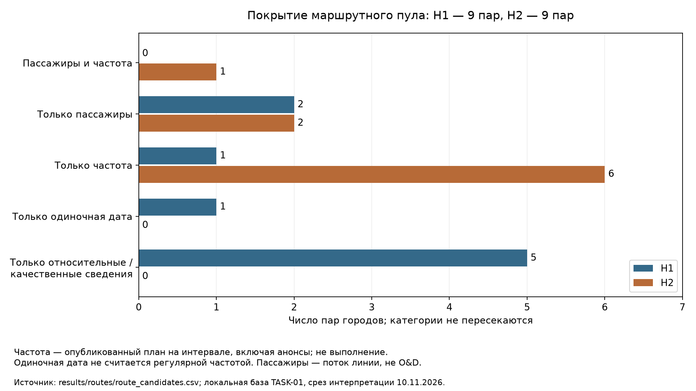

# TASK-03A — маршрутный пул для проверки H1 и H2

**Топ-3 TASK-02 пригоден как предварительный фильтр, но не как выбор нового хаба.**
Казань требует уточнения уже существующей роли Red Wings; Красноярск — проверки
ниши рядом с хабом группы «Аэрофлот». Уфа остаётся кандидатом без доказанного
пересадочного спроса. Арифметических оснований пересобирать рейтинг не найдено.

Отобраны **18 уникальных пар: 9 для H1 и 9 для H2**. У пяти есть опубликованный
пассажиропоток линии, у восьми — частотные сведения на интервале; одна пара входит
в обе группы. Ещё у одной есть только одиночный вылет, у пяти — относительные
изменения или качественные сведения. Это покрытие исследования, не оценка спроса.

Дата интерпретации — **10 ноября 2026 года**, как в TASK-01/02. Проверена локальная
ветка `rewrite`, исходный HEAD `c46a591`; перед работой изменений в Git не было.
Изучены ТЗ, README, отчёты 02/05/06, четыре таблицы core, результаты cities,
извлечения авиакомпаний и существующий код. Более поздних локальных результатов
следующего этапа не обнаружено. Новые источники не скачивались, сайты повторно
не проверялись. Ссылки ниже взяты из реестра; наличие CSV не доказывает актуальность
онлайн-расписания на дату анализа. Прогнозов, экономики и выбора победителя нет.

## 1. Что показала проверка TASK-02

| Класс проблемы | Проверка и результат | Последствие для стратегии |
|---|---|---|
| **Фактическая ошибка** | В разделе 8 отчёта 06 S58 приписано свидетельство Красноярск — Уфа. В `airlines/routes.csv` у S58 такой пары нет. Есть только +14% потока линии за 2025 к 2024 в S31, `airports/metrics.csv:64`, `lines 9-9`. | Для R06 не установлены перевозчик, абсолютный поток и частота. Нельзя приписывать линии «Россию» или «Аэрофлот». Настоящий отчёт исправляет этот вывод; файлы TASK-02 сохранены как предыдущий результат. |
| **Фактическая ошибка семантики извлечения** | S11, `airlines/relations.csv:45–51`, содержит `relation=hub`, хотя `source_excerpt` — «опорных аэропортов». Казань и Самара — строки 47–48; локатор `post`, occurrence=2, chars=564:582. | `hub` нельзя читать как доказательство полноценного пересадочного хаба. В этом отчёте смысл исправлен на «опорный аэропорт»; исходный CSV не менялся. |
| **Методологическое ограничение, критично** | Баллы воспроизводятся: 75% — общий поток аэропорта за 2025 год, 25% — годовая динамика. Веса и шкалы заданы аналитиком. | Это фильтр масштаба обслуженного рынка. Поток аэропорта включает разные типы поездок и не равен местному рынку; рейтинг не измеряет пересадки, конкуренцию или затраты. |
| **Методологическое ограничение, критично** | У пяти из десяти кандидатов нет общего годового роста: Красноярск, Тюмень, Нижний Новгород, Саратов, Оренбург. При пропуске условный балл равен оценке размера. | Красноярск получает 71,06 балла из 100. При условном G=50, соответствующем нулевому росту, полный балл был бы 65,79. Это иллюстрация эффекта перенормирования, не заполнение пропуска. Отсутствие данных может улучшать позицию относительно городов со слабой динамикой. |
| **Методологическое ограничение** | Самара: 3 570 000 человек и за 2024, и за 2025 год, S37/S36, `airports/metrics.csv:137/118`, оба локатора `lines 1-1`. Расчёт даёт 0% на точности публикаций. | Нельзя утверждать точную стагнацию. Округление и конфликт заголовка S36 остаются; интервал ошибки без источника не назначен. |
| **Недостающие данные / противоречие источника** | Красноярск: итог 4 263 566 человек за 2025 год против суммы ВВЛ и МВЛ 4 208 211; разница 55 355 человек. S31, `airports/metrics.csv:54,57,58`. | Причина неизвестна. Общий итог не заменён суммой; доли перевозчиков по спорному знаменателю не рассчитывались. |
| **Методологическое ограничение и недостающие данные** | В отчётах 02/05 зафиксированы округления сегментов Уфы, Тюмени, Саратова, Самары, Кольцово; у Иркутска в core неполный год, у Нижнего Новгорода и Оренбурга нижние пороги. | Не смешивать периоды, не восстанавливать «точные» итоги и не считать нижние пороги точками без оговорки. Требуется сопоставимый годовой ряд. |

Проверены формулы по входам core и `criteria_scores.csv`; текущая тройка совпадает
с `city_ranking.csv`. В TASK-02 уже показано: при весе размера 90% Красноярск уступает
третье место Минеральным Водам. Пересчёт всех мест не устранит отсутствия O&D,
конкурентных ёмкостей и условий базирования. Поэтому рейтинг сохранён, его статус
ограничен предварительным фильтром. Источники аэропортовых чисел:
[S26 — Уфа](https://www.airportufa.ru/news/2025/mezhdunarodnyy-aeroport-ufa-podvel-itogi-2025-goda/),
[S31 — Красноярск](https://team.kja.aero/media/aeroport-krasnoyarsk-po-itogam-2025-goda-1-1),
[S36 — Самара](https://ar-kuf.ru/about/news/itogi-raboty-v-novogodnie-prazdnik/),
[S37 — Самара, 2024](https://ar-kuf.ru/about/news/passazhiropotok-aeroporta-kurumoch-prevysil-3-5-milliona-che/),
[S38 — отчёт с итогами Казани](https://pravo.tatarstan.ru/file/npa/2026-02/1794855/npa_1794856.pdf).

## 2. Какие города допускаем к проверке нового хаба

**Опорный аэропорт** — опубликованная роль города в программе перевозчика.
**Базирование** — размещение самолётов и экипажей; техническая база сама по себе
не подтверждает это размещение. **Пересадочный хаб** — сеть со стыковками,
согласованными рейсами и обслуживанием транзитных пассажиров. В определении H1
из ТЗ к этому добавлена новая база. Эти статусы нельзя подменять друг другом.

В [S11 — зима 2026/27](https://flyredwings.com/press/news/red-wings-pereshla-na-osenne-zimnee-raspisanie-poletov/)
Казань и Самара входят в список опорных аэропортов программы до 27.03.2027.
S10 летом 2026 использует более широкое слово «хабы», но также не устанавливает
ни базирование, ни объём реальных пересадок.
[S09](https://flyredwings.com/en/press/news/rossijskaya-aviakompaniya-red-wings-otmechaet-svoj-yubilej-25-let-deyatelnosti/)
сообщает о технических базах
Жуковского и Екатеринбурга за 2023 год (`relations.csv:17–18`); это историческое
свидетельство технической поддержки. Для H2 существующее базирование в Москве
и Екатеринбурге принимается из ТЗ, разделов 1/5, а не выводится из S11.

| Город | Допуск в H1 | Что надо установить до признания новым хабом |
|---|---|---|
| Уфа | Допустим для проверки. 4 929 715 человек за 2025 год и +4% к 2024, S26. В пуле R05–R06. | Наличие или отсутствие уже существующего базирования и стыковочной модели Red Wings; местный O&D; западные подвозящие пары; условия аэропорта. Отсутствие Уфы в списке опорных городов не доказывает отсутствие базы. |
| Казань | Условно допустима. 5 384 816 человек за 2025 год, +0,3%, S38; уже опорный город S11. В пуле R01–R04. | Самолёты/экипажи на месте, существующие пересадки, сквозные билеты/багаж и стыковочные волны. Если полноценный хаб уже есть, расширение Казани нельзя выдавать за создание нового H1. |
| Красноярск | Допустим как проверка входа рядом с действующим хабом конкурента. R07–R09; не «свободный» аэропорт. | Доступная ниша, ёмкости и пересадки конкурентов, условия новой базы и пригодность плеч для самолётов Red Wings. |
| Самара | Резерв для уточнения статуса; автоматически не заменяет топ-3. В текущем пуле используется для H2. | Те же проверки «опорный ≠ база ≠ пересадочный хаб». Пятое место по двум критериям не отменяет необходимость изучить уже существующую сеть. |

[S58 — пресс-релиз «Аэрофлота», перепечатка АвиаПорт](https://www.aviaport.ru/news/aeroflot-otmechaet-5-letie-sibirskogo-khaba/)
описывает действующий красноярский хаб: 2,2 млн человек за 2025 год и 32 направления
летней программы 2026 года. Это пассажиры хаба в формулировке публикации, не
измеренные трансферные пассажиры. `airlines/metrics.csv:57,59`, локаторы chars=601:608
и 775:801. На 01.06.2026 указаны 3 SSJ 100, 4 A319 и 3 Boeing 737: всего 10 самолётов
по сумме трёх категорий (`metrics.csv:61–63`, chars=1467:1529). S31 отдельно сообщает
1 395 375 пассажиров «России» и 857 078 «Аэрофлота» в аэропорту за 2025 год
(`airports/metrics.csv:65–66`, `lines 19-19`). Это разные области учёта с S58;
их нельзя складывать между публикациями или называть свободным спросом Red Wings.

## 3. Маршрутный пул и основания отбора

Пул — целевой набор проверяемых пар, а не случайная выборка и не оптимальная сеть.
Он охватывает плечи трёх кандидатов H1, существующие линии базы для H2 и две пары
вне базы с наблюдениями. Для каждой пары есть собственное свидетельство; величина
аэропорта не подставляется вместо потока линии. Перекос покрытия в пользу H2
ожидаем: подробно собранное расписание есть прежде всего у Екатеринбурга и Саратова.
Более полные данные не означают превосходства H2.

Обозначения локальных CSV: **AM** — [airports/metrics.csv](../data/processed/airports/metrics.csv),
**AR** — [airlines/routes.csv](../data/processed/airlines/routes.csv),
**F** — [flights/scheduled_departures_winter_2026_27.csv](../data/processed/flights/scheduled_departures_winter_2026_27.csv).
Число после двоеточия — физическая строка с заголовком как строкой 1.
Полные локаторы публикаций, ссылки, периоды, направления и все варианты графиков
сохранены в JSON-полях [route_candidates.csv](../results/routes/route_candidates.csv).
Таблицы ниже показывают краткие основания. «Не установлено» означает пробел в нашей
выборке, а не отсутствие рейса или конкурента. P1 — исследовать первым, P2 — следом;
это порядок снятия неопределённости, а не рейтинг будущей доходности.

### H1: местная опора и возможные плечи пересадочного хаба

Указанный первым город — кандидат в хаб, а не доказанное направление свидетельства.

| ID / пара | Зачем включена; что известно о перевозчиках | Источник пары | Приоритет и конкретный пробел |
|---|---|---|---|
| R01 Казань — Омск | Восточное плечо Казани с наблюдаемым потоком линии. Перевозчик не установлен. | S23, AM:13, `lines 21-21` | P1: частоты, перевозчики, местные поездки и дальнейшие назначения через Казань. |
| R02 Казань — Саратов | Западное плечо; ЮТэйр опубликовала только Саратов → Казань на одну дату. | S20, F:481, `table 1, tr 9` | P1: сначала проверить регулярность, затем пассажиров и пригодность для подвоза. |
| R03 Казань — Новый Уренгой | Северная пара из анонса Red Wings на лето 2026; местный спрос и возможные пересадки не разделены. | S10, AR:2 | P2: выполнение анонса, пассажиры, сезонность, субсидии и действующие конкуренты. |
| R04 Казань — Нижневартовск | Ещё одно северное плечо из того же анонса Red Wings; не доказанный дополнительный рынок. | S10, AR:3 | P2: эксплуатация, частоты, O&D и взаимозаменяемость северных плеч. |
| R05 Уфа — Екатеринбург | Локальная опора и проверка пересечения нового проекта с существующей базой. В расписании Red Wings и ЮТэйр. | S19, F:400–406; S17, AR:33 | P1: пассажиры пары, доли перевозчиков, наземная альтернатива и риск переноса собственной загрузки. |
| R06 Уфа — Красноярск | Восточное плечо Уфы. Есть относительный рост; перевозчик и уровень не установлены. | S31, AM:64, `lines 9-9` | P1: уровни 2024/2025 и перевозчик. S58 этой пары не подтверждает. |
| R07 Красноярск — Омск | Западное плечо с потоком линии; «Россия» названа в летней сети 2026. Есть риск конкурировать за уже обслуживаемый рынок. | S23, AM:14; S31, AM:59; S58, AR:67 | P1: местный O&D, доля «России», реальные пересадки, частоты и субсидии. |
| R08 Красноярск — Иркутск | Восточное плечо из летней сети «России», необходимое для проверки связей с западными плечами. | S58, AR:60 | P2: уровень линии, текущие частоты, ёмкости и стыковки. Девять месяцев аэропортового потока Иркутска не заменяют годовой поток пары. |
| R09 Красноярск — Челябинск | Западное плечо; рост линии в S31 и «Россия» в летней сети S58. | S31, AM:61; S58, AR:72 | P2: абсолютный поток, текущая ёмкость конкурента и конечные пункты поездок. |

Возможные направления поиска стыковочного спроса — Омск → Казань → Саратов и
Челябинск/Омск → Красноярск → Иркутск. Это **гипотезы поездок**, не подтверждённые
соединения: нужны обе направленные части расписания, времена и условия пересадки.
Обратные рейсы в данных не создавались. Для Уфы в выбранных свидетельствах нет
западного подвоза: Уфа — Екатеринбург включена прежде всего для проверки местного
рынка и пересечения с базой. Пул пока не доказывает географически разумную
стыковочную модель Уфы; нельзя предлагать Урал → Уфа → Сибирь без проверки крюка.

### H2: прямые линии с использованием существующей базы

Во всех строках операционная опора — **Екатеринбург из условия кейса**. Москва
также допустима по ТЗ, но добавлять московские пары только ради её представления
не требуется. Семь пар начинаются в Екатеринбурге. Две другие требуют отдельной
проверки обслуживания самолётом/экипажем из этой базы; Самара и Омск новыми базами
не объявляются. Слово «развитие» включает проверку расширения существующей линии;
пассажиров действующей сети нельзя целиком считать приростом.

| ID / пара | Зачем включена; перевозчики в выборке | Источник пары | Приоритет и конкретный пробел |
|---|---|---|---|
| R10 Екатеринбург — Омск | Прямая линия Red Wings из базы; сравнение с H1 через Казань/Красноярск. | S19, F:267; S17, AR:35 | P1: поток этой пары, местный O&D, ёмкость, загрузка и субсидии. |
| R11 Екатеринбург — Саратов | Red Wings; оба направления независимо присутствуют в расписаниях. | S19, F:352–353; S20, F:477–478; S15/S17, AR:15,40 | P1: уровни пассажиров и фактическое выполнение на общем календаре. |
| R12 Екатеринбург — Нижний Новгород | Red Wings; регион вне топ-3 H1, несколько вариантов графика. | S19, F:223–227; S15/S17, AR:14,29 | P2: местный поток, сезонность, конкуренты и субсидии. |
| R13 Екатеринбург — Оренбург | Red Wings; ещё один регион вне топ-3, база уже существует. | S19, F:268–274; S15/S17, AR:21,34 | P2: пассажиры, наземная альтернатива, фактическая загрузка и субсидии. |
| R14 Екатеринбург — Самара | Red Wings и ЮТэйр; опорный город не требуется превращать в новую базу. | S19, F:308–320; S17, AR:27 | P1: поток пары, доли перевозчиков и дополнительность расширения. |
| R15 Екатеринбург — Абакан | Red Wings; восточная региональная линия из существующей базы. | S19, F:2–3, `table 1, tr 3–4` | P2: уровень пассажиров, сезонность, O&D, выполнение и субсидии. |
| R16 Екатеринбург — Минеральные Воды | Измеренная линия; в расписании «Аэрофлот» и Ural airlines. Присутствие Red Wings на паре не установлено. | S40, AM:174; S19, F:124–127 | P1: местный O&D, ёмкости/тарифы конкурентов, доступная ниша. |
| R17 Самара — Минеральные Воды | Измеренная прямая пара вне базы; перевозчик не установлен. Доступ к Самаре из базы подтверждён отдельно строками R14. | S36, AM:127, `lines 3-3` | P2: период S36, перевозчики, частоты и возможность вернуть борт/экипаж в Екатеринбург без новой базы. |
| R18 Омск — Новосибирск | Есть поток линии; проверить прямые местные поездки отдельно от подвоза к дальнейшим рейсам. Перевозчик не установлен. Доступ из базы — R10. | S23, AM:8, `lines 16-16` | P1: доля конечного Новосибирска, перевозчики/частоты, наземная альтернатива и обслуживание из Екатеринбурга. |

Наличие Екатеринбург → Самара/Омск подтверждает только отдельное плечо доступа.
Оно не подтверждает возврат, готовую ротацию, нужную дальность или допустимую смену
экипажа для R17/R18. Конкретное расписание не проектировалось. Если без новой базы
обслуживание окажется непригодным, эти пары надо исключить из H2 или пересмотреть
способ обслуживания. Для R18 нельзя приписывать S7 по одному названию Новосибирска.

## 4. Какие потоки и частоты действительно известны

### Наблюдения пассажиров

| Пара | Опубликовано, человек за 2025 год | Происхождение |
|---|---:|---|
| R01 Казань — Омск | 27 510 | S23, AM:13; `lines 21-21`; core/route_passengers.csv:10 |
| R07 Красноярск — Омск | 23 192 | S23, AM:14; `lines 22-22`; core:11 |
| R16 Екатеринбург — Минеральные Воды | 211 000 | S40, AM:174; `lines 5-5`; core:28 |
| R17 Самара — Минеральные Воды | 47 000 | S36, AM:127; `lines 3-3`; core:16; период конфликтует с заголовком реестра |
| R18 Омск — Новосибирск | 106 309 | S23, AM:8; `lines 16-16`; core:5 |

Значения опубликованы с точностью источника; сторона учёта не установлена.
Например, у R01 первичное поле origin — Омск, хотя кандидатом в хаб является
Казань. Эта запись не развёрнута в противоположный поток. Числа не удваиваются,
не суммируются между парами и не объявляются конечным O&D. Источники:
[S23 — Омск](https://www.aeroomsk.ru/ob-aeroporte/press-tsentr/novosti/253/),
[S40 — Кольцово](https://ar-svx.ru/about/news/razvitie-infrastruktury-novye-servisy-i-rost-passazhiropotok/), S36 выше.

Дополнительно S31 сообщает изменения потока линий **2025 к 2024, %**:
Красноярск — Омск +89%, — Уфа +14%, — Челябинск +29% (`AM:59,64,61`, `lines 9-9`).
Абсолютный поток Омск — Красноярск взят из другого аэропорта (S23), поэтому
восстановление 2024 делением на 1,89 без согласования области учёта не выполнялось.
Проценты без уровня не превращаются в оценку рынка.

### Опубликованный план, а не выполненные рейсы

В S19/S20 год в диапазонах не установлен. Надпись winter_2026_27 в имени CSV
не даёт основания дописывать его в даты. Ниже приведены примеры отдельных строк;
**в CSV сохранены все варианты**, включая отличающиеся периоды и перевозчиков.

| Пара и направленное свидетельство | Число и единица | Исходный период и источник |
|---|---|---|
| R02 Саратов → Казань, ЮТэйр UT-6494 | Один запланированный вылет в понедельник; **регулярная частота неизвестна** | `07 дек / 07 дек`; S20, F:481 |
| R05 Екатеринбург → Уфа, Red Wings WZ-1025 | 4 запланированных дня в полной неделе | `10 ноя / 22 ноя`, `01 дек / 20 дек`; S19, F:404,406 |
| R05 Екатеринбург → Уфа, ЮТэйр UT-105 | 7 запланированных дней в полной неделе | `16 ноя / 21 мар`; S19, F:401 |
| R10 Екатеринбург → Омск, WZ-5071 | 2 запланированных дня в полной неделе | `27 окт / 18 дек`; S19, F:267 |
| R11 Екатеринбург → Саратов, WZ-5047; отдельно Саратов → Екатеринбург, WZ-5048 | По 1 запланированному дню на вариант | Вперёд `30 окт / 25 дек`, `28 окт / 16 дек`; обратно `30 окт / 18 дек`, `28 окт / 24 мар`; F:352–353,477–478 |
| R12 Екатеринбург → Нижний Новгород, WZ-5029 | По 1 запланированному дню на вариант | `25 окт / 20 дек`, `28 окт / 23 дек`, `30 окт / 25 дек`, `09 ноя / 21 дек`, `19 ноя / 26 ноя`; S19, F:223–227 |
| R13 Екатеринбург → Оренбург, WZ-5049 | По 1 запланированному дню на вариант | Например, `28 окт / 24 мар`; S19, F:268; все варианты F:268–274 |
| R14 Екатеринбург → Самара, WZ-1033 | 7 запланированных дней в полной неделе | `16 ноя / 22 ноя`, `30 ноя / 27 дек`; S19, F:318,320; другие варианты Red Wings/ЮТэйр — F:308–320 |
| R15 Екатеринбург → Абакан, WZ-5015 | 1 и 2 запланированных дня в полной неделе на разных интервалах | `26 окт / 23 ноя`; отдельно `03 дек / 22 мар`; S19, F:2–3 |
| R16 Екатеринбург → Минеральные Воды, SU-2817; U6-205; U6-251 | 7; по 3 на каждый из двух вариантов U6-205; 1 для U6-251 — запланированных дней в полной неделе | `26 окт / 03 янв`; `26 окт / 27 мар`, `27 окт / 21 мар`; `28 окт / 24 мар`; S19, F:124–127 |

Единица S19/S20 — число перечисленных дней в полной неделе **для конкретной строки**,
унаследованное из core как `flights_per_week`. Оно не является годовой средней
или общим числом рейсов всех перевозчиков. Варианты и противоположные направления
не складывались; особенно не экстраполировался одиночный вылет R02.

Старые анонсированные частоты S17 за апрель/май 2024 года сохранены отдельно,
**рейсов в неделю по опубликованной программе**: Екатеринбург → Омск 4,
→ Нижний Новгород 6, → Оренбург 5, → Самара 7, → Уфа 5 (AR:35,29,34,27,33).
Они не подтверждают ни выполнение, ни частоту ноября 2026. Для R03/R04 частот нет:
S10 — анонс летней программы до 24.10.2026. Для R08/R09 S58 — сообщение о летней
сети 2026 без частоты. Ссылки на публикации:
[S19 — расписание Кольцово](https://ar-svx.ru/schedule/),
[S20 — расписание Саратова](https://ar-gsv.ru/schedule/),
[S17 — программа 2024](https://flyredwings.com/en/press/news/red-wings-razvivaet-novye-marshruty-iz-ekaterinburga/),
[S10 — лето 2026](https://flyredwings.com/en/press/news/red-wings-pereshla-na-letnee-raspisanie-poletov/).

## 5. Покрытие пула данными

| Взаимоисключающая категория | H1, пар | H2, пар | Всего, пар |
|---|---:|---:|---:|
| Пассажиры и частота на интервале | 0 | 1 | 1 |
| Только уровень пассажиров | 2 | 2 | 4 |
| Только частота на интервале | 1 | 6 | 7 |
| Только одиночная дата графика | 1 | 0 | 1 |
| Только относительные / качественные сведения | 5 | 0 | 5 |
| Всего | 9 | 9 | 18 |

«Только» относится к наличию уровня пассажиров и частоты; дополнительные сообщения
и проценты роста могут присутствовать. Частоты включают планы/анонсы, не фактическое
выполнение. Относительное изменение без уровня не считается пассажирским объёмом.
Подвозящие плечи R17/R18 и общие статусы аэропортов не улучшают покрытие целевой пары.

Для H1 измерения слабее: из наличия сети и крупных аэропортов нельзя вывести объём
пересадок. Для H2 данные позволяют быстрее начать проверку существующего
предложения, но почти нигде не известны пассажиры именно выбранной пары.
Это различие определяет порядок сбора, а не выбор стратегии.

## 6. Что потребуется для TASK-03B и с чего начать

**P1 в CSV — 10 пар**, P2 — 8. Внутри P1 сначала снять ошибки смысла и источников,
затем оценивать измеренные рынки и предложение:

1. R02 и R06: подтвердить регулярность Саратов — Казань и получить абсолютный
   поток/перевозчика Уфа — Красноярск. Без этого нельзя строить сетевые предпосылки H1.
2. R01, R07, R16, R18: запросить помесячные уровни и выделить конечный O&D из
   наблюдаемого потока линии. У R07/R16 отдельно проверить ёмкости конкурентов;
   у R18 — долю подвоза к дальнейшим рейсам и возможность обслуживания из базы.
3. R05, R10, R11, R14: сопоставить полный актуальный календарь, фактические вылеты,
   кресла, загрузку, тарифы и субсидии. Проверить прирост к существующей сети,
   а не засчитать действующих пассажиров как новых.

| Конкретно недостаёт | Как это влияет на сравнение H1/H2 |
|---|---|
| Конечный O&D по парам/месяцам, включая поездки через Москву и другие хабы; единая сторона учёта | Разделить местные поездки, подвоз и пересадки; не сложить один маршрут пассажира по нескольким сегментам. |
| Полные действующие расписания обоих направлений с годами, перевозчиками, креслами; фактическое выполнение | Проверить конкуренцию, ёмкость и регулярность, не экстраполируя строки зимнего графика. |
| Статус Казани/Самары, фактическое базирование Red Wings, сквозные билеты/багаж, пересадки | Определить, действительно ли H1 создаёт новый хаб и какие существующие перевозки составляют базу сравнения. |
| Для H1: минимальные времена пересадки, направления продолжения, география и время пути | Проверить пары конечных городов и удобство стыковок. У Уфы сначала найти западный подвоз; готовой модели в текущем пуле нет. |
| Для H2 R17/R18: дальность/время плеч, возврат, техподдержка и ограничения экипажа | Подтвердить работу из Екатеринбурга без новой базы. Наличие одного плеча доступа недостаточно. |
| Тарифы поездок, сезонность, железнодорожная/автомобильная альтернатива, условия субсидий | Понять обслуженный и потенциально переключаемый спрос; не принять весь поток линии за доступный Red Wings. |
| Если O&D получить нельзя: выбранный аналог, правило отделения транзита и явные сценарные допущения | Сделать оценку прослеживаемой; наблюдения и рассчитанные части держать раздельно. Сейчас такие доли и объёмы не назначались. |

R17 оставлена в P2, несмотря на пассажирский уровень: одновременно не сняты конфликт
периода S36 и способ работы без новой базы. Сведения о стоимости базы, флоте и
аэропортовых условиях понадобятся для следующих этапов сравнения, но экономика
и проектирование расписания в TASK-03A не выполнялись.

## 7. Структура CSV, воспроизводимость и проверка

Одна строка — одна ненаправленная пара городов в контексте одной гипотезы.
`origin_city`/`destination_city` задают порядок представления; для H1 первым стоит
хаб-кандидат. **Направления свидетельств остаются внутри JSON**, не выводятся из
этого порядка. Все 18 физических пар различаются и между гипотезами.

- `candidate_id`, `hypothesis`, `hub_candidate`, `operating_base`, `network_role` —
  контекст сценария; роли и приоритеты являются решениями отбора.
  `context_interpretation` отделяет смысл S11/S09 от исходной метки `hub` или техбазы.
- `inclusion_reason`, `missing_demand_data`, `research_priority`, `priority_reason` —
  основания, конкретные пробелы и порядок исследования каждой пары.
- `passenger_evidence`, `route_evidence`, `relative_change_evidence` — JSON-массивы
  исходных записей core, без изменения чисел, периодов, направлений и квалификаторов.
  `base_access_evidence` — отдельные плечи из базы для R17/R18;
  `context_evidence` — S11 для опорного города либо историческая техбаза S09.
- В каждой записи есть `evidence_file/evidence_row` — прочитанная таблица/физическая
  строка. `source_file/source_row`, `source_id`, `source_locator`, `source_url`
  ведут к исходному обработанному CSV и публикации. Для relations исходной таблицей
  служит непосредственно `evidence_file`. Сырые файлы не входят в результат.
- Пустые массивы `[]` означают отсутствие свидетельств в данном наборе; пустые
  исходные поля — неизвестность или неприменимость, не нули. `has_passengers` и
  `has_frequency` описывают наличие свидетельств, не существование спроса.
  Для одиночной даты `has_frequency=False`, даже если core содержит условную 1.
- В `flights_per_week` единица определяется `frequency_basis`: опубликованные
  плановые рейсы/неделю либо дни выполнения в полной неделе для варианта графика.
  Последние не агрегировались. `coverage_class` рассчитан только по целевой паре.

Сборка: `uv run --frozen --no-sync python scripts/build_route_candidates.py`.
Python 3.14; используются стандартная библиотека и существующий matplotlib из
`uv.lock`. Скрипт повторно использует чтение физических строк и разбор дней из
`build_core.py`, не запускает его сборку. Пишет только CSV и этот PNG; отчёт
составлен по проверенным результатам. Новых зависимостей нет.

Фактически выполнены: проверка формул TASK-02 по core и значениям критериев;
уникальность пар в гипотезе; совпадение вложенных свидетельств с исходными строками
core/relations и проверка их provenance до предыдущего CSV; сохранение периодов,
направлений и единиц пассажиров; сверка дней S19/S20; отделение одиночной даты;
обратное чтение JSON из итогового CSV; повторная сборка с побайтовым сравнением
CSV/PNG; сверка покрытия с таблицей отчёта и визуальный просмотр PNG;
`git diff --check`. Исходные/обработанные таблицы, TASK-02 и raw не изменены.
Это проверка локальных данных и результата сборки, не независимая проверка издателей
и не подтверждение фактических перевозок. TASK-03B не начата.
