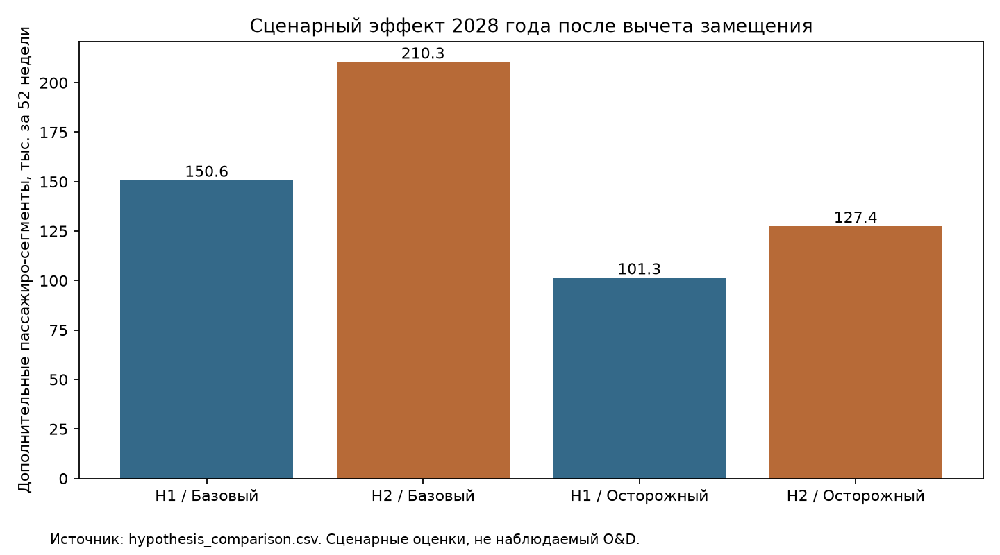
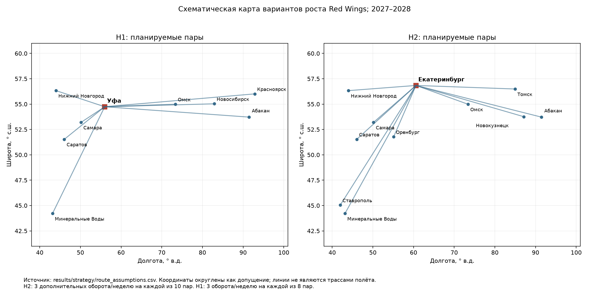

# Решение кейса: прямые рейсы из Екатеринбурга

**Выбираем H2: десять прямых региональных линий из Екатеринбурга с добавлением частот.**
Это сценарное инвестиционное решение: H2 использует существующую базу, допускает
поэтапный запуск и отказ от слабой пары. H1 требует новой инфраструктуры и опирается
на не подтверждённые O&D стыковки. Расчёт ниже не превращает допущения в прогноз.
При отрицательном результате в осторожном сценарии полную сеть нельзя запускать
автоматически: сначала пилот и проверка порогов. Выбранная стратегия — H2, а не
безусловное обязательство выполнять все частоты при любых тарифах и затратах.

## Сравнение

| Вариант | Сценарий | Год | Доп. сегменты, чел. | Доп. выручка, млн ₽ | Прирост доли, п.п. | Бортов с резервом | Условный результат, млн ₽ |
|---|---|---|---|---|---|---|---|
| H1 | Базовый | 2027 | 29,734 | 334.7 | 0.027 | 3 | -110.8 |
| H2 | Базовый | 2027 | 12,399 | 164.0 | 0.011 | 2 | 19.7 |
| H1 | Базовый | 2028 | 150,610 | 1766.7 | 0.138 | 3 | 584.9 |
| H2 | Базовый | 2028 | 210,338 | 2714.9 | 0.193 | 4 | 1310.4 |
| H1 | Осторожный | 2027 | 4,695 | 48.0 | 0.004 | 3 | -193.0 |
| H2 | Осторожный | 2027 | 1,888 | 22.8 | 0.002 | 2 | -35.5 |
| H1 | Осторожный | 2028 | 101,275 | 1051.5 | 0.093 | 3 | -130.3 |
| H2 | Осторожный | 2028 | 127,353 | 1491.4 | 0.117 | 4 | 86.9 |

Выручка — дополнительная билетная выручка после вычета замещения собственных рейсов,
в условных номинальных рублях планирования. Не включает субсидии, ancillary и НДС-модель.
Условный результат — выручка минус заданные ниже расходы, включая стартовые затраты
только в 2027 году; это не бухгалтерская прибыль, NPV или доказанная окупаемость.
Полная детализация: [таблица сравнения](../results/strategy/hypothesis_comparison.csv).
В 2027 у H2 рассчитан пилот трёх пар (Омск, Саратов, Минеральные Воды),
а в 2028 — все десять. H1 рассчитана как запуск восьми плеч нового хаба.
Это разные траектории запуска, не равные по масштабу проекты первого квартала работы.

В базовом 2028 H2 даёт 52.6 тыс. дополнительных
сегментов на борт с резервом против 50.2 тыс. у H1.
Это разные бюджеты: H2 требует на один самолёт больше. В осторожном варианте H1
имеет чуть больше сегментов на борт (33,8 против 31,8 тыс.), но хуже условный
денежный результат. Выбор не основан на абсолютном объёме без учёта ресурса.

## Факты и основа расчёта

Использованы прежние core и маршрутный пул TASK-03A; нового аудита и сбора нет.
Факты: Red Wings — 2.7 млн пассажиров за 2025 год (S08, airlines/metrics.csv:5);
рынок — 108.85 млн человек за 2025 год (S03, market/S03_image13.csv; provenance в core/market.csv).
Исходная доля — 2.480%. ТЗ допускает оценки, определяет Екатеринбург
как существующую базу и ожидает SJ-100 не ранее второй половины 2027 года.
Это не подтверждение конкретных поставок Red Wings. Поставка нужного числа бортов — условие сценария.
Факты с периодами, единицами и прямыми ссылками — [fact_references.csv](../results/strategy/fact_references.csv).

Аналоги местного спроса — наблюдаемые потоки линий 2025 года: Омск — Новосибирск
106 309 человек (S23, airports/metrics.csv:8), Омск — Казань 27 510 (S23:13),
Самара — Минеральные Воды 47 000 (S36:127, период по содержанию с прежней оговоркой),
Екатеринбург — Минеральные Воды 211 000 (S40:174). Это не конечный O&D.
Для каждой пары исходный CSV, строка, локатор и коэффициенты записаны в
[route_assumptions.csv](../results/strategy/route_assumptions.csv).

Свидетельство Red Wings хотя бы в одном направлении/старом анонсе трактуется
консервативно как существующая линия: её полный поток не засчитывается. H2 включает
семь пар из прежнего пула плюс Новокузнецк и Томск из уже имеющегося S19 и
Ставрополь из S18; вместо непроверенных ротаций Самара — Минеральные Воды и
Омск — Новосибирск используются пары непосредственно из базы. На всех парах
моделируются только **+3 оборота/неделю**, существующие частоты не восстанавливаются.
Отсутствие Red Wings в выборке для Минеральных Вод или новых плеч Уфы не доказывает
их новизну: предусмотрен вычет замещения и чувствительность спроса.

## Сеть и спрос: все значения со звёздочкой — допущения

| Вариант | Пара | Блок-часов в одну сторону* | Тариф*, ₽ | Местная цель*, чел./год | Доп. оборотов/нед. |
|---|---|---|---|---|---|
| H1 | Уфа — Нижний Новгород | 1.8 | 9500 | 18157 | 3 |
| H1 | Уфа — Красноярск | 3.4 | 15500 | 19807 | 3 |
| H1 | Уфа — Саратов | 1.6 | 9000 | 16506 | 3 |
| H1 | Уфа — Абакан | 3.5 | 15500 | 14855 | 3 |
| H1 | Уфа — Самара | 1.0 | 7000 | 18157 | 3 |
| H1 | Уфа — Новосибирск | 2.9 | 14000 | 18157 | 3 |
| H1 | Уфа — Минеральные Воды | 2.8 | 13500 | 21150 | 3 |
| H1 | Уфа — Омск | 2.4 | 12500 | 18157 | 3 |
| H2 | Екатеринбург — Омск | 2.0 | 10500 | 29767 | 3 |
| H2 | Екатеринбург — Саратов | 2.0 | 11500 | 26790 | 3 |
| H2 | Екатеринбург — Нижний Новгород | 2.1 | 11500 | 29767 | 3 |
| H2 | Екатеринбург — Оренбург | 1.6 | 9000 | 22325 | 3 |
| H2 | Екатеринбург — Самара | 2.1 | 11000 | 31893 | 3 |
| H2 | Екатеринбург — Абакан | 3.0 | 15000 | 25833 | 3 |
| H2 | Екатеринбург — Минеральные Воды | 3.6 | 16500 | 33760 | 3 |
| H2 | Екатеринбург — Новокузнецк | 2.7 | 13500 | 25833 | 3 |
| H2 | Екатеринбург — Томск | 2.6 | 13500 | 25833 | 3 |
| H2 | Екатеринбург — Ставрополь | 3.5 | 16000 | 28703 | 3 |

В H1 новые плечи кроме Уфа — Красноярск расширяют исследовательский пул по аналогии;
это проектируемые пары, а не обнаруженные действующие рейсы. Уфа — Екатеринбург
исключена: для нового хаба важнее западный подвоз, а не перенос работы существующей базы.
Плановые обратные сегменты здесь заданы явно как часть проекта; они не добавлены в фактическую core.

Местная годовая цель = поток аналога × масштаб × доля захвата дополнительной ёмкостью.
H2: за основу обычно взяты 106 309 человек; масштаб 0,75–1,0 и захват 27–30%,
для Минеральных Вод — собственный наблюдаемый поток ×16%. H1: менее крупный аналог
27 510 человек ×масштаб 0,9–1,2 ×60%; для Минеральных Вод — 47 000 ×45%.
Разница отражает гипотезу: добавочные частоты зрелой базы способны привлечь больше
местных поездок, чем новая база. Это уязвимое допущение; тест ±25% спроса приведён ниже.
Коэффициенты не оценены регрессией; они задают проверяемые коммерческие цели,
а не доказывают наличие необслуженного рынка. Верхний предел загрузки также не является измеренным спросом.

В базовом сценарии: 100 кресел, верх загрузки 85%, вычет перемещения с собственных
рейсов 20% на существующих линиях и 8% на остальных. Осторожный: местная цель ×0,75,
верх загрузки 72%, тариф ×0,90, вычет 35% и 15%. Для 2028 осторожного дополнительно
применён коэффициент освоения 0,90; базовый год — 1,0. Эти понижения применяются вместе.
Перемещение с рейсов конкурентов считается приростом Red Wings, с собственных — вычитается.
Тарифы 7–16,5 тыс. ₽ на сегмент — допущения по длине плеча, не извлечённые цены продажи;
это реализованный билетный доход на занятого пассажира в условном учёте модели.

## Как учтены пересадки H1

Четыре пары конечных городов: Нижний Новгород — Красноярск, Саратов — Абакан,
Самара — Новосибирск, Минеральные Воды — Омск, все через Уфу. В каждой связке
три стыковки в неделю: две одного направления и одна обратного. В модели направления
спроса симметричны; более редкое направление ограничивает общий объём. Стыковка
60 минут, минимум в допущениях 60 минут; это требует сквозного билета/багажа и
согласования MCT аэропортом. Наличие такого сервиса сейчас не заявляется.

Цель одной связки = 27 510 ×35% = 9 628,5 поездки в год до ограничений ёмкости.
В осторожном варианте ×0,55; вычет собственного замещения 15% / 30% соответственно.
Каждая поездка занимает кресло на обоих сегментах; местные пассажиры распределяются
равномерно по направлениям/дням. Модель ограничивает трансфер остатком обоих плеч
и ёмкостью более редкого направления. Это требует отдельной проверки сезонного пика.
В осторожном сценарии фактически размещённых пересадок может быть больше, чем в
базовом: снижение местной загрузки освобождает кресла на редких стыковках.
Это эффект приоритета местных пассажиров в алгоритме, не рост измеренного спроса.
Сквозной тариф = 75% суммы двух сегментных тарифов. Выручка распределяется по плечам
пропорционально тарифам и учитывается один раз на поездку. Подробности —
[transfer_scenarios.csv](../results/strategy/transfer_scenarios.csv).

В доле рынка используется прирост перевезённых пассажиро-сегментов (пересадочный
пассажир занимает два рейса), а число односторонних поездок дано отдельно. Допущение
сопоставимости с авиакомпанейской статистикой отмечено явно; аэропортовые итоги
не подставляются в знаменатель. Нельзя подавать сегменты как уникальных людей.
Прирост доли = ΔP /108,85 млн ×100 п.п. Это фиксированный рынок 2025 года как
контрольный сценарий, не прогноз 2028. В CSV также есть вариант знаменателя
108,85 млн + ΔP: весь прирост считается расширением рынка. Рост рынка на 5% при
неизменной исходной доле уменьшает показанный добавочный эффект в п.п. в 1,05 раза.

## Обороты, флот и сроки

| Вариант | Блок-ч/нед. | Активных | Резерв | Всего | Оборотов/нед. |
|---|---|---|---|---|---|
| H1 | 116.4 | 2 | 1 | 3 | 24 |
| H2 | 151.2 | 3 | 1 | 4 | 30 |

Недельные плановые обороты сохранены в [weekly_rotations.csv](../results/strategy/weekly_rotations.csv).
Таблица флота выше относится к полной сети 2028 года. Пилот H2 2027 года требует
один работающий борт и один резервный; план — [pilot_2027_rotations.csv](../results/strategy/pilot_2027_rotations.csv).
Все времена в единой шкале часов базы; первый вылет не раньше 06:00, окончание
не позднее 20:00. Блок-время задано симметричным по направлениям с запасом как
сценарная инженерная оценка; его не вычисляли вычитанием местных часов расписания.
На удалённом конце 45 минут, между оборотами в базе 60 минут. Ограничения на
воздушное судно: до 10,5 блок-часа и 14 часов занятости в день. Это не норма рабочего
времени одного экипажа: длинные дни требуют сменных экипажей. Каждый борт возвращается
на ночь; резерв — ещё один SJ-100 сверх выполняющих программу. Резерв не генерирует
выручку, но его содержание включено. Свободные часы существующего парка не присвоены.
Потребность — отдельный ресурс нового проекта, не весь флот Red Wings и не число
фактически заказанных самолётов. Резерв не позволяет обещать выполнение при любой
серии отказов; календарь ТО, ограничения аэродромов, дальность с резервом топлива
и допуск конкретной модификации SJ-100 остаются предпусковыми проверками.

H1: связки выполняются на чередующихся днях; первый оборот подвозит в Уфу,
второй вывозит. Поэтому не предполагаются ежедневные стыковки всех со всеми.
H2: алгоритм размещает дополнительные обороты по дням и бортам, проверяя названные
пределы. Он даёт допустимый план, не математически доказанный минимум флота.
Обеим гипотезам предоставлен одинаковый резерв и одинаковые нормативы.

Запуск базового варианта — 01.10.2027, 13 рабочих недель, освоение спроса 65%.
Осторожного — 01.12.2027, четыре недели, освоение 50%. Это плановые даты после
второй половины 2027 года, условные на поставке и допусках. Оба варианта используют
52 недели в 2028 году: оставшиеся календарные дни не монетизируются. Полная сеть
требует весь указанный ресурс к 2028 году; в 2027 H2 начинает с двух бортов с резервом.
Сдвиг на 01.01.2028 обнуляет эффект 2027 при сохранении предпусковых затрат;
каждый потерянный рабочий месяц 2028 сокращает поток примерно на 1/12 при прочих равных.

## Затраты и чувствительность решения

Все расходы — диапазонные предположения для сравнения, не котировки поставщиков:
130 тыс. ₽/блок-час (топливо, переменное ТО и переменная часть экипажей),
20 тыс. ₽/вылет (аэропорт/обслуживание), 75 млн ₽/самолёт/год (лизинг, страхование,
фиксированные расходы самолёта). Дополнительные фиксированные расходы базы:
H1 120 млн ₽/год, H2 20 млн ₽/год; включают местный персонал/сменные экипажи,
планирование и инфраструктуру. Разовые затраты H1 150 млн ₽, H2 20 млн ₽ в год запуска.
Годовые фиксированные расходы в расчёте пропорциональны активным неделям: это
предположение о поэтапных договорах, не гарантированная экономия при задержке.
Налоги, дисконтирование, финансирование, разница капитализированных и текущих
расходов не моделируются; амортизация отдельно не добавляется поверх лизинга.

| Изменение к базовому 2028 | H1: результат, млн ₽ | H2: результат, млн ₽ |
|---|---|---|
| reference | 584.9 | 1310.4 |
| fare_minus_20pct | 231.6 | 767.4 |
| fare_plus_20pct | 938.3 | 1853.3 |
| demand_minus_25pct | 279.2 | 815.2 |
| demand_plus_25pct | 890.6 | 1363.6 |
| block_cost_100k | 766.5 | 1546.2 |
| block_cost_160k | 403.3 | 1074.5 |
| block_cost_190k | 221.8 | 838.6 |

В осторожном H2 результат 2028 обнуляется примерно при 141.1 тыс. ₽/блок-час
вместо 130 тыс. при остальных прежних условиях, либо при снижении осторожного
тарифа ещё на 5.8%. Эти изменения нельзя
складывать независимо: одновременный шок потребует меньшего отклонения каждого.
Если тарифы только H2 окажутся ниже базового плана более чем на 26.7%,
а все условия H1 сохранятся базовыми, H1 обойдёт H2 по условному результату.
Это конкретная граница пересмотра, а не утверждение безусловного превосходства H2.

Пороговый множитель реализованного тарифа для каждого сценария включён в CSV
(`break_even_fare_multiplier`). Он показывает тариф для покрытия принятых расходов
при неизменном объёме, а не рыночную возможность повысить цену без потери пассажиров.
Снижение спроса уменьшает доходы, но не расходы уже выставленного расписания.
Выбор H2 основан на меньшей зависимости от стыковок и новой базы и более сильном
добавочном эффекте; положительная выручка не доказывает окупаемость. Если
осторожный вариант убыточен, это основание ограничить обязательства пилотом,
пересмотреть частоты/цены или отложить расширение, сохранив выбор H2.
Субсидии не использованы как условие прибыльности. Сравнение не оптимизирует все
возможные сети: это решение между двумя конкретными воспроизводимыми проектами.

## План реализации и правило остановки

- До конца 2026: согласовать коммерческие цели, поставочный сценарий и резерв;
  запросить условия аэропортов/лизинга. Это действия внедрения, не новый сбор для текущего расчёта.
- I полугодие 2027: подготовить дополнительные экипажи и продажи, проверить дальность,
  обороты и договоры по выбранным парам. Без готовых бортов рейсы не обещать.
- С октября 2027 при поставке: пилот на трёх парах — Омск, Саратов, Минеральные Воды;
  8–12 недель контроля. При декабрьском старте контроль продолжается в I квартале 2028.
- 2028: разворачивать все десять пар только при покрытии фактических дополнительных
  расходов. На слабых парах менять сезонность/частоту, а не открывать новую базу.
- Еженедельно: дополнительные пассажиры с вычетом переноса собственных продаж,
  реализованный тариф, загрузка, выполненные блок-часы и расходы. За 8 недель
  отрицательного операционного вклада пары — пересмотр, при отсутствии улучшения
  за следующие 4 недели — снятие добавленных частот. Числа 8/4 недели — управленческое допущение.

## Воспроизводимость

`uv run --frozen --no-sync python scripts/compare_growth_strategies.py` (Python 3.14).
Исходники не меняются, сеть не используется. Параметры — [assumptions.csv](../results/strategy/assumptions.csv),
экспорт параметров генерируется из констант скрипта; для нового расчёта менять их в коде,
а не редактировать выходной CSV.
расчёты по парам — [route_scenarios.csv](../results/strategy/route_scenarios.csv),
чувствительность — [sensitivity.csv](../results/strategy/sensitivity.csv).
Скрипт проверяет частоты каждого плеча, отсутствие перекрытий бортов, обороты,
лимиты занятости/блок-часов, баланс трансферных кресел и согласование выручки.
Округление применяется только для показа; дробные пассажиры — математическое
ожидание сценария, не точные люди. Паспорт следует структуре локального шаблона,
неизвестные сведения о составе команды и контактах явно оставлены для заполнения.
