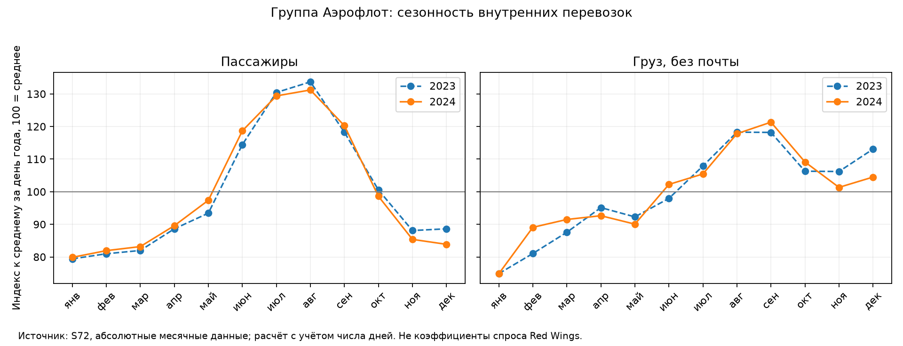

# Аэрофлот S72: опора для проверки H2

**S72 подкрепляет поэтапный запуск H2 с сезонной проверкой продаж и ёмкости.** Он показывает масштаб, сезонность и структуру действующих перевозок, но не доказывает преимущество H2 перед H1. Общесетевые показатели не являются спросом на выбранных парах Red Wings.

## Масштаб и ресурсы

| Субъект | Пассажиры 2023 → 2024, млн | Рост ASK | Загрузка 2023 → 2024 |
|---|---:|---:|---:|
| Aeroflot Group | 47.33 → 55.29 | 18.0% | 87.51% → 89.62% |
| Aeroflot Airline | 25.21 → 30.08 | 21.2% | 85.70% → 88.32% |

Рост сопровождался увеличением провозной ёмкости и загрузки. Для масштабирования H2 нужен план рейсов и ресурсов; одной конверсией нельзя обосновать весь прирост. Это описание совместной динамики, не доказательство её причин.

## Сезонность

| Год, внутренние перевозки группы | III квартал: доля пассажиров | III квартал: доля груза |
|---|---:|---:|
| 2023 | 32.2% | 28.9% |
| 2024 | 31.9% | 28.9% |

Сезонные индексы рассчитаны отдельно для 2023 и 2024 годов с поправкой на число дней. Наблюдённый поток зависит и от предложения рейсов. Индексы S72 не перенесены в маршрутный спрос Red Wings.

**Следствие для H2:** оценивать пилот по сопоставимым сезонам, а расширение до десяти пар проверять на зимнем и летнем расписании. Пилот октября–декабря не подтверждает летний спрос и результат полного года. Гибкость частот — аргумент в пользу поэтапного запуска из существующей базы; S72 не измеряет экономию от этой гибкости и применим также для проверки сезонных рисков H1.

## Груз и почта

| Охват группы | Груз 2023 → 2024, тыс. т | Изменение | Почта 2024, тыс. т |
|---|---:|---:|---:|
| total | 209.06 → 239.22 | 14.4% | 16.77 |
| domestic | 149.24 → 161.02 | 7.9% | 14.27 |
| international | 59.82 → 78.20 | 30.7% | 2.50 |

Грузовой поток существует и имеет собственный сезонный профиль. Для H2 это основание проверить коммерческие договоры на груз/почту по выбранным парам и техническую возможность перевозки вместе с пассажирами. Нужны маршрутный объём, тариф, затраты обработки, ограничения массы и объёма после багажа. В S72 нет разреза по типу самолёта и способу перевозки груза. Общегрупповые тонны не считаются доступным грузом для SJ-100. **Грузовая выручка и прибыль не оценены и в расчёт H2 не добавлены.** Груз, почта и их сумма не складываются друг с другом.

## Применимость к выбору и ограничения

- В H2 сохраняются действующие сценарные потолки 85%/72%; загрузка S72 — RPK/ASK, а не число пассажиров на кресло. Зрелая сеть не калибрует новый региональный маршрут.
- Разделять группу и авиакомпанию, внутренние и международные перевозки. Разность группы и авиакомпании не идентифицирует отдельного конкурента.
- Январь–февраль 2025 сравнивается только с январём–февралём 2024. Полных итогов 2025 в S72 нет; ряд не устанавливает порог позиции №2.
- Цены, прибыльность, O&D, результаты хабов и эффект цифровизации из S72 не определяются.

## Источники, воспроизведение и проверки

[Исходные CSV и ограничения S72](../data/processed/airlines/README.md#статистика-аэрофлота-s72). Каждая исходная запись имеет CSV-строку и локатор ячейки XLS. Числа настоящего документа строятся скриптом, а не правятся вручную.

`uv run --frozen --no-sync python scripts/analyze_aeroflot_traffic.py`

- [Периоды и показатели](../results/aeroflot/period_metrics.csv): суммы и отношения, единицы, формулы, исходные CSV-строки и ячейки.
- [Сезонность](../results/aeroflot/seasonality.csv): месяцы, число дней, доля года и индекс среднесуточного потока.
- [Сопоставления](../results/aeroflot/comparisons.csv): исходные и конечные величины, абсолютные изменения, проценты и п.п.; ключи агрегатов.
- [Сверка с YTD](../results/aeroflot/source_checks.csv): опубликованный итог, сумма месяцев, разность и оба локатора.

Выполнены проверки полноты выбранных периодов, уникальности ключей, total = domestic + international, cargo_and_mail = cargo + mail и месячной загрузки через RPK/ASK (2023–2024). Сверка сумм месяцев с YTD: число расхождений выше 1e-7 в единице показателя — 31. Они сохранены как ограничения источника, без исправления данных. YoY рассчитывается из абсолютных месяцев, а не из спорных YoY-блоков.

| Показатель | Максимальная абсолютная разность суммы месяцев и YTD | Единица | Субъект / период / охват |
|---|---:|---|---|
| passengers | 0.226000 | thousand_person | Aeroflot Group / 2024 / total |
| cargo | 79.291000 | tonne | Aeroflot Group / 2024 / total |
| mail | 1.685000 | tonne | Aeroflot Group / 2019 / domestic |
| cargo_and_mail | 79.291000 | tonne | Aeroflot Group / 2024 / total |
| revenue_flights | 0.000000 | flight | Aeroflot Group / 2019 / total |
| revenue_passenger_kilometers | 2.721564 | million_passenger_km | Aeroflot Group / 2019 / domestic |
| available_seat_kilometers | 0.030807 | million_seat_km | Aeroflot Group / 2024 / total |
