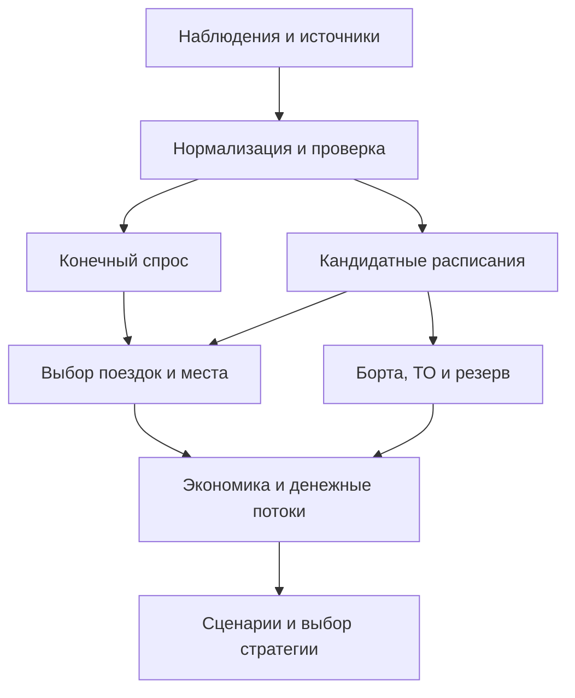

# Red Wings: новый хаб или прямые рейсы — методология выбора и техническое задание на математическую модель

**Исследовательский отчёт DR-02. Дата проверки источников: 10 ноября 2026 года. Горизонт решения: 2027–2028 годы.**

Единый документ: выводы, конкурентные кейсы, методы, формулы, учебные расчёты, требования к данным, архитектура будущей Python-модели и библиография. Обозначения H1/H2/H3 соответствуют приложенному `NEW-DR-02-TASK.md`. Английские термины приведены для сопоставления с первоисточниками.

## A. Краткий итог и рекомендуемый метод

### A.1. Что предлагается реализовать

**Рекомендуется модель конечных рынков O&D и вариантов поездки с ограничениями вместимости, проверяемым расписанием и расчётом прироста денежных потоков относительно общей исходной сети.** Для небольшой программы из 8–12 маршрутных пар достаточно перебора ограниченного набора частот и расписаний, линейного распределения пассажиров и проверки цепочек конкретных самолётов. Смешанно-целочисленная оптимизация нужна только там, где перебор становится неудобным.

Последовательность решения:

1. Уточнить исходную сеть, фактические базы, доступный парк и даты ввода самолётов.
2. Проверить не менее десяти городов по жёстким ограничениям и прозрачным критериям; выделить три кандидата для полноценного расчёта.
3. Восстановить интервалы конечного спроса между городами, отдельно от предложения кресел.
4. Сформировать продаваемые варианты поездки: прямые рейсы, стыковки Red Wings, конкуренты, наземный транспорт и отказ от поездки, если моделируется весь потенциальный рынок.
5. Оценить выбор пассажиров и распределить их по рейсам с общей проверкой вместимости каждого участка.
6. Проверить последовательности самолётов, обслуживание, резерв, ограничения аэропортов и экипажей.
7. Посчитать выручку, денежный вклад, капитальные вложения, потребность в оборотных средствах и диапазон NPV.
8. Сопоставить H1, H2 и при необходимости H3 при одном календаре доступности флота, одинаковом капитальном лимите и одинаковых правилах сценариев.
9. Выбрать устойчивую допустимую стратегию либо отложить запуск, если данные не отделяют её от убыточного решения.

Это **авторская постановка для данного кейса**, основанная на разделении задач спроса, расписания, назначения флота и маршрутной экономики в открытых материалах MIT [R04–R09]. Она не воспроизводит закрытую систему какой-либо авиакомпании.

### A.2. Какие выводы уже можно защитить

- Хаб создаёт ценность через **дополнительные привлекательные поездки и сетевой денежный вклад**. Число линий из одного аэропорта само по себе этого не доказывает. Прибыльность новых участков нужно проверять вместе с вытеснением пассажиров на остальных участках [R09, R15].
- Рост пассажиропотока аэропорта или перевозчика не доказывает окупаемость конкретной базы. Публичные российские кейсы дают операционные результаты, но не полноценные инвестиционные расчёты отдельных хабов.
- Для Red Wings важно актуализировать исходную классификацию аэропортов. Официальный релиз от 27.10.2026 перечисляет **Москву, Санкт-Петербург, Казань, Самару, Екатеринбург, Сочи и Махачкалу как опорные города**. Он не подтверждает семь одинаково оснащённых баз или семь трансферных хабов [R02].
- Аналогии следует переносить на уровне механизмов. Масштаб Copa, техническая инфраструктура S7 и групповая поддержка «Аэрофлота» не являются доступными Red Wings ресурсами по умолчанию.
- Прогноз пассажиров из формулы «кресла × рейсы × желаемая загрузка» — сценарий использования предложения. Это не независимая оценка спроса. В модели загрузка должна получаться после оценки спроса и распределения мест [R06].

### A.3. Что этот отчёт не предрешает

Ни Екатеринбург, ни Омск, ни другой город здесь не объявляются победителем. Не назначаются реальные 8–12 линий, частоты, тарифы и прибыль Red Wings без соответствующих входов DR-01. Требования чемпионата к итоговому решению сохранены: документ даёт процедуру, по которой команда должна получить эти результаты после загрузки данных.

Нужны прежде всего: конечные O&D-потоки и их происхождение; фактические частоты и времена полётов; реализованный доход перевозчика; стоимость рейсов и базы; ограничения эксплуатации; календарь доступных самолётов; статус субсидий. Если их нет, результатом становятся интервалы, пороги и список условий запуска, а не точечная «точная прибыль».

### A.4. Проверенные исходные материалы и границы исследования

Прочитан приложенный `NEW-DR-02-TASK.md`. Через подключённый доступ к GitHub прочитан `задание/5 кейс.md` в ветке `rewrite` указанного репозитория [R01]. Таким образом, исходное ТЗ доступно; утверждение о его недоступности здесь не используется.

Содержимое остальных файлов репозитория и результаты параллельного DR-01 не проверялись. Данные из постановки кейса не получают автоматически статус подтверждённых фактов. Исследование выполнено по открытым публикациям; коммерческие базы бронирований и внутренние расходы перевозчиков недоступны.

Статусы доказательств в документе:

| Метка | Что означает | Как использовать |
|---|---|---|
| Факт публикации | Проверен текст документа или корпоративного сообщения | Сохранять период, охват и определение показателя |
| Заявление/план | Компания сообщила о намерении или дала прогноз | Не считать выполненным результатом |
| Реконструкция | Вывод получен сочетанием открытых наблюдений | Показывать шаги и альтернативные объяснения |
| Рекомендация | Авторский выбор метода для чемпионата | Обосновывать ограничениями задачи |
| Учебный пример | Все входы намеренно условны | Не переносить числа в фактическую модель |
| Частичный доступ | Доступны аннотация, поисковый фрагмент или предпросмотр | Не заявлять чтение полного источника |

## B. Хаб, прямые рейсы и гибридная сеть

### B.1. Операционные определения

| Термин | Рабочее определение | Минимальное подтверждение |
|---|---|---|
| Опорный аэропорт | Значимая точка сети в терминологии перевозчика | Датированный официальный перечень; объём функций уточняется |
| База ВС | Место закрепления/регулярной ночёвки самолётов | Число и периоды базирования, стоянки, порядок обслуживания |
| Операционная база | Узел самолётов, экипажей и операционного обеспечения | Экипажи, смены, наземная поддержка, договоры ТО |
| Фокус-город | Несколько линий и коммерческий приоритет без обязательного трансфера | Сеть и ресурсы; самостоятельный термин не доказывает волны |
| Трансферный хаб | Узел, где скоординированные рейсы образуют продаваемые пересадочные поездки | Расписание, MCT, сквозная продажа, багаж, ответственность за пересадку |
| Международный хаб | Хаб с международными трансферными возможностями | Дополнительно права перевозки, пограничные/таможенные процедуры |

Это рабочая классификация проекта. Единого универсального порога «не менее X самолётов» для всех этих названий не вводится. В нормативных и коммерческих источниках употребление терминов различается. Следует хранить отдельно **название, данное компанией**, и **подтверждённые функции**.

### B.2. Как хаб объединяет потоки

Для (n) городов-спиц потребуется (n) пар «спица–хаб», тогда как полный граф прямых связей между спицами содержит (n(n-1)/2) пар. Это комбинаторное свойство графа, а не доказательство экономии: две посадки на одну поездку расходуют места, часы, циклы и наземные ресурсы.

Через участок A–H могут одновременно ехать пассажиры A–H, A–B, A–C и других конечных рынков. Объединение тонких потоков помогает поддерживать частоту. Преимущество исчезает, если пересадка слишком долгая, обход значителен, тариф непривлекателен или поток вытесняет более доходные поездки. Именно баланс сетевой выручки, потери привлекательности пересадки и затрат следует проверять; этот механизм разобран в лекции MIT о сетевых стратегиях [R09].

Волна — группа прибытий, после которой следует группа отправлений. Для входящего рейса (i) и выходящего (j):

\[
MCT_{ij}\le dep_j-arr_i\le MCT^{max}_{ij}.
\]

Времена — минуты в UTC с датами; MCT зависит от аэропорта, терминалов, вида сообщения и процедуры обработки. Верхняя граница — коммерческий фильтр проекта, а не официальный MCT. «Минимально допустимая пересадка» и «пересадка, которую пассажир предпочитает» — разные понятия. IATA публикует стандарты MCT, но конкретные значения для российских аэропортов должны поступить из подтверждённых данных [R16].

Для иллюстрации проектирования можно задать тестовую волну, однако нельзя автоматически применять к реальным аэропортам единые 45 или 60 минут.

### B.3. Измеримая связность

Для поездки (p=(o,h,d)):

\[
circuity_p=\frac{d_{oh}+d_{hd}}{d_{od}},\qquad
EJT_p=arr_{last,p}-dep_{first,p}.
\]

Расстояния — километры по согласованной геодезической методике; (EJT) — минуты полного времени между первым вылетом и конечным прилётом. Для выбора пассажира добавляются наземный доступ, предполётные процедуры и отклонение от желаемого времени отправления.

Предлагаемый показатель пригодных стыковок:

\[
NC_h=\sum_{(i,j)\in C_h}I_{ij}^{sell}\,q_{ij}^{time}\,q_{ij}^{detour}\,q_{ij}^{reliability}.
\]

(C_h) — пары конкретных рейсов за неделю; (I^{sell}=1), если соблюдены ограничения и поездка реально продаётся; качества (q\in[0,1]) определяются опубликованными правилами проекта. Единица — условная качественно взвешенная стыковка/неделю. Это **авторский индекс**, вдохновлённый принципом ACI/SEO NetScan, а не точное воспроизведение закрытой реализации NetScan [R15].

Следует также показывать число различных конечных O&D-пар, число удобных вариантов по дням недели, медианное время пересадки и **спрос на доступные стыковки**. Пять вариантов для одной пары не создают пять независимых рынков. Взвешенная достижимость полезна как диагностика расписания; её нельзя объявлять пассажирами или рублями.

Экономическая ценность хаба определяется контрфактом:

\[
V_{hub}=NPV(\text{сеть с хабом})-NPV(\text{лучшая допустимая сеть без него}).
\]

В обоих вариантах одинаковы доступные самолёты, капитал, горизонт и внешние сценарии. Если (V_{hub}>0), причинность остаётся модельной и зависит от входов, но сравнение уже отвечает инвестиционному вопросу.

### B.4. Цена волн и последствия сбоев

Волны концентрируют нагрузку на перрон, выходы, багаж, досмотр, персонал и ТО. Между волнами самолёты могут простаивать. Увеличение буфера снижает риск пропущенной пересадки, но ухудшает время поездки и суточный налёт. Ограничения расписания и часовых поясов прямо рассматриваются в MIT [R07].

При наличии наблюдений задержек вероятность пропуска стыковки можно оценивать как

\[
p_{miss,ij}=Pr(\delta_i-\delta_j>gap_{ij}-MCT_{ij}),
\]

где (gap=dep_j-arr_i), а (\delta_i,\delta_j) — задержки соответствующих событий. Нужно согласовать, задерживается ли выходящий рейс ради трансфера. При отсутствии совместных наблюдений вместо вероятности применяют стресс «входящий рейс опоздал на 30/60/120 минут» и пересчитывают последствия. Нельзя независимо разыгрывать задержки всех рейсов, если они вызваны одним закрытием хаба.

### B.5. Прямые рейсы

Прямое сообщение выигрывает временем полёта и отсутствием пересадки. Но редкий прямой рейс может проиграть частой стыковочной программе по удобству даты и времени. Частота влияет на выбор пассажира; универсальной минимальной частоты для всех рынков нет [R04].

Открытие новой пары даёт доступ к новому конечному рынку. Дополнительная частота на существующей паре прежде всего меняет расписание, захват рынка и вытеснение спроса между собственными рейсами. Поэтому её выручка равна приросту выручки всей затронутой программы, а не продажам нового вылета.

H2 не означает бесплатное обслуживание межрегиональных линий. Для рейса C–D самолёт должен оказаться в C: через коммерческий подвозящий рейс, подходящую цепочку или оплаченный перегон. Ночёвка с закреплённым экипажем и постоянной инфраструктурой может превратить формально «прямую» программу в новую операционную базу — тогда её нужно переклассифицировать.

### B.6. Когда какая гипотеза имеет основания

| Условие | H1: новый хаб | H2: прямые линии | H3: гибрид |
|---|---|---|---|
| Много небольших совместимых рынков | Полезно объединение потоков | Частоты могут быть недостаточны | Часть тонких рынков через хаб |
| Несколько крупных конечных рынков | Пересадка может ухудшить продукт | Сильный аргумент в пользу прямых | Прямые на крупных рынках |
| Доступно мало исправных ВС | Волны и резерв могут не сложиться | Проще поэтапное внедрение | Риск распыления ресурса |
| Есть готовая инфраструктура | Уменьшает предельную стоимость | Помогает оборотам из старых баз | Возможен общий резерв при доказанной досягаемости |
| Высокий CAPEX и слабый капитал | Требует более сильного доказательства | Обычно легче ограничить риск запуска | Допустим только явный бюджет |
| Неподтверждённый трансферный спрос | Хаб пока не доказан | Локальный спрос проверяется отдельно | Не решает отсутствие данных |
| Сильный базовый конкурент | Важна реакция на частоты и цену | Возможны отдельные ниши | Нужен расчёт каннибализации |
| Субсидия заканчивается через год | Проверять выживание сети без неё | Проверять каждую программу | Не суммировать обещания поддержки |

Результат в России способны изменить: реальная доступность двигателей и резервных бортов; даты принятия SJ-100 в эксплуатацию; закрытия аэропортов; стоимость базирования; договорная поддержка регионов; частоты конкурентов; доля поездок через Москву; необходимость перегона и изменение собственной международной программы.

## C. Глубокие кейсы конкурентов

### C.1. S7: Новосибирск и Иркутск

**Решение и устройство.** Для сравнения рассматриваются два действующих узла одной компании, а не два независимых бизнес-эксперимента. География Новосибирска позволяет связывать европейскую часть России с Сибирью и восточными направлениями; Иркутск обеспечивает другую зону покрытия. Это географическая интерпретация, а не доказательство конкретной внутренней функции оптимизации S7.

**Результаты.** В опубликованных итогах 2025 года S7 сообщила о 12,8 млн пассажиров и 100 тыс. рейсов; через Новосибирск — почти 7 млн, через Домодедово — 4,9 млн, через Иркутск — 1,9 млн. В сети появились 13 направлений. В том же сообщении указаны 100 ремонтов двигателей и 83 обслуживания C-check у S7 Technics [R17]. Эти показатели характеризуют масштаб компании и инженерного обеспечения; ремонты не относятся исключительно к двум рассматриваемым узлам.

**Ресурсы.** S7 Technics отдельно подтверждает базу ТО в Новосибирске и линейную станцию в Иркутске [R18]. Это важное различие: два города, называемые хабами, не обязательно имеют одинаковую глубину обслуживания. Корпоративное руководство для пассажиров подтверждает предложение пересадочных поездок через Новосибирск [R50]. Проверенная полная матрица волн, закреплённых бортов и экипажей по двум узлам не получена.

Аэропорт Иркутска опубликовал за 2025 год 4 048 738 обслуженных пассажиров. Для S7 приведены 1 416 955 на внутренних и 462 486 на международных линиях [R19]. Сумма — 1 879 441, что согласуется с округлёнными 1,9 млн в сообщении перевозчика. Региональные направления в том же релизе являются дополнительным разрезом: их нельзя прибавлять к внутренним перевозкам как отдельный непересекающийся рынок.

**Что нельзя установить.** Сумма потоков через три аэропорта не обязана равняться перевозкам всей S7: поездка между двумя узлами отражается в аэропортовых разрезах обоих. Из 7 млн нельзя вычислить долю трансфера, прибыль новосибирской базы или требуемый Red Wings парк. Не найдены проверенные отдельные P&L и CAPEX двух хабов; нет достаточной истории для причинной оценки эффекта каждой волны.

**Урок для модели.** Переносимы учёт сетевых рынков, согласование расписания и технической поддержки. Непереносимы готовый масштаб, бренд, накопленный поток и инженерные ресурсы. Для Red Wings надо отдельно проверить, можно ли получить полезное покрытие и обслуживание при существенно меньшем числе самолётов. Историю формирования узлов следует доисследовать архивными решениями; даты их превращения в полноценные хабы здесь не выдумываются.

### C.2. Группа «Аэрофлот»: Красноярск

**Решение.** Пятилетие хаба отмечалось 1 июня 2026 года, что подтверждает запуск в 2021 году. Аэропорт сообщил о более 8,7 млн пассажиров группы за пять лет, росте от примерно 1 млн в первый год до 2,2 млн в 2025 году; на лето 2026 года — 32 направления, из них 21 внутреннее. Подтверждены десять базируемых самолётов «России»: три SSJ100, четыре A319 и три B737 [R21].

**Ресурсы.** В сообщении к юбилею указаны почти 130 работников представительства, более 70 специалистов линейной станции «Аэрофлот Техникс», открытой в 2021 году, и почти 200 бортпроводников регионального отделения «России», созданного в 2022 году [R22]. Это показывает, что базирование включает организацию труда и обслуживания, а не только стоянку самолёта.

**Проверка охвата.** В отдельном релизе за 2025 год приведено более 35 направлений за год и более 2,2 млн пассажиров, включая 2,1 млн на рейсах «Аэрофлота» и «России» под кодом SU. Москва — 690,7 тыс., Санкт-Петербург — 191,4 тыс.; отдельно опубликована строка «Москва — Владивосток» 52,6 тыс. [R20]. Это не готовая матрица конечного спроса: у последней строки требуется уточнить транзит и способ учёта.

**Ограничения вывода.** 35+ направлений за весь 2025 год и 32 в летнем расписании 2026 года — разные охваты, а не доказательство сокращения сети. Поток группы включает местные, международные, трансферные и иные перевозки; проверенной отдельной доли пересадок нет. Публичных расходов и прибыли именно хаба, полного бюджета создания базы и контрфактического варианта без неё не получено. Поддержка инфраструктуры и ресурс группы — альтернативные объяснения роста наряду с расписанием.

**Применимость.** Red Wings может перенять структуру проверки: закреплённый парк → экипажи → линейное ТО → согласованные рейсы → измеряемый результат. Нельзя взять «2,2 млн / 10 самолётов» как производительность нового хаба: поток относится к группе и всей программе, а десять бортов — к конкретному текущему базированию «России». Более ранние альтернативы выбора Красноярска по доступным материалам не восстановлены.

### C.3. Red Wings: Екатеринбург

**Исходное решение.** В официальном сообщении от 13.10.2020 объявлено создание регионального транзитного хаба. Указаны три действовавшие с сентября линии и шесть новых; после их открытия сеть должна была достигнуть девяти направлений, шесть из которых на тот момент назывались уникальными. Для 2021 года заявлялся план 25 направлений; SSJ100 описан в компоновке 100 кресел [R23]. Это сочетание фактически начатых полётов и планов, которое нельзя записать одной строкой «план выполнен».

**Развитие.** В марте 2021 года компания анонсировала летнюю сеть из 22 российских городов, с использованием SSJ100 и A320/A321, и сообщила о 48 тыс. пассажиров за три с половиной месяца 2020 года [R24]. Следовательно, масштаб программы нельзя целиком приписывать парку стоместных самолётов.

**Измеренный промежуточный результат и поддержка.** В релизе 07.10.2021 приведены 470 тыс. за первый год проекта и 380 тыс. за январь–сентябрь 2021 года; около полумиллиона по итогам календарного года обозначено прогнозом. Там же говорится о необходимости федеральной и региональной поддержки, а также о подписанном код-шеринговом соглашении с «Уральскими авиалиниями» [R25]. Это свидетельство организационного развития и зависимости доступных тарифов от поддержки, но не опубликованный финансовый результат хаба.

**После 2022 года.** Итоги всей Red Wings за 2025 год: 2,7 млн пассажиров, более 2 млн на российских самолётах, 24 тыс. рейсов на российских типах и около тысячи чартерных рейсов B777. Сообщается об открытии 25 регулярных направлений [R26]. Эти данные нельзя разложить на прибыль и трансфер Екатеринбурга без дополнительных наблюдений.

**Что не доказано.** Нет проверенного реестра всех запусков, сезонных остановок и окончательных закрытий линий Екатеринбурга за 2020–2026 годы, с причинами каждого изменения. Поэтому отчёт не называет весь проект ни провалом, ни доказанно окупившимся хабом. Не найдены отдельные денежные потоки базы и временной ряд трансферной доли.

**Следствие для выбора.** Действующая инфраструктура может сделать расширение Екатеринбурга дешевле новой базы. Однако исторические вложения уже понесены: учитывать следует будущие дополнительные расходы и альтернативный вклад самолёта. Новый город может победить, если даёт действительно иной конечный спрос, меньшее конкурентное давление и более высокий вклад после покрытия полной стоимости нового базирования. Это проверяется моделью, а не статусом «исторического хаба».

### C.4. «Уральские авиалинии»: Екатеринбург

**Масштаб и изменение структуры.** Официальные итоги 2024 года: 9 522 214 пассажиров и 55 435 рейсов; внутренние линии — 5 527 982 пассажира против 6 767 497 в 2023 году. Компания отдельно выделяет 969 466 на международных линиях вне блока СНГ и 3 024 766 на направлениях СНГ [R27]. Для сопоставления с российским общим рынком обе международные категории нужно объединять, сохраняя исходную классификацию.

В индексируемом официальном канале за 2025 год заявлены более 8 млн пассажиров и почти 53 тыс. рейсов [R28]. Полный текст через инструмент не открылся; точное значение и маршрутная детализация здесь не восстанавливаются. Итоги 2024 года не выдаются за состояние ноября 2026 года.

**Роль конкурента.** Наличие двух базовых перевозчиков и исторического соглашения с Red Wings подтверждается сообщением самого проекта Кольцово [R25]. Соглашение 2021 года не доказывает действующие в 2026 году условия код-шеринга. Для каждой предлагаемой пары надо проверить текущие рейсы, дни, тарифы и продажу стыковок.

**Ресурсы и ограничения.** Не получены проверенные численность исправного парка, закрепление ВС в Екатеринбурге, стоимость ремонта и текущая маршрутная прибыль. Причину снижения объёма нельзя надёжно установить только из пассажирской статистики. Версию об ограничениях двигателей или обслуживания нужно подтверждать отдельными актуальными документами, а не автоматически переносить из описания кейса.

**Реакция на Red Wings.** Снижение тарифов, увеличение частоты и защита наиболее доходных времён — сценарии, а не установленное будущее поведение. Ниша считается подтверждённой только после оценки остаточного конечного спроса с учётом такой реакции. Наличие или отсутствие конкурента в одной поисковой выдаче этого не доказывает.

### C.5. Дополнительный российский материал: субсидируемые региональные программы

Публичный перечень Росавиации на 2026 год содержит маршруты разных операторов, включая «Азимут» и Utair, с типами ВС, периодами, частотами и условиями софинансирования [R42]. Он полезен для проверки принципа: **низкая частота и государственная поддержка могут быть свойствами конкретного договора и сезона**. Это не означает, что любой похожий маршрут автоматически получит поддержку Red Wings.

Самостоятельные финансовые кейсы дополнительных перевозчиков не включены: найденных данных недостаточно, чтобы добавить доказанный вывод сверх четырёх основных российских случаев.

### C.6. airBaltic: Рига, региональные базы и финансовое ограничение

**Сопоставимость.** Полезен пример перевозчика с единым семейством региональных реактивных ВС, домашним рынком ограниченного размера, пересадками и несколькими базами. Различия существенны: европейский рынок, международные права перевозок и бизнес ACMI — предоставление самолётов с экипажами другим авиакомпаниям.

**Факты за 2025 год.** Презентация результатов от 11.03.2026 показывает €779 млн выручки, €144 млн скорректированного EBITDAR и чистый убыток €44,3 млн. В ней указаны 133 маршрута, €157 млн выручки ACMI-out и парк 51 A220-300 на конец года с оговоркой об исключённом борте. Число 8,7 млн относится ко всем операциям, включая ACMI, тогда как собственная сеть перевезла около 5,2 млн [R29]. Эти пассажирские охваты нельзя смешивать в RASK собственной сети.

**Последующее развитие.** В официальном индексируемом сообщении компания подтверждает добровольное начало процедуры Chapter 11 в США 14.09.2026; в другом — временное одобрение доступа к €140 млн из финансирования на €350 млн [R30, R31]. При прямом открытии сайт отдаёт почти пустой HTML; сведения проверены по индексируемому тексту официального сайта, а не по материалам судебного дела.

**Вывод.** Этот пример нельзя представлять безусловной историей успеха. Перевозки и положительный EBITDAR не гарантируют покрытия амортизации, аренды, процентов и потребности в ликвидности. Причину реорганизации нельзя свести к одному устройству хаба: влияют капитал, двигатели, топливо, геополитика и иные обязательства.

**Для Red Wings.** Переносимы отдельный учёт доступности двигателей и денежных обязательств, сезонное управление парком и разделение бизнеса собственной сети/чартеров. Прогноз расширения флота из мартовской презентации нельзя использовать как актуальное подтверждение поставок после сентябрьской реорганизации. Копирование международного трансфера через Ригу в российские региональные условия не обосновано.

### C.7. Copa: Панама и ценность согласованного трансфера

**Стратегия.** Copa описывает Hub of the Americas как основу сети внутрилатиноамериканских поездок через Панаму. Это пример концентрации пересадочных рынков, но с другой географией и международными правами перевозки.

**Результаты.** За 2025 год опубликованы чистая прибыль $671,6 млн, операционная маржа 22,6%, RASM 11,2 американского цента/кресло-милю и CASM 8,6 цента/кресло-милю. Парк на конец года — 125 самолётов. Вместимость в ASM выросла на 7,8%; годовой RASM снизился на 2,6%, CASM — на 3,6% [R32]. Это результаты группы, а не отдельная оценка стоимости панамского хаба.

**Урок.** Финансовый успех здесь подтверждён отчётностью; причинная доля хаба в прибыли из неё не идентифицируется. Для Red Wings полезны дисциплина полной сетевой экономики и согласование стыковок с надёжностью. Нельзя переносить маржу Copa на SJ-100 или получать требуемое число ВС масштабированием пассажиров. Требуется собственная себестоимость на российских расстояниях и частотах.

### C.8. Ryanair: прямые сети с операционными базами

**Стратегия.** Прямые пассажирские поездки могут сочетаться с многочисленными базами самолётов. Поэтому «point-to-point» и «отсутствие затрат базы» не являются синонимами. Для кейса Red Wings H2 строже: новая база не создаётся, а её функции нельзя спрятать в расходах другой строки.

**Результаты и ресурс.** В финансовом году, завершившемся 31.03.2025, Ryanair перевезла около 200 млн пассажиров, на 9% больше; прибыль после налога составила €1,61 млрд против €1,92 млрд годом ранее при снижении среднего тарифа на 7%. В сообщении от 19.05.2025 указан текущий парк 618 самолётов; задержки поставок ограничивали план роста [R33]. Парк на дату сообщения нельзя без оговорки называть парком на конец финансового года.

**Урок.** Больший поток может сопровождаться меньшей прибылью. Ценовая стимуляция требует пересчёта и спроса, и дохода на пассажира. Масштаб закупок, парк B737, аэропортовые соглашения и ёмкость европейского рынка не переносятся на Red Wings. Переносима проверка результата на самолёто-час и возможность закрывать слабые программы с учётом договорных расходов выхода.

### C.9. United: сворачивание хаба в Кливленде

В отчёте United за 2013 год, поданном в 2014 году, описано решение сократить средние ежедневные вылеты из Кливленда примерно на 60% с апреля–июня 2014 года; региональные вылеты — более чем на 70%. Компания объясняла решение продолжающимися убытками, а ускорение сроков — нехваткой региональных пилотов и эффектом новых требований. После сокращения планировались 72 вылета в пиковый день по 20 прямым направлениям; ожидались расходы на сокращение до 470 рабочих мест и другие обязательства [R34].

Это документированное решение о сворачивании роли хаба. Указанные 72 вылета — план в отчёте, а не отдельно проверенный фактический итог июня. Переносимый принцип: хаб может иметь полезную географию и всё же проигрывать по экономике и доступности экипажей. Выход из проекта также стоит денег. Открытая публикация объясняет решение руководства, но не даёт независимой причинной оценки каждого фактора.

## D. Сравнительная матрица конкурентов

| Перевозчик / период | Стратегия | Ресурсы | Сеть | Измеримый результат | Ограничение доказательства | Применимость |
|---|---|---|---|---|---|---|
| S7, 2025 | Несколько узлов | База ТО Новосибирска, ЛСТО Иркутска | Прямые и стыковочные поездки | 12,8 млн по компании; почти 7 млн через OVB, 1,9 млн через IKT | Нет отдельных P&L и доли трансфера | Сетевая и техническая согласованность [R17–R19] |
| Группа «Аэрофлот», 2021–2026 | Новый региональный хаб | 10 базируемых ВС «России», экипажи, ЛСТО | 32 направления летом 2026 | 2,2 млн в 2025; 8,7 млн за пять лет | Групповой поток не равен производительности этих 10 ВС | Полная стоимость организации базы [R20–R22] |
| Red Wings, 2020–2026 | Региональная база и развитие трансфера | Несколько типов ВС, поддержка региона | Стартовые линии, последующее расширение | 380 тыс. за 9 мес. 2021; позднее общекорпоративные итоги | Нет отдельной современной экономики Кольцово | Сравнить расширение и новую базу [R23–R26] |
| «Уральские авиалинии», 2024–2025 | Базовый перевозчик Кольцово | Текущая исправность парка не установлена | Нужен актуальный срез по парам | 9,52 млн в 2024; в 2025 заявлено более 8 млн | Последний показатель проверен частично | Проверка конкурентной реакции [R27–R28] |
| airBaltic, 2025–2026 | Хаб, базы и ACMI | A220-300; финансовая реорганизация | 133 маршрута в 2025 | Рост выручки при чистом убытке | Разные охваты собственной сети и ACMI | Контроль капитала и ликвидности [R29–R31] |
| Copa, 2025 | Международный трансферный хаб | 125 ВС на конец года | Узел Панамы | Операционная маржа 22,6% | Другие география, масштаб и права | Проверка сетевого вклада [R32] |
| Ryanair, FY2025 | Прямые поездки, операционные базы | Крупный парк B737 | Прямые рынки | +9% пассажиров при снижении прибыли | Финансовый год и масштаб несопоставимы | Вклад на ограниченный ресурс [R33] |
| United, решение 2014 | Сворачивание хаба CLE | Региональные партнёры, дефицит пилотов | Сокращение региональной сети | Объявлено −60% вылетов | Часть цифр — план, не результат | Стоп-условия и расходы выхода [R34] |

Достоверность высока для непосредственно опубликованного показателя в его охвате; существенно ниже для причинности, прибыли отдельных узлов и переносимости на Red Wings. В матрице намеренно нет единой оценки «хаб успешен / провален» по пассажирскому росту.

## E. Каталог методов и правила применения

Сквозные индексы: (m) — направленный конечный рынок «город отправления → город назначения»; (t) — месяц; (p) — вариант поездки; (f) — конкретный вылет с датой; (a) — самолёт; (b) — база; (s) — сценарий. (D) и (y) измеряются в односторонних поездках/период; (P_f) — пассажиры на участке; деньги — рубли заданного ценового года. Знак (\Delta) означает отличие от общей исходной сети.

| Метод | Задача и формула | Входы / проверка | Ограничение и решение для проекта |
|---|---|---|---|
| Прямое наблюдение O&D | (\hat D=\sum w_n) по наблюдаемым поездкам | Билеты, веса охвата, даты, конечные пункты | Учесть непокрытые каналы; приоритетный вход [R49] |
| Восстановление из участков | (Aq=P,\ q\ge0) | Потоки участков и множество путей | Обычно несколько решений; считать границы, не выдумывать трансфер [R08] |
| Аналоги | (\hat D_m=z_m\sum_k w_kD_k/z_k) | Сопоставимые рынки, масштаб (z), веса | Авторская адаптация; только с независимой проверкой |
| Гравитационная регрессия | (E[D\mid X]=\exp(X\beta)) | Панель рынков и реальные поездки | Население не заменяет обучение; PPML при обоснованных наблюдениях [R13] |
| Регрессия спроса | (\ln D=\alpha+\beta_F\ln F+\beta_T\ln T+\gamma X+u) | Доход, цены, время, сезоны | Эндогенность цены/частоты; причинная трактовка требует идентификации [R04, R12] |
| Логит | (s_p=e^{V_p}/\sum_j e^{V_j}) | Выборы и атрибуты альтернатив | Нельзя назначить коэффициенты фактами; условная модель при слабых данных [R10] |
| Вложенный логит | (s_p=s_{p\mid g}s_g) | Наблюдения переключений внутри/между группами | Больше параметров; не нужен в первой версии [R11] |
| Эластичность | (D_1/D_0=(F_1/F_0)^\epsilon) | Сопоставимый рынок, оценка (\epsilon) | Различать уровень рынка и перевозчика; сценарный диапазон [R12] |
| Сезонный профиль | (D_{mt}=D_{m,year}\omega_{mt},\sum_t\omega=1) | История направленных поездок | Частоты и поток аэропорта — только прокси, не конечный спрос [R06, R14] |
| Пассажирский поток с вместимостью | (P_f=\sum_p A_{fp}y_p\le S_fx_f) | Пути, рейсы, спрос, места | Основной способ исключить физический и рыночный двойной счёт [R08] |
| Скрининг городов | (score_i=\sum_kw_kz_{ik}) | Критерии, интервалы, единые шкалы | Открытые авторские веса; не заменяет инвестиционный расчёт [R37] |
| AHP | (Aw=\lambda_{max}w), (CR=CI/RI) | Парные экспертные сравнения | Полезно для обсуждения весов; основной расчёт не усложнять [R38] |
| TOPSIS | (C_i=d_i^-/(d_i^++d_i^-)) | Нормализованные критерии и веса | Чувствителен к шкалам и набору альтернатив; только дополнительная проверка [R39] |
| Маршрутный вклад | (CM=R-C_{avoidable}) | Предельные доходы и избегаемые расходы | Сравнивать сеть до/после, включая каннибализацию [R09] |
| DCF | (NPV=\sum_tFCF_t/(1+r)^t) | CAPEX, оборотный капитал, поток, ставка | Не выдавать отсутствие затрат за нулевые затраты [R35–R36] |
| Назначение флота | Покрытие вылетов и сохранение потоков ВС | Расписание, типы, парк | Назначение типа не гарантирует осуществимое ТО [R08] |
| Цепочки конкретных бортов | (end_f+turn\le start_g) при одной локации | UTC, даты, ТО, перегоны | Обязательно даже после агрегатной оценки часов [R07–R08] |
| Сценарный анализ | (Z_s=Z(\theta_s)) | Согласованные наборы входов | Базовый и осторожный без придуманных вероятностей |
| Устойчивая оптимизация | (\max_x\min_{s\in S}Z_s(x)) | Допустимое множество сценариев | Полезно при близком выборе; множество должно быть содержательным [R40] |
| Минимизация сожаления | (\min_x\max_s[Z_s^*-Z_s(x)]) | Лучшая альтернатива в каждом сценарии | Авторская процедура для неопределённого спроса; не обещает вероятность успеха |
| Реальные опционы | Отложить/расширить/закрыть после наблюдения | Стоимость ожидания, обратимость, сроки | Дерево решений полезнее сложной опционной цены без данных |

Формулы раскрыты в G–K. Для методов аналогов, скрининга и выбора авторская адаптация отделена от научного источника. AHP/TOPSIS не выбираются ядром: при недостатке рыночных данных дополнительные десятичные знаки рейтинга не повышают доказательность.

## F. Полный рабочий словарь KPI

Ниже — определения **для будущей модели**. Они не объявляются внутренними определениями Red Wings. Для статистической доли применяется отдельное согласование с официальной методологией в K.6.

| Русский / английский термин | Обозначение и единица | Формула | Смысл и предел применимости |
|---|---|---|---|
| Конечная поездка / O&D journey | (J), односторонняя поездка | (\sum_p y_p) без повторения путей одного выбора | Одна пересадочная поездка остаётся одной поездкой |
| Пассажир на участке / leg passenger | (P_f), пасс. | (\sum_pA_{fp}y_p) | Пересадочная поездка занимает место на каждом участке |
| Пересадочная поездка / connecting journey | (J^{tr}), поездка | (\sum_{p:\#legs>1}y_p) | Не равна всем пассажирам аэропорта |
| Перевезённые пассажиры в отчётном учёте / reported passengers | (P^{stat}), пасс. | (\sum_p b_p y_p) | Коэффициент (b_p) зависит от правил учёта рейсов; см. K.6 |
| Выполненные вылеты / departures performed | (N), вылет | Количество фактических участков | Парный рейс содержит два вылета; план и факт отдельно |
| Предложение кресел / seats offered | (Q), кресло-вылет | (\sum_fS_fx_f) | Использовать доступные к продаже места, с ограничениями полезной нагрузки |
| Предельные кресло-километры / ASK | (ASK), кресло·км | (\sum_fS_fx_fd_f) | Не включать недоступные места; одна методика расстояний [R03] |
| Пассажирооборот / RPK | (RPK), пасс.·км | (\sum_fP_fd_f) | Счёт по участкам полёта [R03] |
| Занятость кресел / PLF, LF | (LF), доля или % | (RPK/ASK) | Для сети это взвешенный расстоянием показатель, не среднее процентов [R03] |
| Простая загрузка мест / seat occupancy | (LF^{seat}), доля | (\sum_fP_f/\sum_fS_fx_f) | Совпадает с RPK/ASK только при одинаковых расстояниях |
| Пассажирская выручка / passenger revenue | (R^{pax}), руб. | (\sum_pF_p^{net}y_p) | Билет один раз; сборы третьих лиц не доход перевозчика [R04, R09] |
| Дополнительная выручка / ancillary revenue | (R^{anc}), руб. | (\sum_pa_py_p) | Только доля, принадлежащая перевозчику; не вся стоимость услуги партнёра |
| Операционная выручка / operating revenue | (R^{op}), руб. | Сумма признанных операционных категорий | Субсидии и прочие доходы выделить отдельно по учётной политике |
| Средний тариф / average fare | (\bar F), руб./поездку | (R^{pax}/J) | Охват поездок и тарифа должен совпадать |
| Реализованный чистый тариф / net realized fare | (F^{net}), руб./поездку | Полученный тариф за вычетом исключаемых сумм | Отдельно определить НДС, возвраты и комиссию; не цена «от» |
| Доходная ставка / yield | (Y), руб./пасс.·км | (R^{pax}/RPK) | На участках требует распределения билетной выручки; не руб./пассажира |
| Пассажирская выручка на ASK / PRASK | (PRASK), руб./кресло·км | (R^{pax}/ASK) | (PRASK=Y\times LF) при одном охвате |
| Операционная выручка на ASK / RASK, TRASK | (RASK), руб./кресло·км | (R^{op}/ASK) | Указать включение ancillary, груза и субсидий |
| Расходы на ASK / CASK | (CASK), руб./кресло·км | (C^{op}/ASK) | Сравнение требует одной длины этапа и состава расходов [R05] |
| CASK без топлива / CASK ex-fuel | (CASK_{exfuel}), руб./кресло·км | ((C^{op}-C^{fuel})/ASK) | Не исключать другие статьи без указания |
| Безубыточная загрузка / BELF | (BELF), доля | См. H.4 | Простой CASK/Y не учитывает пассажирские затраты и прочие доходы |
| Выручка на вылет / revenue per flight | (R_f), руб./вылет | Распределённая выручка / вылеты | Не дублировать полную цену пересадочного билета |
| Денежный вклад / contribution | (CM), руб./период | (R-C^{avoidable}) | Не равен прибыли после общих и капитальных расходов |
| Вклад на вылет / contribution per departure | (CM/N), руб./вылет | Одноимённое отношение | Полезен внутри сопоставимых по ресурсу программ |
| Маржа вклада / contribution margin | (CMR), % | (CM/R\times100\%) | При нулевой выручке не определена |
| Сетевой предельный вклад / network incremental contribution | (\Delta CM), руб. | (CM_{with}-CM_{without}) | Учитывает собственные потерянные продажи [R09] |
| Операционный результат / operating result | (OP), руб. | (R^{op}-C^{op}) | Нужны все включённые статьи; при неполноте не называть прибылью |
| Налёт по блок-времени / block hours | (BH), ч | Сумма от начала движения до остановки | Не только время в воздухе [R03] |
| Использование самолёта / aircraft utilization | (U), ч/ВС·сутки | (BH/(A\times days)) | Отдельно для всего парка и исправных ВС; оба знаменателя явно |
| Вклад на самолёто-час / contribution per aircraft-hour | (CM_{BH}), руб./ч | (\Delta CM/\Delta BH) | Капитальный и резервный ресурс дополнительно ограничиваются |
| Циклы / flight cycles | (FC), цикл | Число взлётно-посадочных циклов | Важны для обслуживания коротких линий |
| Регулярность / completion factor | (CF), % | Выполненные / запланированные вылеты | Перенос и отмена должны иметь единое правило |
| Пунктуальность / on-time performance | (OTP\), % | Прибытия в выбранном допуске / наблюдённые | Указать порог, отмены и охват наблюдений |
| Пропущенные пересадки / missed connections | (MC), поездка или % | Неуспевшие / пересадочные пассажиры | Не заменять долей задержанных рейсов |
| Чистый прирост / net incremental traffic | (\Delta P^{stat}), пасс. | Стратегия минус исходная сеть | Отличается от пассажиров только новых рейсов |
| Доля рынка / market share | (MS), % | (100P^{stat}_{RW}/M^{stat}) | Одинаковые период, территория, тип сообщения и правила счёта |
| Чистая приведённая стоимость / NPV | (NPV), руб. на дату оценки | Дисконтированная сумма FCF | Результат сценария, а не гарантированный доход [R35] |
| Внутренняя доходность / IRR | (IRR), %/год | Корень (NPV(r)=0) | Может отсутствовать или быть неоднозначной [R35] |
| Срок окупаемости / payback | (PB), месяц/год | Первый момент покрытия инвестиций потоками | Отдельно простой и дисконтированный; «за горизонтом» не равно «никогда» |

Для нулевых знаменателей выводить «не определено». Промежуточные расчёты вести без округления; в отчётных таблицах округлять после агрегации.

## G. Оценка конечного спроса и распределение пассажиров

### G.1. Три объекта, которые нельзя подменять друг другом

1. **Наблюдаемые перевозки** — выполненные поездки/посадки в определённом охвате.
2. **Потенциальный конечный спрос** — поездки, которые были бы выбраны при заданных ценах и качестве, до ограничения мест.
3. **Перевозки Red Wings** — часть конечного спроса, которую перевозчик привлечёт и сможет обслужить.

Пассажиры на полном рейсе являются цензурированным наблюдением спроса: неизвестно, сколько людей хотели купить билет, но не смогли. На неполном рейсе также не виден весь спрос на другие даты, времена и тарифы. Разделение demand/load/spill изложено в MIT [R06]. Наблюдение кресельного предложения не устраняет эту неопределённость.

### G.2. Прямые данные O&D

Предпочтительный набор — обезличенные записи односторонних поездок с конечными городами, датами, промежуточными участками, перевозчиком и фактической ценой. Билет туда–обратно разделяется на две направленные поездки, если так определена целевая единица.

Для выборки с известной вероятностью включения (\pi_n):

\[
\hat D_{mt}=\sum_{n\in sample(m,t)}\frac{1}{\pi_n}.
\]

Единица — поездки/месяц. Это взвешенная оценка наблюдаемого рынка. Если база покрывает только один канал продаж и вероятности включения неизвестны, механически домножать её до «всего рынка» нельзя. Нужны данные об охвате или интервальная поправка.

DB1B в США полезен как эталон структуры данных: BTS описывает его как 10%-ную выборку билетов с отдельными таблицами билета, рынка и купона [R49]. Это **пример методологии**, а не источник российских потоков. Факт наличия 10%-ной выборки в США не обосновывает множитель десять для российского источника.

Проверки: единый перевозчик-оператор против маркетингового кода; города против аэропортов; отсутствие дубликатов купонов; возвраты; направление; начало и конец путешествия; определение остановки, разделяющей поездки; неизвестные каналы.

### G.3. Восстановление спроса из маршрутных перевозок

Если известны только фактические рейсы (N_f), кресла (S_f) и **наблюдаемая**, а не предполагаемая загрузка (LF_f), можно оценить перевезённых на участке:

\[
\hat P_f=N_fS_fLF_f.
\]

Для одинаковых расстояний здесь уместна простая загрузка мест. Сетевая RPK/ASK-загрузка, подставленная в каждую линию, не восстанавливает маршрутные перевозки.

Для набора возможных путей вводится матрица (A_{fp}\in\{0,1\}), показывающая, использует ли поездка (p) участок (f). Тогда

\[
P_f=\sum_p A_{fp}q_p+e_f.
\]

(q_p) — перевезённые поездки/период, (e_f) — ошибка наблюдения. Это сохранение пассажирских потоков, совместимое с маршрутными постановками MIT [R08]. Оно не идентифицирует неизвестные поездки автоматически: число возможных путей часто больше числа наблюдаемых участков.

**Рекомендуемая процедура при неполноте:** задать доверяемые интервалы (P_f^-\le\sum_pA_{fp}q_p\le P_f^+), ограничения известных локальных/трансферных потоков, затем решить две линейные задачи для каждого интересующего конечного рынка:

\[
D_m^- =\min_q\sum_{p\in m}q_p,\qquad
D_m^+ =\max_q\sum_{p\in m}q_p.
\]

Без достаточных ограничений верхняя граница может быть малоинформативной. Это корректный результат частичной идентификации. Регуляризация «предпочитать короткие пути» сужает решение за счёт допущения, поэтому должна быть явно помечена модельной, а не измеренной.

### G.4. Потоки через Москву и другие узлы

Нельзя считать, что фиксированный процент пассажиров «город–Москва» хочет лететь в каждый другой регион. Правильное разложение использует конечное назначение:

\[
D_{od}^{via\ Moscow}=\sum_{p:o\to h\to d,\ h\in Moscow}q_p.
\]

При отсутствии конечных назначений поток A–Москва даёт только часть системы ограничений. Нужно различать смену аэропорта Москвы, сквозной билет, самостоятельную пересадку, остановку в Москве и поездку по собственным делам в столицу. Самостоятельные пересадки часто отсутствуют в едином билете и требуют отдельного способа наблюдения.

Потенциал прямой линии A–B — не весь найденный трансферный поток. Часть пассажиров предпочитает накопленные мили, тариф, нужный день недели или продолжение маршрута. Существующий прямой спрос и переток с пересадок складывают только после проверки, что это разные поездки.

### G.5. Перенос с сопоставимых маршрутов

Предлагаемая воспроизводимая оценка:

\[
\hat D_m=z_m\sum_{k\in K}w_k\frac{D_k}{z_k},\qquad
w_k\ge0,\quad \sum_kw_k=1.
\]

(D_k) — наблюдённые конечные поездки аналогов за тот же период; (z) — одинаковый показатель масштаба, например население обслуживаемого ареала; (D_k/z_k) — поездок на жителя. Итог — поездки. Если ареалы сравнивать нельзя, используется иной заранее определённый масштаб или метод отклоняется.

Это авторская схема сопоставления, не универсальный авиационный закон. Аналоги выбираются **до просмотра желаемого результата** по длине поездки, доходам, туристической/деловой структуре, альтернативам железной дороги, предложению рейсов, цене и сезону. Веса близости и поправки раскрываются; минимум один аналог оставляется для проверки вне обучения. Диапазон формируется из ошибок на сопоставимых парах, а не из произвольных ±10%.

Нельзя масштабировать пассажиров аэропорта целиком пропорционально населению другого города: в аэропортовом показателе смешаны разные конечные рынки, трансфер и международные потоки.

### G.6. Гравитационная модель и эконометрия

Простая структурная форма:

\[
\mu_{odt}=E[D_{odt}\mid X]
=\exp\{\alpha+\beta_o\ln Pop_o+\beta_d\ln Pop_d
+\beta_y\ln Inc_{odt}-\gamma\ln d_{od}
+\eta\ln F_{odt}+\xi\ln T_{odt}+\delta_t+\zeta X_{odt}\}.
\]

(Pop) — жители; (Inc) — согласованный показатель реальных доходов; (d) — км; (F) — реальная стоимость поездки; (T) — часы общего времени; (X) — индикаторы туризма, деловых связей и наземных альтернатив; (\delta_t) — сезон/год. Логарифмы берутся от отношения к зафиксированной единице/базе, чтобы смысл коэффициентов не зависел от записи рублей или тысяч рублей. Положительное среднее (μ) измеряется поездками/месяц.

Метод PPML оценивает условное среднее в уровнях и допускает наблюдаемые нулевые значения. Работа Santos Silva и Tenreyro показывает проблему логарифмирования зависимой переменной при гетероскедастичности; её эмпирический объект — международная торговля, а не региональные рейсы России [R13]. Переносится статистический принцип, не готовые коэффициенты спроса.

**Принципиальные ограничения:**

- Нет рейса — не значит нулевой конечный спрос. Ненаблюдаемая поездка через другой узел не должна становиться нулём в обучении.
- Тариф и частота назначаются в ответ на спрос; простая регрессия не доказывает их причинный эффект.
- Население, доход и ВРП могут дублировать один фактор. Нужны проверка корреляций и устойчивости спецификации.
- Прогноз вне диапазона расстояний, размеров рынков и тарифов обучающей выборки особенно ненадёжен.

Для проекта: PPML — дополнительный модуль только после получения достаточно широкой сопоставимой панели. Проверка — отложенные города и будущие месяцы, ошибка агрегатов и рынков, устойчивость к удалению крупнейших пар. Нельзя случайно разделить строки одной пары между обучением и тестом и объявить это проверкой новых городов. Если данных мало, интервальные аналоги лучше плохо идентифицированной регрессии с десятком коэффициентов.

### G.7. Модель выбора поездки

Для фиксированного варианта расписания:

\[
V_{mpt}=\alpha_{carrier} +\beta_FF_{mpt}+\beta_TT_{mpt}
+\beta_SSDisp_{mpt}+\beta_KK_p+\beta_RReliability_{mpt},
\]
\[
s_{mpt}=\frac{\exp(V_{mpt})}{\sum_{j\in C_{mt}}\exp(V_{mjt})},\qquad
\hat y_{mpt}^{pref}=D_{mt}s_{mpt}.
\]

(F) — полная цена пассажиру, руб./поездку; (T) — часы; (SDisp) — отклонение от желаемого времени, часы; (K) — число пересадок; (Reliability) — согласованная характеристика надёжности. Коэффициенты имеют обратные единицы соответствующего атрибута, так что (V) безразмерна. Обычно цена и время снижают привлекательность, но знаки и величины должны подтверждаться оценкой. Формула логита и ограничение независимости нерелевантных альтернатив — у Train, гл. 3 [R10].

**Граница рынка обязательна.** Если (D) — только наблюдаемые авиапоездки, условный логит распределяет их между воздушными вариантами; наземный транспорт и отказ не добавляются без расширения исходной совокупности. Если моделируется потенциальный рынок всех поездок, наземные варианты и отказ входят в знаменатель, а исходный (D) должен соответствовать этой совокупности.

Вложенный логит полезен, если варианты внутри группы, например две похожие пересадки, имеют коррелированные ненаблюдаемые свойства. Для группы (g):

\[
s_{p\mid g}=\frac{e^{V_p/\lambda_g}}{\sum_{j\in g}e^{V_j/\lambda_g}},\quad
IV_g=\ln\sum_{j\in g}e^{V_j/\lambda_g},\quad
s_g=\frac{e^{W_g+\lambda_gIV_g}}{\sum_he^{W_h+\lambda_hIV_h}}.
\]

(0<\lambda_g\le1) при данной параметризации, (W_g) — полезность уровня группы; (s_p=s_{p\mid g}s_g). Теория — Train, §4.2 [R11]. Оценивать эти параметры без наблюдений переключения невозможно; в первой версии модели метод не нужен.

**Практический выбор:** при малых данных использовать несколько содержательно обоснованных долей захвата/коэффициентов как сценарии и показывать порог, при котором меняется решение. Называть результат «расчётом при заданной доле», а не «обученной моделью предпочтений».

### G.8. Частота, цена и общее время

Для ограниченных изменений в сопоставимом рынке допустима сценарная зависимость:

\[
D_1=D_0\left(\frac{F_1}{F_0}\right)^{\epsilon_F}
\left(\frac{T_1}{T_0}\right)^{\epsilon_T}
\left(\frac{Inc_1}{Inc_0}\right)^{\epsilon_I}.
\]

Все отношения безразмерны. Эластичность — относительное изменение спроса при малом относительном изменении фактора. IATA/InterVISTAS подчёркивает различие эластичности отдельного маршрута, национального рынка и более широкого рынка [R12]. Изменение тарифа одного перевозчика включает переключение между компаниями; оно не равно индуцированному росту всей авиации.

Частоту полезнее включать через фактическое удобство расписания. При очень упрощённой равномерной возможности отправления по интервалу длиной (H) часов и (f) вылетах ожидаемое ожидание следующего вылета составляет (H/(2f)). Для заранее планируемой поездки это лишь условный прокси; бизнес-пассажир оценивает желаемое время, а не случайный приход к расписанию. Прямое моделирование доступных дней и времён лучше такого приближения.

Не следует одновременно увеличивать (D) за счёт частоты, повышать долю захвата за ту же частоту и добавлять отдельный «сетевой бонус», если они описывают один эффект. В спецификации нужно назначить каждому механизму одно место: размер рынка, выбор пути либо ограничение обслуживания.

### G.9. Сезонность и направленная асимметрия

Для годового направленного спроса:

\[
D_{od,t}=D_{od,year}\omega_{od,t},\qquad
\omega_{od,t}\ge0,\quad\sum_{t=1}^{12}\omega_{od,t}=1.
\]

Веса — доли годовых поездок, а не загрузки. Направления (o\to d) и (d\to o) хранятся отдельно. Неравенство спроса в конкретный месяц может объясняться отпускными заездами/выездами; разница за несколько лет требует проверки определения рынка и возвращений другим способом.

При отсутствии маршрутной истории порядок прокси: близкий конечный рынок → подтверждённая статистика назначения поездок → профиль туризма/деловых событий → аэропортовая сезонность как слабый ориентир. Влияние календаря, праздников и запуска в середине месяца рассчитывается по датам. Переход с половины года на полный год нельзя оценивать простым удвоением, если сезонность неодинакова.

### G.10. Каннибализация, переключение и индуцированный спрос

Для затронутых рынков строится таблица переходов (T_{ab}), где (a) — вариант поездки до изменения, (b) — после него. Единица — конечные поездки/период. Сумма по строке не превышает исходный спрос этой группы; новые поездки выделяются отдельной строкой «раньше не совершали».

Чистый прирост поездок Red Wings:

\[
\Delta J_{RW}=J_{from\ competitors}+J_{induced}+J_{from\ other\ modes}
-J_{lost\ to\ alternatives}-J_{cancelled}.
\]

Переход между двумя собственными вариантами даёт нулевой прирост уникальных поездок, но может изменить сегментный счёт, расходы и выручку. При переходе конкурента с двух участков на один прямой рейс Red Wings рыночная статистика перевозок может измениться иначе, чем число путешественников.

Индуцированный спрос допустимо получить либо из модели выбора с отказом от поездки, либо из независимой модели расширения рынка. Применять оба результата последовательно к одним людям нельзя. В осторожном сценарии без доказательств индуцированный компонент можно установить нулевым — как допущение, а не как утверждение, что его не существует.

### G.11. Ограничение мест и вытеснение

После модели предпочтений:

\[
0\le y_{mpt}\le\hat y^{pref}_{mpt},\qquad
\sum_{m,p}A_{fp}y_{mpt}\le S_fx_f.
\]

Это ограничивает обслуживание, но само по себе **не моделирует** повторный выбор после распродажи. В первой версии допустимо считать неудовлетворённый спрос потерянным и явно показывать его. Улучшение — повторное распределение по ещё доступным альтернативам с оценёнными долями возврата (recapture). Каждый повтор учитывает остаток исходной группы, чтобы она не появлялась заново на каждом шаге.

Нельзя независимо обрезать каждый участок пересадочной поездки: её надо либо провести по обоим участкам, либо не обслужить. При наличии разных тарифных групп линейная задача может выбирать наиболее выгодный поток **внутри обоснованных верхних границ спроса**. Без этих границ оптимизатор стал бы искусственно направлять весь рынок Red Wings.

### G.12. Рекомендуемый алгоритм спроса

```text
для каждого направленного рынка и месяца:
    прочитать наблюдение, охват, источник и статус
    получить интервал конечного спроса допустимым методом
    проверить пересечения прямого и трансферного потока

для каждой кандидатной программы расписания:
    построить доступные пути Red Wings и альтернативы
    исключить непродаваемые, слишком долгие и недопустимые стыковки
    рассчитать выбор при согласованном тарифе и времени
    распределить поездки с общей вместимостью участков
    при включённом возврате спроса перераспределить только остаток
    вывести поездки, участки, потерянный спрос и происхождение прироста
```

Синтетические входы разрешены для учебной проверки алгоритма. Статус «подтверждено» не наследуется от успешного расчёта: вычислительная корректность и подтверждённость исходного наблюдения — разные свойства.

## H. Экономическая модель

### H.1. Доход пассажира и доход перевозчика

Следует хранить две цены:

- (F^{choice}) — полная цена пассажиру, влияющая на выбор поездки;
- (F^{net}) — доход перевозчика по принятому учётному определению.

Из суммы билета исключаются перечисляемые третьим лицам налоги и сборы. Для агентской услуги, например страховки, доходом может быть только комиссия. Возвраты, неиспользованные билеты и изменения тарифа учитываются согласованным способом. Если комиссия дистрибуции вынесена в расходы, не нужно второй раз вычитать её из (F^{net}).

\[
R^{pax}=\sum_pF_p^{net}y_p,\qquad
R^{anc}=\sum_pa_py_p,\qquad
R^{commercial}=R^{pax}+R^{anc}+R^{cargo}+R^{other}.
\]

Цены — руб./поездку, выручка — руб./период. Для каждого источника тарифа требуется дата покупки, дата полёта, багаж, класс, условия возврата и валюта. Рекламируемая минимальная цена не является средним реализованным тарифом. Наблюдение предложения в поиске не доказывает фактические продажи.

### H.2. Распределение цены пересадочного билета

В сетевом расчёте билет (p) учитывается один раз. Для аналитики участков вводятся веса:

\[
R_{fp}=\alpha_{fp}F_p^{net}y_p,\qquad
\alpha_{fp}\ge0,\quad\sum_{f\in p}\alpha_{fp}=1.
\]

Простейший открытый вариант — (\alpha_{fp}=d_f/\sum_{g\in p}d_g). Другие варианты: пропорция самостоятельных тарифов или договорная межлинейная прорейтация. Внутренние правила перевозчика и соглашения с партнёрами не предполагаются известными.

**Назначение пропорции — сверка выручки, а не доказательство эффективности участка.** Изменение пропорции может изменить бухгалтерскую «прибыльность» плеча при неизменном результате сети. MIT прямо отмечает субъективность распределения и необходимость сетевого предельного анализа [R09]. Решение о новой линии проверяется повторным расчётом всех затронутых поездок с линией и без неё.

Если один участок выполняет партнёр, выручка Red Wings включает только принадлежащую ей часть по договору. Нельзя одновременно начислить компании полную стоимость билета и не учесть выплату партнёру.

### H.3. Классификация расходов и драйверы

| Статья | Драйвер | Что запросить | Частая ошибка |
|---|---|---|---|
| Топливо | кг/вылет × руб./кг | Расход по направлению, ветру, загрузке; цена с условиями | Использовать одну цену и норму на все аэропорты |
| Навигация и аэропорт | Вылет, посадка, масса, услуги | Действующие тарифы, скидки, минимальные платежи | Считать всё пропорциональным пассажирам |
| Наземное обслуживание | Оборот/вылет, иногда пассажир | Договор, состав услуг, дополнительные операции | Дублировать статьи в аэропортовом пакете |
| ТО планера и двигателей | Блок-часы, циклы, календарь | Резервы ремонта, ставки, исключения договора | Считать каждый расход только часовым |
| Экипажи | Смена, штат, ночёвки, командировки | Полётные и рабочие смены, закрепление | Приравнять рабочее время к налёту |
| Аренда/владение | ВС·месяц и условия использования | Платежи, резервы, страховка, условия возврата | Одновременно вычесть аренду и её полную капитализацию |
| Резерв и простой | ВС·период; события | Исправность, запасной борт, время подмены | Загрузить весь физический парк коммерческими рейсами |
| Перегоны | Вылет и блок-часы | Реальные цепочки и допуски | Забыть расходы при «прямой» стратегии |
| База | Месяц, штат, фиксированный договор | Стоянки, помещения, склад, оборудование, ИТ, персонал | Объявить базу бесплатной из-за поддержки аэропорта |
| Запуск | Разовая подготовка | Обучение, сертификация, подбор, продажи, оборудование | Повторять разовые расходы каждый год |
| Пассажирские затраты | Пассажир/поездка/участок | Питание, обработка, платежи и сервис | Начислить услугу поездки дважды при пересадке |
| Дистрибуция | Билет, сегмент или % продаж | Условия GDS/агентов/эквайринга | Перепутать договорную базу начисления |
| Нерегулярность | Событие или пострадавшая поездка | Размещение, питание, возвраты, перепосадка | Учитывать только компенсацию без потерянной выручки |
| Оборотный капитал | Запасы, авансы, задолженность | Сроки расчётов, предоплаты, возвратный резерв | Признать прибыль достаточной ликвидностью |
| Налоги | Налоговая база и юрисдикция | Согласованное налоговое описание | Дисконтировать поток до налогов ставкой после налогов |

Разделение драйверов на блок-час, вылет, пассажира и доход согласуется с классификацией MIT [R05]. Приведённые там исторические американские суммы и доли затрат не являются ставками для Red Wings.

Для конкретного вылета рекомендуемая калькуляция:

\[
C_f^{flight}=fuel_f\cdot price_f^{fuel}
+BH_f c_f^{hour}+FC_f c_f^{cycle}+c_f^{departure}
+c_f^{special},
\]
\[
C^{program}=\sum_fC_f^{flight}x_f
+\sum_pc_p^{pax}y_p+\sum_{b,t}F_{bt}^{base}z_{bt}
+C^{aircraft}+C^{launch}+C^{irregularity}.
\]

(fuel) — кг, (BH) — часы, (FC) — циклы, остальные ставки соответствуют драйверу; итог — рубли. Каждый элемент имеет ровно одну строку учёта. Если топливо уже входит в часовую ставку, его следует исключить из одного слагаемого. На первом этапе лучше раскрытая неполная калькуляция, чем непрозрачная «стоимость самолёто-часа», которую затем дублируют другими статьями.

### H.4. Денежный вклад и безубыточная загрузка

Пусть вылет имеет (S) мест; (p) — фактические пассажиры; (F\) — средний чистый билетный доход, (a) — дополнительный доход на пассажира, (v) — пассажирские переменные затраты; (K\) — расходы вылета, не зависящие от (p), включая явно выбранную долю фиксированных расходов; (G\) — допустимая субсидия/прочий непассажирский доход на вылет.

\[
CM_f=p(F+a-v)+G-K,\qquad
p^{BE}=\frac{K-G}{F+a-v},\qquad
BELF=\frac{K-G}{S(F+a-v)}.
\]

Единицы: (F,a,v) — руб./пасс.; (K,G) — руб./вылет; (BELF) — доля. Формула — алгебраический вывод из этой калькуляции. При (F+a-v\le0) обычная пассажирская безубыточность отсутствует; при (BELF>1) вылет не покрывает выбранные расходы даже при полной загрузке. Отрицательный результат при больших (G) не означает необходимость отрицательных пассажиров: отдельно проверяются условия выплаты и физические ограничения.

Порог (CASK/Y) корректен лишь при согласованной постановке без дополнительных доходов и с фиксированной выбранной базой расходов. Если пассажирские расходы зависят от LF, такой CASK сам меняется с загрузкой. Поэтому для проекта основная формула BELF — через драйверы затрат, а RASK/CASK — контроль агрегатов.

Требуются как минимум две версии:

- операционная безубыточность нового вылета по избегаемым расходам;
- безубыточность всей программы с базой, арендой и другими дополнительными обязательствами.

### H.5. Предельное сравнение, общие расходы и самолёт как ограничение

\[
\Delta CM_H=\Delta R_H-\Delta C_H^{avoidable}.
\]

Постоянные общекорпоративные расходы, не меняющиеся от решения, не нужно распределять на каждый вариант для его инвестиционного ранжирования. В управленческой отчётности их можно распределять по часам, вылетам или пассажирам, но следует показывать правило и сверку с полной суммой.

Два корректных способа учёта альтернативной стоимости:

1. Полностью пересчитать исходную и новую сеть: отменённые старые рейсы и потерянная выручка уже войдут в разницу.
2. Для изолированного расчёта программы отдельно вычесть лучший потерянный вклад самолёта на другой работе.

**Одновременно применять оба способа нельзя**: это двойное вычитание. Аналогично, при сравнении H1 и H2 нельзя дать H1 весь новый флот, а H2 — только один самолёт, затем приписать разницу качеству стратегии.

### H.6. Инвестиции, денежный поток, NPV и IRR

Для даты оценки (0), месяцев (t=1..T), годовой ставки (r\):

\[
NPV=-I_0+\sum_{t=1}^{T}\frac{\Delta FCF_t}{(1+r)^{t/12}}
+\frac{SV_T}{(1+r)^{T/12}}.
\]

(I_0) — начальная инвестиция в рублях; (ΔFCF_t) — дополнительный свободный поток за месяц; (SV_T) — остаточная стоимость/стоимость продолжения, согласованная с горизонтом. Для нерегулярных дат вместо (t/12) используется фактическая доля года. Принцип дисконтирования и определение IRR — Damodaran [R35].

При достаточных данных:

\[
FCF=EBIT(1-\tau)+D\&A-CAPEX-\Delta NWC.
\]

Нужны денежные, а не только бухгалтерские статьи; налоговый щит убытков не предполагается немедленно доступным. В простом учебном расчёте без подтверждённых налоговых/амортизационных входов допустим поток до финансирования и налогов, но он должен так называться и сравниваться согласованной ставкой. Не следует выдавать его за полный FCF после налогов.

Субсидия в выручке и поступление субсидии в денежных потоках могут приходиться на разные месяцы. Отдельно моделируются начисление, поступление и возврат при нарушении условий.

IRR вычисляется только при понятном потоке и проверке числа корней. Для взаимоисключающих проектов разного масштаба главным сравнением остаётся прирост NPV при одинаковом ограничении капитала. Простая окупаемость не учитывает время денег; дисконтированная — учитывает, но обе игнорируют часть потока после момента окупаемости.

### H.7. Как не наказать хаб двухлетним горизонтом

Нужно разделить:

- **План работы и долю рынка:** конкретные 2027 и 2028 годы, с календарём поставок.
- **Инвестиционную оценку:** один обоснованный жизненный цикл для H1 и H2, с расходами выхода/продления.

Допустимы два варианта оценки за пределами 2028 года:

1. Продлить явный сценарный прогноз, например на пять лет с даты запуска, если это обосновано сроками договоров и использования активов. Пять лет — рекомендация для проверки, не раскрытый норматив Red Wings.
2. При завершении модели в 2028 году добавить остаточную реализуемую стоимость активов и высвобождение оборотного капитала либо обоснованную стоимость продолжения.

Не следует возвращать весь стартовый CAPEX как «остаток»: обучение, реклама и часть запуска могут не иметь цены продажи. Нельзя одновременно включать стоимость продолжения и полную ликвидацию того же действующего бизнеса.

Для устойчивого бизнеса формула (TV_T=FCF_{T+1}/(r-g)) требует (r>g), согласованных инвестиций и оборотного капитала [R36]. Для ещё не проверенного регионального хаба вечный рост легко создаёт почти весь NPV искусственно. Рекомендуется явный ограниченный горизонт, остатки по отдельным активам и чувствительность; бесконечная рента — только дополнительный расчёт.

### H.8. Субсидии

Реестр должен различать: программа существует; маршрут включён в перечень; перевозчик выбран; соглашение подписано; объём лимита подтверждён; рейсы выполнены и приняты; деньги получены. Список прошлого года не подтверждает договор будущего года [R42].

Предлагаемая формула расчёта начисления, **с уточнением по конкретному договору**:

\[
G_{rt}=I_{rt}^{contract}\min\{L_{rt}^{remaining},\ rate_{rt}\cdot units_{rt}^{eligible}\}.
\]

(rate) — руб./допустимую единицу; единица может быть парным рейсом, вылетом или иной договорной базой; (L) — оставшийся рублёвый лимит. Нельзя считать один парный рейс двумя субсидируемыми единицами без основания. Если есть условия вместимости, частоты, тарифа, софинансирования или возврата, они входят в проверку допустимости, а не только в пояснение к доходу.

В основной таблице показывать результат без субсидий и при подтверждённой поддержке. Неподписанная будущая субсидия может быть отдельным условным сценарием, но не обязательным доходом базового расчёта.

## I. Сеть, расписание и флот

### I.1. Три уровня графа

1. **Географический:** аэропорты и маршрутные пары. Нужен для карты и отбора.
2. **Событийный:** конкретные прилёты/вылеты с датами, дуги стоянки, рейса, перегона, обслуживания. Нужен для самолётов и волн.
3. **Пассажирский:** конечные рынки и продаваемые пути по рейсам. Нужен для выбора, мест и выручки.

Общий узел на карте не заменяет пересадку в событийном графе. Возможная по времени пересадка не означает продажи сквозного продукта.

### I.2. Календарь доступности самолётов

Для каждого борта (a) и даты (d):

\[
available_{ad}=I(d\ge acceptance_a)\ I(technical_{ad})\ I(operational\ approvals_{ad}).
\]

Дата поставки изготовителем, приёмка, получение разрешений, подготовка экипажей и первый коммерческий вылет могут не совпадать. Ввод SJ-100 в 2027 году из кейса — плановое условие до подтверждения графиком; существующий SSJ100 и новый SJ-100 должны иметь отдельные технические параметры и статусы готовности.

Для H1, H2 и H3 используется один массив (available_{ad}). Резерв либо выделяется отдельными бортами/периодами, либо задаётся проверенной схемой подмены. Если резерв общий для нескольких баз, учитывается время доставки в отказавший узел и собственная занятость запасного борта.

### I.3. Часы дают только необходимое условие

Агрегатный нижний предел:

\[
A^{hours}_{min}=\left\lceil\frac{BH^{program}}{H^{usable}_{per\ aircraft}}\right\rceil.
\]

Единицы — часы за один период в числителе и ч/ВС за тот же период в знаменателе. Данный предел не проверяет географию, одновременность вылетов, обслуживание и ночёвки. Нельзя объявлять его окончательной потребностью флота.

На коротких линиях дополнительно ограничивают циклы и число оборотов. Одни и те же 100 блок-часов на длинных и коротких этапах могут иметь разную стоимость ТО и трудоёмкость. Назначение типа ВС по времени само по себе не обеспечивает маршрут, проходящий необходимые проверки ТО [R08].

### I.4. Минимальная точная постановка для программы из 8–12 пар

В первой версии рассматривается ограниченный каталог кандидатных расписаний, а не произвольное время каждого вылета. Для каждого (f) заранее известны аэропорты, времена, тип, кресла и затраты.

Переменные:

- (x_f\in\{0,1\}) — включить конкретный вылет;
- (z_b\in\{0,1\}) — открыть новую базу;
- (v_{af}\in\{0,1\}) — назначить конкретный борт на вылет;
- (u_{afg}\in\{0,1\}) — связать вылеты (f,g) последовательностью одного борта;
- (y_{mpt}\ge0) — обслуженные поездки по конечному рынку и пути;
- (h_{bt}\) — число/периоды выделенных самолётов, если требуется явное описание базирования.

Основные ограничения:

\[
\sum_av_{af}=x_f;qquad
v_{af}\le available_{a,date(f)}.
\]

Дуга (f\to g) разрешается только при совпадении аэропорта и условии

\[
dep_g\ge arr_f+turn_{a,airport,operation}.
\]

Для каждого назначенного вылета обеспечиваются предшественник/последователь либо допустимое начало/окончание цепочки. Начальные и конечные местоположения бортов задаются; «телепортация» между аэропортами запрещена. Перегон — отдельная оплаченная дуга. Для каждого момента времени у борта не более одной активной задачи.

\[
\sum_{m,p}A_{fp}y_{mpt}\le S_fx_f,qquad
\sum_py_{mpt}\le D_{mt}^{accessible}.
\]

Дополнительно нужны верхние границы предпочтительного спроса на пути или группы выбора из G.11. В противном случае оптимизатор произвольно «захватит» спрос конкурентов.

Для хаба:

\[
y_p\le D_m x_f\quad\forall f\in p,qquad y_p\le D_m z_h
\]

при условии, что путь требует именно новой базы (h). Продаваемые пути через существующие аэропорты не связываются с открытием новой базы автоматически. Недопустимые по MCT или правам перевозки пути не создаются.

\[
\sum_fBH_fv_{af}\le H_{at}^{max},\qquad
\sum_fFC_fv_{af}\le Cycles_{at}^{max}.
\]

Обслуживание моделируется доступными окнами и возвратом к станции нужного допуска до соответствующего срока. Часового лимита недостаточно для календарных проверок. На первом этапе можно зафиксировать согласованные окна ТО и исключать недопустимые цепочки; построение полного регламента технической эксплуатации не является задачей университетской модели.

Ограничения базы, перрона и аэропорта:

\[
\sum_{f\in departures(b,window)}x_f\le cap_{b,window},qquad
\sum_bCAPEX_bz_b+CAPEX^{other}\le K^{available}.
\]

Числа (cap) должны быть подтверждены аэропортом или помечены сценарными. Полученный график не является согласованным слотом.

### I.5. Экипажи и правовая допустимость

Самолёт и экипаж — разные ресурсы. Между вылетами могут быть смена экипажа, командировка, ожидание и обязательный отдых. Нужны рабочая смена, налёт, число участков, время начала, отдых, акклиматизация и ограничения применимой редакции правил.

В актуальной памятке Роструда упомянут приказ Минтранса от 10.11.2025 №381; более старые материалы надзора ссылаются на иной акт [R44]. Поэтому старое правило из учебника или статьи нельзя зашивать как действующий универсальный предел для 2027 года. Перед эксплуатационной оценкой требуется проверить действующие нормы и переходные положения. Здесь конкретные допустимые смены Red Wings не установлены.

Рекомендуемый первый уровень: сформировать потребность в сменах по местам и датам и проверить её по согласованным ограничениям. При отсутствии фактических экипажных данных вывод — «кандидатный график; экипажная осуществимость не подтверждена». Это ограничение результата, не разрешение игнорировать экипажи.

### I.6. Какой алгоритм выбрать

| Подход | Добавочная польза | Цена реализации | Рекомендация |
|---|---|---|---|
| Конструктивные обороты и проверка | Быстро выявляют географические/временные ошибки | Низкая | Первый обязательный уровень |
| Каталог программ + полный пересчёт | Прозрачно сравнивает волны, частоты и даты | Низкая/средняя | Основной подход |
| LP распределения пассажиров | Согласует общий спрос и узкие участки | Средняя | Включить при трансфере |
| MILP назначения/выбора рейсов | Комбинирует дискретные решения при ограничениях | Средняя | После проверенного калькулятора |
| Полная совместная нелинейная оптимизация спроса, цен и расписания | Теоретически более общая постановка | Высокая, трудная идентификация | Для чемпионата избыточна |
| Имитация сбоев | Проверяет восстановление и резерв | Средняя | Детерминированные стресс-события сначала |

Для 12 пар и четырёх независимых частот уже (4^{12}=16\,777\,216) комбинаций. «Малая сеть» не означает бесплатный полный перебор. Следует отсекать по спросу, капиталу и часам, объединять частоты в осмысленные пакеты, фиксировать несколько схем волн и сохранять недоминируемые варианты.

SciPy `milp` решает линейную смешанно-целочисленную задачу через HiGHS [R46]. Логит, меняющий долю с включением каждого рейса, не становится линейным автоматически. Для первой версии доли пересчитываются **для каждой кандидатной программы**, а LP/MILP работает с согласованными входами этой программы. При итерационном пересмотре расписания следует честно называть результат эвристикой, если глобальная оптимальность не доказана.

### I.7. Временные зоны и календарь

Хранить `departure_local`, `arrival_local`, IANA-зоны аэропортов, UTC-времена и даты. Длительность вычислять после перевода в UTC, включая переход суток. Для иностранных альтернатив проверять сезонный перевод часов. Указание «18:00» без даты, аэропорта и зоны непригодно для проверки пересадки.

Месячные вылеты генерируются по фактическим дням недели и периоду действия расписания. Год не равен автоматически 52 неделям; неполный месяц поставки и задержка ввода обрабатываются по датам. Запуск в ноябре 2027 года не получает полную годовую выручку за 2027 год.

## J. Отбор городов: скрининг и устойчивость

### J.1. Сначала исключающие ограничения

Перед баллами проверяются: допустимость эксплуатации конкретного типа; реальная дальность с полезной нагрузкой и ограничениями маршрута; доступные времена работы; инфраструктура пассажирского трансфера; возможность обслуживания; размещение и набор экипажей; размер стартового капитала; ограничения прав перевозки; наличие достаточного набора конечных рынков.

Три статуса: «проходит», «не проходит», «неизвестно». Последний не заменяется нулевым баллом и не считается прохождением. Город с непроверенным критическим условием остаётся условным кандидатом с конкретной задачей проверки.

### J.2. Конкретные критерии и предлагаемые веса

| Критерий | Вес | Как измерять | Почему включён |
|---|---:|---|---|
| Доступный локальный конечный спрос | 35% | Поездки/год в рамках кандидатов сети, с интервалом | Основа загрузки без зависимости от трансфера |
| Привлекательный трансферный потенциал | 20% | Конечные поездки на пригодных по времени/географии путях | Отличает хаб от набора прямых линий |
| Конкурентная возможность | 15% | Остаточный спрос/качество предложения по целевым парам | Помогает различать насыщенный и недостаточно обслуженный рынок |
| Операционная готовность | 15% | Подтверждённые функции по единой рубрике | Влияет на срок и осуществимость запуска |
| Затраты и срок развёртывания | 10% | Дополнительные рубли и месяцы до коммерческого старта | Отражает ограниченный капитал |
| Сезонная устойчивость | 5% | Отношение низкого сезона к среднему по выбранным рынкам | Защищает от выбора по одному летнему пику |

**Это предложенные экспертные веса проекта, а не научно установленные коэффициенты и не предпочтения Red Wings.** Они отдают преимущество доказанному конечному спросу. Если конкурентная возможность уже полностью вычтена из доступного спроса, её вес нужно перенести в блок спроса или оставить только отдельный аспект реакции: повторно награждать за один фактор нельзя.

Население и доходы могут помочь построить спрос, но не должны затем ещё дважды повышать балл как независимые доказательства. Удобство получения данных — отдельная оценка исследовательской готовности, вне рыночного балла.

### J.3. Нормализация

Для полезного критерия:

\[
z_{ik}=clip\left(\frac{x_{ik}-L_k}{U_k-L_k},0,1\right).
\]

Для затратного:

\[
z_{ik}=clip\left(\frac{U_k-x_{ik}}{U_k-L_k},0,1\right).
\]

(L,U) — заранее зафиксированные опорные границы в единицах критерия; (z) — безразмерная оценка. Если используются минимум/максимум текущего списка, добавление нового города может изменить шкалу и рейтинг старых. Для воспроизводимости лучше фиксировать границы и показывать значения вне них. При (U=L) критерий не различает города и исключается с согласованным перераспределением веса.

Общая оценка (Score_i=100\sum_kw_kz_{ik}), баллов из 100. Подход к нормализации, весам и неопределённости связан с руководством OECD/JRC [R37]; конкретные шкалы и веса здесь авторские. Полный текст руководства в данном проходе не был прочитан: подтверждены библиография и отдельные индексируемые фрагменты.

### J.4. Неполные данные и топ-3

При (x_{ik}\in[x_{ik}^-,x_{ik}^+]) выводятся интервалы баллов. Для отсутствующего значения нельзя подставлять ноль или среднее по выборке как факт. Можно сохранить максимально широкий обоснованный диапазон и показать, способен ли он изменить прохождение в топ-3.

Проверка устойчивости:

1. Зафиксировать базовые веса.
2. Изменять каждый вес, например на ±20% **от его значения**, с перенормировкой остальных. Диапазон — предлагаемая проверка, не вероятностная модель предпочтений.
3. Проверить несколько содержательных наборов: приоритет локального спроса, трансфера, капитала и операционной готовности.
4. По сочетаниям интервалов и весов вывести лучший/худший ранг, состав возможного топ-3 и причины смены мест.
5. Если третий и четвёртый кандидат меняются от одного непроверенного входа, доисследовать его либо передать в финансовый этап четыре города.

Доля проверенных наборов весов, в которых город вошёл в топ-3, — **частота в выбранной сетке**, не вероятность его объективной привлекательности.

### J.5. AHP и TOPSIS: добавочная ценность

В AHP эксперт сравнивает критерии попарно, (a_{ij}=1/a_{ji}); нормированный собственный вектор (w) задаёт веса. (CI=(\lambda_{max}-n)/(n-1)), (CR=CI/RI_n). Обычно контролируется порог около 0,1, но согласованность суждений не подтверждает достоверность рыночных данных. Источник Saaty 2008 проверен на уровне аннотации; полноценная авторская процедура и таблица (RI) в этом исследовании не воспроизводились по полному тексту [R38]. Поэтому обязательного AHP-модуля в ТЗ нет.

В TOPSIS строятся нормализованные критерии, взвешенные координаты (v_{ik}=w_kx_{ik}/\sqrt{\sum_ix_{ik}^2}), идеальные точки (v^+,v^-), расстояния

\[
d_i^\pm=\sqrt{\sum_k(v_{ik}-v_k^\pm)^2},\qquad
C_i=\frac{d_i^-}{d_i^++d_i^-}.
\]

Все координаты и (C\) безразмерны. Формулы идеальных расстояний доступны в индексируемой статье [R39]; прямой доступ к полному PDF ограничен. Преимущество — компактная проверка близости к согласованному профилю; недостатки — зависимость от нормализации, корреляций и состава альтернатив. Нулевой знаменатель требует отдельного правила одинаковых вариантов.

**Выбор для команды:** линейный взвешенный скрининг с интервалами и устойчивостью. AHP можно использовать один раз для разговора о весах; TOPSIS — факультативная проверка. Ни один балльный метод не заменяет последующий расчёт сети, флота и денежных потоков.

## K. Формальная процедура выбора H1/H2/H3

### K.1. Общая исходная сеть и целевая функция

Нулевая альтернатива (H0) — продолжение исходной сети с уже подтверждёнными обязательствами. Для каждой программы рассчитывается дополнительный результат к (H0), а не только сумма новых рейсов.

Основной вариант постановки, согласованный с задачей чемпионата:

\[
\max_x\ \Delta MS_{2028}(x)
\]

при ограничениях капитала, ликвидности, флота, спроса, расписания, минимального денежного результата и допустимого риска. Минимальный результат задаёт команда/заказчик; например, (NPV\ge0) в принятом базовом сценарии и ограничение максимальной потери денежных средств в осторожном. Это предложенные критерии, не раскрытые требования самой Red Wings.

Полезно дополнительно строить множество Парето по (\Delta J\), (\Delta P^{stat}\), (NPV\), стартовому капиталу и устойчивости. Одна составная оценка с произвольным коэффициентом «рубли за процентный пункт» хуже показывает компромисс.

### K.2. Обязательная сопоставимость ресурсов

| Ресурс | Что одинаково у H1/H2/H3 | Что может различаться как результат стратегии |
|---|---|---|
| Парк | Доступность каждого борта по датам | Назначение в допустимые программы |
| Часы и циклы | Одни технические ограничения по типу/борту | Налёт, обороты и простой |
| Резерв | Одно правило обеспеченности | Место и стоимость реальной подмены |
| Капитал | Один доступный лимит и стоимость денег | Требуемые вложения и остаток денег |
| Исходная сеть | Одни обязательства и коммерческие входы | Обоснованная каннибализация/снятие рейсов |
| Сценарии | Одни внешние шоки | Разная чувствительность программ |
| Горизонт | Одна дата оценки и принцип остатка | Даты запуска и фактический поток |

Не обязательно заставлять обе стратегии израсходовать все часы или капитал. Неиспользованный ресурс имеет альтернативное применение; искусственное заполнение его убыточными рейсами не улучшает решение.

H3 допустима при явном балансе (A^{hub}_t+A^{direct}_t+A^{reserve}_t\le A^{available}_t), с проверкой конкретных бортов и периодов. Один резервный самолёт нельзя одновременно обещать двум удалённым базам в одном стресс-событии.

### K.3. Базовый и осторожный сценарии

| Вход | Базовый | Осторожный | Основание |
|---|---|---|---|
| O&D | Центральная оценка проверенного метода | Нижняя защищаемая граница | Охват наблюдений, ошибка аналога/прогноза |
| Захват рынка | Калиброванный либо явно сценарный | Более слабый при реакции конкурента | Сопоставимые рынки, цена и расписание |
| Тариф | Сопоставимый реализованный/оценённый | Доход с учётом скидок и состава спроса | История продаж или наблюдаемая ценовая корзина |
| Ввод ВС | Договорный/подтверждённый календарь | Задержка с конкретной датой | Надёжность программы и открытые решения |
| Исправность | Подтверждённая доступность | Конкретный простой/недоступность борта | История ТО или инженерная оценка |
| Затраты | Подтверждённые ставки | Верхняя обоснованная граница | Договоры/тарифы и отклонения |
| Субсидия | Только допустимый подтверждённый объём | Сокращение/задержка в допустимом сценарии | Лимит, соглашение, риск платежа |
| Рынок страны | Отдельный внешний сценарий | Другой согласованный сценарий | Официальные прогнозы либо интервалы DR-01 |

Осторожный сценарий не обязан механически брать самый плохой конец каждого диапазона: комбинация должна быть совместима экономически и операционно. Но нельзя исключать содержательный общий шок, например задержку поставки вместе с расходом на резерв, лишь потому, что он ухудшает выбранную стратегию.

У каждого значения хранятся статус и происхождение: наблюдение, оценка, экспертный интервал или стресс. Ни одно из этих оснований не превращается в вероятность без данных.

### K.4. Пороги смены решения

Пусть (\Delta NPV(\theta)=NPV_{H1}(\theta)-NPV_{H2}(\theta)). Для тарифа, спроса, затрат базы и даты ввода найти границу (\Delta NPV=0) на допустимом диапазоне. Из-за ступенчатой вместимости, дискретных частот и дат граница может быть разрывной: вместо гладкой производной нужен пересчёт соседних программ.

При упрощённой постоянной марже трансфера (m_T\), дополнительном годовом числе поездок (T\), фиксированных расходах хаба (F_H\), потерянном альтернативном вкладе (OC\), инвестиции (I\) и аннуитетном множителе (AF\):

\[
\Delta NPV\approx-I+(Tm_T-F_H-OC)AF,
\qquad
T^*=\frac{I/AF+F_H+OC}{m_T}.
\]

Рубли и годы согласованы; (T^*\) — поездок/год. Это авторский диагностический порог. Он применим только если маржа и доступность мест примерно постоянны; для новой частоты, вытеснения местного спроса и изменения тарифа требуется полный пересчёт. Числовой пример — L.3.

Отдельно вычисляются пороги: минимального нетто-тарифа; максимальных затрат вылета; необходимого остаточного спроса; допустимой задержки запуска; максимального CAPEX; минимального размера пригодного парка. Порог часто полезнее незащищённого точечного прогноза.

### K.5. Неопределённость и устойчивость

Однофакторная чувствительность меняет один параметр, удерживая остальные; сценарий меняет связанные входы совместно. Tornado показывает локальную чувствительность, но не совместный худший исход.

Для ограниченного набора сценариев можно максимизировать минимальный допустимый вклад или минимизировать максимальное сожаление. Если применяется бюджет неопределённости Bertsimas–Sim, в ограничении (\sum_j\tilde a_jx_j\le b) используется защита

\[
\sum_j\bar a_jx_j+
\max_{0\le u_j\le1,\ \sum_ju_j\le\Gamma}
\sum_j\hat a_j|x_j|u_j\le b.
\]

(\bar a\) — номинальные коэффициенты, (\hat a\) — пределы отклонения, (\Gamma\) — бюджет одновременного ухудшения; все слагаемые имеют единицы исходного ограничения [R40]. Для данного кейса это факультативно: несколько прозрачных стресс-сценариев обычно проще защитить, чем выбирать (Γ) без эмпирического основания. (Γ) не является вероятностью.

Monte Carlo допускается при обоснованных распределениях и зависимостях. Не следует превращать экспертный диапазон в равномерное распределение по умолчанию и сообщать «вероятность окупаемости 83%». При дефиците данных предпочтительны интервалы и пороги.

Реальные опционы в прикладном смысле: начать без необратимой инфраструктуры, измерить продажи, затем расширить; отложить обязательство до подтверждения флота; заключить договор с правом выхода. Ценность ожидания оценивается сравнением доступных действий после новых наблюдений за вычетом их стоимости и упущенного результата. Модель Блэка–Шоулза без торгуемого аналога и волатильности здесь не нужна.

### K.6. Доля рынка и официальная статистика

Основная доля по кейсу:

\[
MS_t=100\frac{P^{stat}_{RW,t}}{M^{stat}_{RU,t}},\qquad
\Delta MS_t=MS_t^{strategy}-MS_t^{baseline},
\]

единица результата — процентные пункты. Числитель и знаменатель должны относиться к российским перевозчикам, одному периоду и одному охвату внутренних/международных, регулярных/нерегулярных рейсов. Долю на внутренних линиях считать отдельно, с внутренним числителем и знаменателем.

**Критическое уточнение счёта.** По инструкции ICAO Form A пассажир на одном рейсе с неизменным номером учитывается один раз, а RPK — по участкам. Для разных рейсов пересадки счёт перевозок отличается от числа уникальных поездок [R03]. Поэтому формула «любая поездка из двух участков всегда равна двум официальным пассажирам» слишком груба: надо различать трансфер и транзит под одним номером, а также применимую российскую методологию.

В реализации хранить (b_{cp}) — число учитываемых перевозок оператора (c) для одной поездки (p) по выбранным правилам. Для обычной пересадки между двумя разными рейсами Red Wings это обычно две учитываемые перевозки; для отдельного прямого рейса — одна. Транзит под одним номером, код-шеринг и смена оператора требуют отдельных правил и сверки с официальной отчётностью. Российская методология обновлялась в сентябре 2026 года; полный текст текущего документа в этом проходе не извлечён [R43]. До проверки правила сложных случаев модель должна выдавать несогласованность учёта, а не автоматически приравнивать посадки к официальному показателю.

Для обычных отдельных рейсов:

\[
P^{stat}_{RW}=\sum_p b_{RW,p}y_p.
\]

При фиксированном рынке (M\): (\Delta MS=100\Delta P^{stat}_{RW}/M). При изменяемом рынке:

\[
MS_1=100\frac{P_0+\Delta P}{M_0+\Delta M}.
\]

Смена перевозчика при том же числе учитываемых рейсов обычно не меняет общий знаменатель. Новая индуцированная поездка и изменение прямой поездки на пересадку могут изменить его. Поэтому (\Delta M\) нужно получать из переходов всего рассматриваемого рынка, а не считать равным (\Delta P_{RW}\).

Внешний сценарий роста (M_t\) и собственный вклад программы следует сочетать без дублирования: либо внешний рынок уже включает программу, либо её добавка/изменение структуры считается отдельно.

Для исторической проверки: Минтранс публикует 108,9 млн воздушных пассажирских перевозок за 2025 год [R41], Red Wings — 2,7 млн по всей компании [R26]. Их отношение около 2,48% — расчёт из округлённых корпоративных данных, не более точная официальная доля. Эти цифры не задают знаменатель 2027–2028 годов.

Аэропортовый поток нельзя суммировать и использовать знаменателем доли перевозчика: перелёт отражается в аэропортах отправления и прибытия, а трансфер добавляет особенности учёта. Следует отдельно показывать уникальные поездки, пассажиров по участкам, официальный счёт и RPK — это помогает не выбирать дополнительные пересадки лишь ради статистического прироста.

### K.7. Правило решения и отказа

Программа проходит к запуску, если:

1. Есть проверенный диапазон спроса по каждому существенному рынку и объяснение частот.
2. Выполнимы цепочки ВС, резерв, ТО, аэропортовые и экипажные ограничения в заявленном статусе проверки.
3. Финансовый результат укладывается в принятые ограничения капитала и потерь.
4. Субсидии включены по допустимому статусу.
5. Выбор сохраняет смысл в осторожном сценарии либо ясно указано, на каком условии он меняется.

Если ни H1, ни H2 не проходят, рациональный ответ — **отложить запуск или провести ограниченный проверочный этап**, назвав конкретные недостающие доказательства и срок пересмотра. Если H1 выигрывает только при непроверенном трансфере, утверждать победу хаба преждевременно. Если H2 проигрывает после учёта перегонов и снятых старых рейсов, её кажущаяся дешевизна также не доказана.

## L. Полностью разобранные учебные расчёты

**Все числа раздела L условны. Они не являются данными Red Wings, ставками SJ-100, прогнозом российского рынка или рекомендацией конкретной частоты.** Примеры проверяют логику и размерности будущей модели.

### L.1. Прямая пара: спрос → рейсы → экономика

Входы: конечный спрос по паре в обоих направлениях вместе — 24 000 односторонних поездок/год; направления симметричны. Для условного расписания оценена доля Red Wings 50%. Индуцированный спрос отсутствует. Рабочий сезон — ровно 50 недель; два парных рейса/неделю, 100 мест на вылет. Длина каждого участка — 1 000 км.

Перевозки: (24\,000\times0{,}5=12\,000) поездок/год, по 6 000 на направление. Вылеты: (2\times50\times2=200), по 100 на направление. Места: (200\times100=20\,000). При равномерном распределении — 60 пассажиров/вылет и 60% загрузки. Реальная модель должна проверять не только год, но и каждый вылет/день; здесь равномерность — учебное допущение.

Чистый тариф — 7 000 руб./поездку, дополнительный доход — 500, пассажирские затраты — 400. Расходы вылета без пассажирских статей — 350 000 руб. Дополнительные фиксированные расходы программы — 8 млн руб./год.

| Расчёт | Значение |
|---|---:|
| Билетная выручка | (12\,000\times7\,000=84) млн руб. |
| Дополнительная выручка | 6 млн руб. |
| Расходы вылетов | (200\times350\,000=70) млн руб. |
| Пассажирские расходы | (12\,000\times400=4{,}8) млн руб. |
| Денежный вклад до фиксированных расходов | 15,2 млн руб. |
| Результат после заданных фиксированных расходов | 7,2 млн руб. |
| ASK | 20 млн кресло·км |
| RPK | 12 млн пасс.·км |
| Yield | 7 руб./пасс.·км |
| PRASK / коммерческий RASK | 4,20 / 4,50 руб./кресло·км |
| CASK с указанными фиксированными расходами | (82{,}8/20=4{,}14) руб./кресло·км |

На вылет приходится 40 000 руб. фиксированных расходов. Полная безубыточная загрузка в заданной калькуляции:

\[
BELF=\frac{350\,000+40\,000}{100(7\,000+500-400)}
=54{,}93\%.
\]

Она ниже расчётных 60%. Это ещё не полная инвестиционная прибыль: не задан CAPEX, налоги, оборотный капитал и все возможные общефирменные расходы.

**Дополнительная частота.** Пусть три парных рейса/неделю повышают захват до 55%. Получаем 13 200 поездок, 300 вылетов и 30 000 мест. Загрузка — 44%; выручка — 99 млн, расходы вылетов — 105 млн, пассажирские — 5,28 млн; после прежних 8 млн фиксированных расходов результат **−19,28 млн руб.** Дополнительные продажи не покрывают расходы третьей частоты. Само увеличение частоты не гарантирует рост финансового результата.

**Осторожный сценарий при исходной частоте.** Спрос 20 000, захват 45% → 9 000 пассажиров. Выручка 67,5 млн; вылеты 70 млн; пассажирские расходы 3,6 млн; фиксированные 8 млн. Результат **−14,1 млн руб.** Это основание проверить меньшую программу/тариф/расходы либо отказаться, а не просто объявить «загрузка будет выше».

### L.2. Пересадка: одно путешествие, два ограничения мест

Одна условная волна включает A–H и H–B, по 100 мест. Локальные пассажиры A–H — 60, H–B — 70. Предпочитаемый трансфер A–H–B — 40 поездок.

Остаток мест: 40 на первом плече и 30 на втором. При обслуживании всех местных пассажиров можно принять **30 трансферных поездок**, десять остаются неудовлетворёнными.

| Показатель | A–H | H–B | Вся программа |
|---|---:|---:|---:|
| Местные пассажиры | 60 | 70 | 130 конечных поездок |
| Трансферные пассажиры на участке | 30 | 30 | 30 конечных поездок |
| Всего занято мест | 90 | 100 | 190 пассажиров на участках |
| Уникальные односторонние поездки | — | — | 160 |

При двух разных учитываемых рейсах перевозок/посадок — 190; поездок — 160. Точный официальный счёт требует правил K.6. Нельзя объявить 190 уникальных путешествий или принять все 40 пересадок по остаткам первого участка.

Пусть нетто-тарифы местных поездок — 6 000 и 5 000 руб., трансферного билета — 8 000. Длина плеч — 600 и 900 км. Тогда:

\[
R=60\times6\,000+70\times5\,000+30\times8\,000
=950\,000\text{ руб.}
\]

По расстоянию трансферная выручка 240 000 руб. распределяется как 96 000 и 144 000. Выручка плеч — 456 000 и 494 000; сумма снова 950 000. Начисление 240 000 на **каждое** плечо завысило бы результат на 240 000.

Пусть расходы вылетов — 300 000 и 320 000, переменные расходы — 200 руб. на пассажира каждого участка, дополнительная стоимость обслуживания трансфера/нерегулярности — условные 300 руб. на пересадочную поездку. Общие расходы: (620\,000+190\times200+30\times300=667\,000). Вклад до расходов базы и владения — **283 000 руб.**

**Вытеснение.** Чистый пассажирский вклад одного трансфера до расходов вылета: (8\,000-2\times200-300=7\,300) руб. Если оба места иначе были бы проданы местным пассажирам, их совместный вклад (5\,800+4\,800=10\,600) руб. Тогда трансфер может уменьшить результат. Если первое место иначе пустовало, а второе вытесняет только пассажира с вкладом 4 800, вывод другой. Поэтому «трансферный пассажир всегда дополнительный» — неверное правило.

### L.3. Сколько дополнительного трансфера должно оправдать хаб

Пусть относительно H2 новый хаб требует дополнительных 90 млн руб. в начале, 30 млн руб. постоянных расходов/год и 20 млн потерянного альтернативного вклада. Маржа **дополнительной**, не каннибализированной трансферной поездки после всех выбранных переменных и альтернативных расходов — 5 200 руб. Горизонт — пять полных лет, ставка — 15% годовых; потоки в конце года. Все параметры учебные.

\[
AF_5=\sum_{t=1}^{5}(1{,}15)^{-t}=3{,}352155.
\]

\[
T^*=\frac{90\,000\,000/3{,}352155+30\,000\,000+20\,000\,000}{5\,200}
\approx14\,779\text{ дополнительных поездок/год}.
\]

Если оценивать только два полных года без остатка, (AF_2=1{,}625709), порог — около **20 262 поездок/год**. Разница вызвана горизонтом; она не доказывает, что пятилетняя окупаемость хаба реальна. Порог нужно сопоставить с подтверждённым спросом, местами, частотой и денежным резервом на первые годы.

### L.4. Горизонт способен изменить выбор

Условный H1: начальные вложения 100 млн, ежегодный свободный поток 45 млн. H2: 10 млн и 12 млн. Ставка 15%, остаток нулевой, полные годы после запуска.

| Горизонт | NPV H1, млн руб. | NPV H2, млн руб. | Лучший по NPV |
|---|---:|---:|---|
| Два года | −26,84 | 9,51 | H2 |
| Пять лет | 50,85 | 30,23 | H1 |

Это демонстрирует необходимость сопоставимого инвестиционного горизонта. Если более поздние потоки не обоснованы, нельзя продлевать горизонт только ради победы H1. Дополнительно нужны потребность в капитале, риск и возможность фактически профинансировать отрицательный поток начала.

### L.5. Почему часы не дают окончательное число ВС

Условная база H обслуживает три направления. На каждой паре ежедневно один оборот H–A–H, H–B–H и H–C–H. Каждый участок — два блок-часа. Требуется 12 блок-часов в день. Пусть агрегатный учебный лимит одного самолёта — 12 блок-часов; деление часов предлагает один борт.

Однако на каждой внешней стоянке нужно 30 минут, между оборотами в H ещё по 30 минут. Полная последовательность трёх оборотов занимает (12+3\times0{,}5+2\times0{,}5=14{,}5) часа. При допустимом окне работы 14 часов один самолёт программу не выполнит.

Два рабочих борта могут разделить два и один оборот; отдельный резерв повышает потребность до трёх физических ВС при данном требовании резервирования. Пример показывает географию и время; пригодность экипажных смен и реальные нормы типов здесь не проверяются. Сам учебный лимит 12 часов не является рекомендацией эксплуатации SJ-100.

### L.6. Рост пассажиров без роста доли и прибыли

Условная компания перевозит 2,0 млн из рынка 100 млн: доля 2%. После программы — 2,2 млн из 120 млн: доля 1,833%. Поток вырос на 10%, доля снизилась на 0,167 процентного пункта.

Если 200 тыс. дополнительных пассажиров дают 1 000 руб. вклада каждый, но добавляют 250 млн руб. фиксированных и иных дополнительных расходов, результат программы **−50 млн руб.** Нельзя заменить проверку доли и экономики одним процентом пассажирского роста.

## M. Матрица входных данных для DR-01

Приоритеты: **P0** — без входа нельзя защищать соответствующую часть решения; **P1** — существенно сужает неопределённость; **P2** — улучшение после работоспособной модели. «Источники» ниже — требуемые каналы поиска, а не заявление, что все данные уже получены.

| Вход | Назначение | Единица / зерно | Период | Приоритет | Предпочтительный источник | Допустимая замена и риск |
|---|---|---|---|---|---|---|
| Конечные O&D-поездки | Размер рынка | Поездки; направление × месяц | 2023–2026 | P0 | Билеты/бронирования с раскрытым охватом, исследования перевозчика/аэропорта | Интервалы аналогов; высокая неопределённость |
| Прямые перевезённые по паре | Нижняя наблюдаемая часть | Пассажиры/месяц/оператор | 2023–2026 | P0 | Первичная маршрутная статистика | Рейсы × места × наблюдаемый LF; не потенциальный спрос |
| Конечные назначения через Москву | Потенциал переключения | Поездки o–h–d/месяц | Те же годы | P0 для H1 | Сквозные билеты, обследования, подтверждённый O&D-разрез | Ограничения потоков; нельзя произвольный процент |
| Локальная/трансферная структура узла | Устранение двойного счёта | Поездки/посадки с определением | Год + сезон | P0 для H1 | Аэропорт/перевозчик | Широкий интервал; поток узла не равен трансферу |
| Реальные частоты конкурентов | Выбор и предложение | Вылеты по датам/направлению | Два сезона 2026/27 | P0 | Официальные расписания и архивы | Агрегатор с датой фиксации; риск устаревания |
| Фактическое выполнение | Отличие плана и реальности | Вылеты/отмены/дата | Не менее сезона | P1 | Аэропортовые/операторские данные | Наблюдаемое табло; раскрыть пропуски |
| Коммерчески доступные стыковки | Продукт хаба | Путь, рейсы, даты, тариф | Актуальный сезон | P0 для H1 | Продажа перевозчика, правила багажа | Временная стыковка без продажи — только кандидат |
| Реализованный тариф | Выручка | Руб./одностороннюю поездку | По сезону и каналу | P0 | Обезличенные продажи/финансовая статистика | Корзина цен с датами; не считать средним проданным |
| Полная цена пассажиру | Выбор | Руб./поездку с услугами | По датам | P0 | Прямые предложения с условиями | Согласованная ценовая корзина |
| Ancillary, комиссия и возвраты | Чистый доход | Руб./поездку или % | 2025–2026 | P1 | Учёт перевозчика/договор | Отдельный интервал, ноль только как сценарий |
| Сезонность и направления | Месячный прогноз | Доли годового O&D | Несколько лет | P0 | История конечных рынков | Сезонность аналога; риск несовпадения |
| Доступный парк по бортам | Ресурс стратегий | ВС × дата × статус | 2026–2028 | P0 | Перевозчик, лизингодатель, график ввода | Условные календарные сценарии |
| Поставки SJ-100 | Ввод мощности | Борт/тип/приёмка/эксплуатация | 2027–2028 | P0 | Договоры и официальные решения | Не подтверждать из общего плана отрасли |
| Компоновка и ограничения мест | Вместимость | Кресла по конкретному типу/борту | На запуск | P0 | Перевозчик, одобренная компоновка | Типовая схема с отдельным статусом |
| Реальная дальность/полезная нагрузка | Допустимость пар | Км, масса, ограничения | На сезон | P0 | Эксплуатационные данные, инженерная оценка | Номинальная рекламная дальность — слабый фильтр |
| Блок-время по направлениям | Ресурс и затраты | Минуты/участок | По сезону | P0 | Фактические полёты/планирование оператора | Расписание с буфером; не только расстояние/скорость |
| Оборот и обслуживание | Расписание | Минуты/операцию/аэропорт | На запуск | P0 | Договоры и нормы наземного обслуживания | Сценарный диапазон, без утверждения готовности |
| MCT и процедура трансфера | Допустимые пути | Минуты; терминал/сообщение | Актуальная версия | P0 для H1 | Аэропорт, перевозчик, IATA | Кандидатное значение блокирует финальное одобрение |
| Доступные окна, слоты, стоянки | Осуществимость | Время/места/операции | 2027–2028 | P0 | Аэропорт, координатор | Тестовое расписание с пометкой |
| ТО, двигатели, ремонтный резерв | Доступность и стоимость | Часы, циклы, даты, рубли | 2026–2028 | P0 | Оператор/провайдер ТО | Стресс простоя; неизвестное распределение не придумывать |
| Потребность/доступность экипажей | Смены | Люди, смены, допуски/дата | По запуску | P0 | Перевозчик | Оценка потребности с неподтверждённым наличием |
| Топливо | Калькуляция | Кг/вылет и руб./кг | Сезон/аэропорт | P0 | Оператор и поставщик | Обоснованные границы, учитывать регион |
| Аэропорт/навигация/handling | Калькуляция | Руб./вылет/масса/пассажир | Действующие ставки | P0 | Официальные тарифы, коммерческие предложения | Индексированные аналоги с раскрытием |
| Лизинг, владение, страхование | Фиксированные обязательства | Руб./ВС·месяц | 2027–2028 | P0 | Договоры/лизингодатель | Отдельный сценарий, не ноль |
| CAPEX и запуск базы | Инвестиционный выбор | Рубли по статье/дате | До запуска | P0 для H1 | Предложения аэропорта, подрядчиков, смета | Диапазон по составу работ, а не единая выдуманная сумма |
| Постоянный OPEX базы | Денежный поток | Руб./месяц | 2027–2028 | P0 | Штатное/договорное описание | Интервал и порог допустимости |
| Существующая сеть и её вклад | Альтернативная стоимость | Рейс/месяц/доход/расходы | Исходный год | P0 | Перевозчик | Явные условные границы потерянного вклада |
| Субсидии | Доход и условия | Руб./единицу, лимит, статус | Каждый год отдельно | P0 при включении | Росавиация, регионы, подписанное соглашение | Неподписанное — только отдельный условный вариант |
| Платёжный календарь и оборотный капитал | Ликвидность | Рубли по месяцам | Запуск–2028 | P1 | Договоры, учёт | Интервальные задержки поступлений |
| Официальный общий рынок | Знаменатель доли | Пассажирские перевозки/год | 2025, прогноз 2027/28 | P0 | Росавиация/Минтранс, методология | Внешний сценарный диапазон |
| Метод официального счёта | Сопоставимость доли | Определение/версия | На дату расчёта | P0 | Росстат/Росавиация | До проверки сложные случаи не агрегировать |
| Население, доходы, туризм | Скрининг/аналоги | Согласованные региональные единицы | Сопоставимые годы | P1 | Росстат, официальная региональная статистика | Не превращать непосредственно в авиаспрос |
| Наземные альтернативы | Выбор вида транспорта | Рубли, часы, частота | По сезону | P1 | Операторы железной дороги/автобусов | Датированные предложения |
| История ограничений и задержек | Стресс и резерв | Событие × аэропорт × дата | 2024–2026 | P1 | Официальные сообщения/полётная история | Детерминированный стресс вместо псевдовероятностей |
| Эластичности и поведение | Захват/индуцированный спрос | Безразмерные коэффициенты | Сопоставимый рынок | P2 | Оценка по данным, первичные исследования | Сценарные диапазоны без вероятностей |

**Обязательный паспорт каждого входа:** идентификатор наблюдения; автор; первоисточник; `landing_url`; `direct_url`; дата публикации и извлечения; период действия; таблица/страница/строка; значение; единица; охват; метод преобразования; статус; версия; связь с исходным файлом/снимком. Ссылка на исследовательский пересказ без первичного наблюдения недостаточна для присвоения статуса факта.

Поля «не найдено», «недоступно», «не раскрыто», «не применимо» и ноль должны различаться. Необходимый отсутствующий вход — задача исследования или сценарий, а не повод тихо заполнить таблицу синтетикой.

## N. Техническое задание на Python-модель

### N.1. Границы реализации

В этом отчёте проект и дополнительные файлы не создаются. Ниже — спецификация будущей разработки в JetBrains Air с Codex. Из существующего репозитория можно использовать структуру и проверенный код после аудита; присутствие числа в репозитории само по себе не подтверждает его реальность.

Минимальный продукт: воспроизводимый расчёт H0/H1/H2, двух сценариев, месячного календаря 2027–2028, инвестиционного горизонта и программы из 8–12 пар. H3 включается после работоспособного раздельного сравнения. Все результаты строятся из одного рассчитанного набора; ручные цифры на слайдах не допускаются.

### N.2. Окружение и зависимости

Предлагаемый **фиксированный начальный профиль**, выбранный для ограниченного учебного проекта:

| Компонент | Версия / способ фиксации | Назначение |
|---|---|---|
| Python | `3.13.18` | Исполнение; точная версия в `.python-version` и метаданных запуска |
| NumPy | `2.3.4` | Числовые массивы и расчёты |
| pandas | `2.3.3` | Нормализованные таблицы и агрегации |
| SciPy | `1.16.3` | LP/MILP, поиск порогов |
| Matplotlib | `3.10.7` | Экспортируемые графики |
| pytest | `8.4.2`, группа разработки | Проверки расчётных инвариантов |
| uv | Версия инструмента фиксируется в протоколе и инструкции проекта | Управление Python, зависимостями и запуском |

Существование указанных выпусков проверено по официальной странице Python и первичным страницам пакетов [R47–R48]. Это не заявление о последних версиях всех библиотек и не утверждение, что данный набор уже установлен и испытан. На этапе N.7.1 обязательно разрешить зависимости на целевой ОС, получить `uv.lock` и выполнить проверочный расчёт. Если разрешение несовместимо, изменить один профиль, зафиксировать причину и повторить проверку.

`pyproject.toml` содержит точные прямые зависимости и допустимую ветку Python, а `uv.lock` — разрешённые транзитивные версии и хеши. В команде исполнения использовать `uv sync --locked` и `uv run --locked ...`. Режим `--frozen` не проверяет актуальность lock относительно описания проекта; его нельзя считать эквивалентом `--locked` [R45]. Обновление зависимостей — отдельное воспроизводимое изменение с пересчётом эталонных результатов.

На первом этапе достаточно стандартных `argparse`, `dataclasses`, `tomllib`, `csv`, `json`, `zoneinfo`, `hashlib` и `pathlib`. NetworkX, Pydantic, Polars, OR-Tools и дополнительные системы хранения добавляются только при выявленной потребности. Отдельный сервер, очередь задач, база данных или контейнерный кластер не требуются.

### N.3. Организация будущего проекта

| Область | Что хранится | Правило |
|---|---|---|
| `data/raw` | Оригинальные документы/снимки и выгрузки | Не изменять; контроль хеша и версии |
| `data/processed` | Нормализованные наблюдения | Каждая строка связана с исходником и преобразованием |
| `data/catalog` | Реестр источников и наблюдений | Статус доказательства отделён от значения |
| `scenarios` | TOML-конфиги базового, осторожного и стрессов | Значения, единицы, основания и область применения |
| `src/redwings_model` | Расчётные модули | Чистые функции там, где это удобно для проверки |
| `tests` | Инварианты и разобранные примеры | Проверять смысл результата, не повторять реализацию |
| `results/<run_id>` | Таблицы, графики и протокол расчёта | Генерировать автоматически, не править вручную |

Версионирование: `raw_hash + processed_hash + scenario_hash + code_commit + lock_hash + model_version`. Одинаковые версии и входы должны давать одинаковые результаты в оговорённом числовом допуске. Дата запуска не должна влиять на календарь модели без явного параметра.

### N.4. Зерно таблиц и ключи

| Таблица | Ключ/зерно | Основные поля |
|---|---|---|
| `sources` | `source_id`, версия | Автор, публикация, обе ссылки, локатор, доступ, дата проверки |
| `observations` | `observation_id` | Метрика, значение/границы, единица, период, охват, статус, `source_id` |
| `airports` | Код аэропорта | Город, координаты, IANA-зона, инфраструктура и статус проверки |
| `markets` | `origin_city`, `destination_city`, месяц | O&D, метод, границы, состав путешественников |
| `flight_instances` | Оператор + номер + дата + участок | Аэропорты, UTC, локальное время, тип, места, план/факт |
| `itineraries` | `itinerary_id`, рынок, дата | Упорядоченные участки, продаваемость, MCT, цена, время |
| `aircraft` | `aircraft_id` | Тип, места, приёмка, допуски, обслуживание, доступность по датам |
| `bases` | Аэропорт, период, функция | Опорный/ВС/экипаж/ТО/трансфер, расходы, подтверждение |
| `cost_rates` | Статья, тип, аэропорт, период | Ставка, драйвер, валюта, налоговый режим, источник |
| `subsidies` | Договор, маршрут, период | Единица, лимит, статус, условия, дата денег |
| `scenario_overrides` | Сценарий, вход, область | Значение/границы, основание, статус |
| `passenger_allocations` | Запуск, сценарий, поездка/путь | Обслужено, потеряно, группа происхождения |
| `route_results` | Запуск, направление, месяц | Вылеты, места, поездки, участки, выручка, расходы, вклад |
| `strategy_results` | Запуск, стратегия, сценарий, период | Общие показатели, парк, капитал, доля и NPV |

Код города и код аэропорта не взаимозаменяемы. Маршрутная **пара** — не направленная строка; обе стороны имеют отдельные значения. Нельзя соединять данные только по названию города и получить размножение строк по аэропортам или сезонам.

### N.5. Модули и поток расчёта

| Модуль | Ответственность |
|---|---|
| `ingest` | Чтение оригиналов и регистрация происхождения |
| `normalize` | Единицы, периоды, аэропорты, валюты, классификации |
| `validate_data` | Пропуски, дубликаты, границы, несовместимые охваты |
| `demand` | Интервалы O&D, аналоги, сезонность, опциональная регрессия |
| `choice` | Полезность и доли по готовым вариантам расписания |
| `schedule` | Рейсы, времена, стыковки, продаваемые пути |
| `fleet` | Борта, цепочки, ТО, резерв, календарь ввода |
| `allocation` | Вместимость и распределение пассажиров, spill/recapture |
| `economics` | Выручка, драйверы затрат, субсидии, вклад |
| `finance` | Денежный календарь, NPV, окупаемость, остаток |
| `strategy` | Кандидатные программы, ограничения, Парето, пороги |
| `reporting` | Таблицы, диаграммы и сверки из готовых результатов |



Отчётность получает уже рассчитанные значения. Она не должна заново вычислять пассажиров по собственным формулам или «исправлять» отрицательные результаты.

### N.6. CLI, проверки и воспроизводимость

Предлагаемый интерфейс, который надо реализовать позднее:

```text
uv run --locked redwings validate --config scenarios/base.toml
uv run --locked redwings run --config scenarios/base.toml --strategy H1
uv run --locked redwings run --config scenarios/cautious.toml --strategy H2
uv run --locked redwings compare --config scenarios/comparison.toml
uv run --locked redwings sensitivity --config scenarios/comparison.toml
uv run --locked redwings report --run-id <идентификатор>
```

Полный пересчёт должен иметь одну команду `compare`, которая строит обе стратегии и оба сценария из одинакового каталога входов. Фильтры одной стратегии не должны незаметно менять методику другой.

Обязательные смысловые проверки:

| Проверка | Что должно выполняться |
|---|---|
| Размерности | Рубли/час × часы = рубли; км и мили не смешаны |
| Периоды | Месячные наблюдения не выдаются за год; действительность ставки покрывает рейс |
| Времена | UTC и локальные даты согласованы, длительность положительна |
| Вместимость | На каждом вылете (P_f\le S_fx_f) |
| Конечный спрос | Сумма обслуженных, ушедших и потерянных не превышает исходную группу |
| Пересадки | Два места одной поездки связаны; билетная выручка один раз |
| Сеть | Сумма распределённой выручки равна выручке поездок |
| Нулевая программа | H0 против самого себя даёт нулевой прирост |
| Альтернативная стоимость | Потери старой сети не вычтены повторно |
| Флот | Нет пересечения задач/телепортаций; приёмка раньше первого рейса |
| Часы/циклы/ТО | Выполнены все включённые ограничения и окна |
| Резерв | Один ресурс не обещан двум одновременным задачам |
| Субсидии | Нет начисления без допустимого статуса и превышения лимита |
| Финансы | Денежный остаток и NPV согласованы по датам; остаток не посчитан дважды |
| Доля | Числитель и знаменатель имеют один статистический охват |
| Сценарии | Одинаковые правила, разница только в явных входах |
| Происхождение | У каждого фактического значения есть наблюдение и первоисточник |

Проверки на специально составленных малых примерах: недостающие десять мест второго плеча в L.2; одинаковые рынки с разными путями; отказ от маршрута с положительной выручкой и отрицательным вкладом; ввод борта 15-го числа; рейс через полночь; общая задержка хаба; неподписанная субсидия; нулевой ASK; транзит и трансфер с разным статистическим счётом.

Для LP/MILP сохранять статус решателя, время, допустимый разрыв и ограничения. Прерванное решение с допустимым вариантом не называется доказанным оптимумом. Сортировка входов и результаты агрегаций детерминированы. Если появится имитация, фиксируются генератор, seed и число повторений; seed не превращает произвольное распределение в обоснованное.

### N.7. Этапы разработки и критерии готовности

1. **Основа и паспорт данных.** Создать окружение, схемы, каталог источников и валидацию. Готовность: ручные синтетические значения нельзя импортировать как факты.
2. **Калькулятор одной прямой пары.** Реализовать G/H и воспроизвести L.1. Готовность: экономика меняется вместе с частотой и спросом; нет заданного LF в роли доказательства спроса.
3. **Пассажирская сеть.** Реализовать пути, общие места и билетную выручку; воспроизвести L.2. Готовность: сверяются поездки, участки и выручка.
4. **Календарь и борта.** Проверить UTC, обороты, ввод и резерв; воспроизвести L.5. Готовность: есть объяснение каждой цепочки и нарушения.
5. **Стратегии и финансы.** H0/H1/H2, одинаковые ресурсы, два сценария, NPV и денежный резерв. Готовность: нет ручного подкручивания коэффициентов для победителя.
6. **Реальные входы DR-01.** Заменять учебные записи только подтверждёнными/явно оценёнными наблюдениями. Готовность: каждый маршрут имеет метод спроса и частоты.
7. **Отбор и вывод.** Лонглист ≥10, устойчивый короткий список, допустимая сеть 8–12 пар, флот, пороги и дорожная карта. Готовность: таблицы и графики получены автоматически из одного запуска.

## O. План диаграмм для итогового решения

Здесь определяется содержание будущих графиков; фактические графики на неподтверждённых числах не создаются. Источник каждого визуального значения — таблица результата с трассировкой до наблюдений.

| Диаграмма | Вопрос | Оси / кодирование / единицы | Входы | Допустимый вывод |
|---|---|---|---|---|
| Карта существующей и предлагаемой сети | Какие рынки и география добавляются? | Координаты; цвет H0/H1/H2, ширина — вылеты/неделю | Аэропорты, расписание, стратегия | Покрытие; не доказательство спроса |
| Матрица конкуренции по парам | Где есть реальная конкурентная возможность? | Строки — пары, столбцы — операторы/сезоны; вылеты/неделю и места | Датированные расписания | Пробелы предложения и его качество |
| Интервалы O&D | Где спрос отделяется от неопределённости? | Y — рынки, X — поездки/год; интервалы по методу | G и DR-01 | Уровень и ширина неопределённости |
| Рейтинг и устойчивость | Стабилен ли топ-3? | Города × наборы весов; баллы и диапазон ранга | J | Чувствительность выбора к суждениям |
| Сезонность | Работает ли программа зимой? | X — месяцы; отдельные панели спроса, мест и частоты | Направленные потоки и календарь | Дефицит/избыток предложения, не только годовой LF |
| Волны хаба | Какие пересадки действительно доступны? | X — местное время с датой, Y — направления; прилёт/вылет/разрешённые связи | Событийное расписание, MCT | Качество и доступность стыковок |
| Диаграмма занятости бортов | Хватает ли исправного парка и резерва? | X — UTC/даты, Y — борта; рейсы, ТО, резерв | Проверенные цепочки | Операционная осуществимость в границах данных |
| Доход–расход–загрузка | Где безубыточность? | X — обслуженные пассажиры или LF; Y — руб./вылет; порог | H.4, согласованный тариф | Условный порог, не прогноз загрузки |
| Мост сетевого вклада | За счёт чего меняется результат? | Рубли: новые продажи, каннибализация, переменные, база, резерв | Сеть до/после | Источники финансового изменения |
| CAPEX и месячная ликвидность | Можно ли профинансировать запуск? | X — месяцы, Y — рубли; остаток денег и лимит | FCF, обязательства, даты платежей | Минимальный резерв и месяц дефицита |
| Сравнение стратегий | Какой результат при равных ресурсах? | H1/H2 × сценарии; раздельные панели поездок, NPV, доли | Итоги одного запуска | Компромисс доли, денег и риска |
| Парето | Что теряется ради большего роста? | X — капитал или NPV, Y — чистый прирост поездок/доли | Допустимые программы | Недоминируемые решения |
| Tornado | Какие входы определяют выбор? | X — изменение (\Delta NPV), Y — параметры | Однофакторные пересчёты | Приоритет следующего исследования |
| Карта переключения | Где H1 меняется на H2? | X — спрос, Y — нетто-тариф/затраты; цвет — лучшая допустимая стратегия | Полный пересчёт по сетке | Область устойчивости, включая «не запускать» |
| Стресс-сценарии | Что произойдёт при задержке ВС/закрытии? | Сценарий × результат, рубли/пассажиры/отмены | Детерминированные события | Уязвимость, без выдуманных вероятностей |
| Дорожная карта | Когда можно принять следующее обязательство? | Даты, этапы, зависимости | P | Решения и проверяемые условия |

Не совмещать рубли, пассажиров и проценты на одной необъяснённой шкале. У интервальных оценок подписывать источник диапазона. Под каждой картой и диаграммой показывать период, единицы, статус входов и идентификатор расчёта.

## P. Проверки по этапам и дорожная карта до 2028 года

Даты ниже — **предлагаемый порядок работ**, привязанный к горизонту кейса; они не являются подтверждённым производственным графиком Red Wings. Условия важнее календарного желания запуска.

| Этап / предлагаемый срок | Ответственная роль | Что должно быть подтверждено | Решение |
|---|---|---|---|
| Проверка данных, IV кв. 2026 | Аналитик источников, руководитель модели | Источники, актуальные базы, статистические определения | Принять набор входов или вернуть на исследование |
| Скрининг ≥10 городов, IV кв. 2026 — I кв. 2027 | Коммерческий аналитик, операционный эксперт | Ограничения, интервалы, устойчивость короткого списка | Выбрать три кандидата для расчёта; при пограничности расширить список |
| Расчёт обеих стратегий, I–II кв. 2027 | Сетевое планирование, финансы | Спрос, тариф, одинаковый ресурс, денежные потоки | Выбрать допустимые программы, пороги и H0 |
| Коммерческие условия, до обязательств | Финансы, аэропортовые переговоры | Договоры базы/handling, CAPEX, субсидии, условия выхода | Принять ограниченный бюджет или отказаться |
| Готовность флота и эксплуатации, перед запуском | Флот, ТО, экипажи, аэропорт | Приёмка, исправность, резерв, график, слоты, MCT, продажи | Разрешить конкретную дату/объём либо сдвинуть |
| Ограниченный старт, не ранее фактической готовности в 2027 | Операционный и коммерческий руководители | Подтверждённая минимальная программа | Запустить первый пакет, не обещая весь годовой объём |
| Контроль после 4–8 недель | Продажи, операции, финансы | Продажи/доход по датам, отмены, фактические затраты | Корректировать продажи и расписание; не оценивать весь год по стартовому месяцу |
| Контроль после 3–6 месяцев | Руководитель программы | Сезонно сопоставимая экономика, конечные поездки, трансфер, ликвидность | Расширить, сохранить, сократить или закрыть |
| План 2028, конец 2027 | Руководство, планирование флота | Фактический ввод ВС, работа первого сезона, обязательства | Утвердить объём 2028 при обновлённом сценарии |
| Проверка 2028, по сезонам | Аналитика и финансы | Чистый прирост доли, вклад, резерв и инвестиционный результат | Продолжить, изменить стратегию или выйти |

Для каждого решения хранить исходный расчёт, новые наблюдения и причину изменения. Если сценарий оказался неверным, корректируется модель, а не только подпись к старому графику.

Условные стоп-триггеры выводятся из модели: прогнозный остаток денег ниже утверждённого резерва; отсутствие допустимого резервирования; ставка дохода ниже безубыточной при подтверждённой структуре продаж; недостижимая программа экипажей; неподтверждённая критическая субсидия; недоступная обработка трансфера. Числовые пределы утверждаются после расчёта и не выдумываются как «отраслевой стандарт».

## Q. Сложные вопросы экспертов и защищаемые ответы

| Вопрос | Что показать на защите |
|---|---|
| Откуда взялись пассажиры каждой линии? | Наблюдение O&D или формулу/аналоги, период, охват, интервал и первоисточник; LF не служит исходным доказательством |
| Почему именно такая частота? | Набор проверенных вариантов расписания, захват рынка, вместимость, вылеты, вклад и ресурс |
| Почему десять городов, а эти три лучшие? | Правила исходного списка, исключения, веса, интервалы и устойчивость; причины включения без заднего подбора |
| Зачем новый хаб, если есть семь опорных городов? | Различия функций аэропортов; новые конечные рынки и дополнительный вклад сверх лучшей программы действующей сети |
| Где доказательство трансферного спроса? | Конечные назначения, подходящие пути и время, продаваемость; при отсутствии — порог, а не выдуманный поток |
| Не посчитан ли пассажир дважды? | Раздельные таблицы конечных поездок, участков и официального счёта, с точным правилом агрегирования |
| Не посчитан ли билет дважды? | Сверку суммы прорейтации с выручкой одного билета |
| Почему хаб конкурента назван успешным? | Отдельно опубликованные операционные и финансовые показатели; признание отсутствия прибыли конкретного узла и причинного контрфакта |
| Что произойдёт при ответе S7/«Уральских»? | Условный сценарий цены/частоты и границу выбора; без утверждения, что реакция заранее известна |
| Где реальные расходы? | Статьи и драйверы, тарифы/предложения, статус оценки, непокрытые расходы, интервалы и порог |
| Чем вклад отличается от прибыли? | Полный мост от выручки к переменным, базе, владению, амортизации, налогам и денежному потоку |
| Почему окупаемость не за два года? | Операционный горизонт кейса отдельно от сопоставимого инвестиционного, остаток по активам и чувствительность |
| Самолёты точно успевают? | Цепочки по бортам в UTC, обороты, даты ввода, ТО и резерв; отдельно статус слотов и экипажей |
| Что если SJ-100 задержится? | Пересчёт по датам с сокращением фактической программы, доходов и обязательств; допустимая дата последнего запуска |
| Субсидию действительно дадут? | Документ и статус, единицу начисления, лимит и срок; отдельный результат без поддержки |
| Как рассчитана доля рынка? | Совместимые числитель/знаменатель, год, внутренняя/общая доля, изменение общего рынка и транзит/трансфер |
| Модель не подогнана под город? | Зафиксированные до расчёта правила, одинаковые сценарии и ресурсы, версия входов, H0 и пороги смены решения |
| Почему нет Monte Carlo и сложного оптимизатора? | Какие данные нужны для распределений и поведения; достаточность прозрачного расчёта, LP/MILP и содержательных стрессов |
| Что заставит отказаться от рекомендации? | Конкретное недостающее наблюдение, порог и следующее решение из P |
| Можно ли воспроизвести числа? | Команда полного пересчёта, lock, версии кода/данных/сценариев, протокол и автоматические сверки |

## R. Библиография, локаторы и уровень проверки

Ссылки R01–R50 используются по всему отчёту. `landing_url` — страница публикации/каталога; `direct_url` — точный ресурс, использованный или обнаруженный при проверке. `embedded_html` означает, что самостоятельный PDF не нужен: полный материал находится на указанной HTML-странице. «Индексируемый текст» означает проверку через поисковую выдачу; это слабее прямого чтения. Дата доступа ко всем записям — **10.11.2026**.

Для PDF локатор «PDF-страница» означает порядковую страницу файла; печатная нумерация может отличаться. Проверка доступности и релевантного фрагмента не означает постраничное чтение всего объёмного документа.

### R.1. Постановка и методология

**R01. Команда кейса / репозиторий We-seek-D-p. «Кейс 5. Red Wings — Новый хаб или прямые рейсы?», ветка rewrite.** Прочитан исходный файл; требования чемпионата и исходные ориентиры, а не официальная позиция перевозчика. Локаторы: разделы 5–6, требования к расчёту спроса и частот. Точную дату редакции по одному содержимому не устанавливаем.

- `landing_url`: https://github.com/We-seek-D-p/case-championship-26/tree/rewrite
- `direct_url`: https://github.com/We-seek-D-p/case-championship-26/blob/rewrite/задание/5%20кейс.md
- Доступ: прочитано через подключённый доступ; публичность ссылки не гарантируется. Тип: первичный источник требований, вторичная справка о рынке.

**R02. Red Wings. «Red Wings перешла на осенне-зимнее расписание полетов», 27.10.2026.** Локатор: первые два абзаца; сезон до 27.03.2027, перечень опорных городов. Доказывает заявленную сезонную сеть и терминологию, не техническую оснащённость всех аэропортов.

- `landing_url`: https://flyredwings.com/press/news/red-wings-pereshla-na-osenne-zimnee-raspisanie-poletov/
- `direct_url`: https://flyredwings.com/press/news/red-wings-pereshla-na-osenne-zimnee-raspisanie-poletov/ — `embedded_html`.
- Доступ: полный релевантный текст. Тип: официальный корпоративный релиз.

**R03. ICAO. Form A: Traffic — Commercial Air Carriers, Reporting Instructions.** Локатор: PDF-страницы 2–3, определения aircraft hours, passengers carried, passenger-kilometres, seat-kilometres, passenger load factor. На странице 3 — правило неизменного номера рейса. Дата редакции в извлечённом тексте не установлена; не обозначается методологией Росавиации 2026 года.

- `landing_url`: https://www.icao.int/sites/default/files/sp-files/sustainability/Documents/STA-Excel-Forms/English/Form_A-Instructions_en.pdf
- `direct_url`: https://www.icao.int/sites/default/files/sp-files/sustainability/Documents/STA-Excel-Forms/English/Form_A-Instructions_en.pdf
- Доступ: открытый PDF, 6 страниц; определения прочитаны. Тип: первичная международная статистическая инструкция.

**R04. Peter Belobaba, MIT. Airline Economics Review, курс 16.75J, 2006, лекция 2.** Локаторы: PDF-страницы 2–3 — базовые метрики и прибыль; 12–16 — спрос и полное время поездки; 20–22 — частота и доля. Исторические примеры не являются оценками эластичности России 2026 года.

- `landing_url`: https://ocw.mit.edu/courses/16-75j-airline-management-spring-2006/resources/lect2/
- `direct_url`: https://ocw.mit.edu/courses/16-75j-airline-management-spring-2006/10e44483827af2b4f9a4c1903c8fb342_lect2.pdf
- Доступ: открытый PDF, 40 страниц; релевантные разделы проверены. Тип: университетский учебный материал.

**R05. Peter Belobaba, MIT. Operating Costs and Productivity, 2006, лекция 3.** Локаторы: PDF-страницы 2–9 — категории, драйверы, стоимость часа и её зависимость от использования. Долларовые примеры относятся к историческим данным США; в финансовые входы Red Wings не перенесены.

- `landing_url`: https://ocw.mit.edu/courses/16-75j-airline-management-spring-2006/resources/lect3/
- `direct_url`: https://ocw.mit.edu/courses/16-75j-airline-management-spring-2006/9bb71aec4e8bb7a97b7365dca8def444_lect3.pdf
- Доступ: открытый PDF, 35 страниц. Тип: университетская методология.

**R06. Peter Belobaba, MIT. Airline Demand Analysis and Spill Modeling, 2006, лекция 4b.** Локаторы: PDF-страницы 1–3 — stochastic/cyclical demand, load, spill, unconstrained demand. Предположения о распределении и исторической вариации не приняты как готовые параметры для кейса.

- `landing_url`: https://ocw.mit.edu/courses/16-75j-airline-management-spring-2006/resources/lect4b/
- `direct_url`: https://ocw.mit.edu/courses/16-75j-airline-management-spring-2006/f990b2cd2141f75cd9b348051af762e7_lect4b.pdf
- Доступ: открытый PDF, 8 страниц. Тип: университетская методология.

**R07. Peter Belobaba, MIT. Airline Schedule Development, 2006, лекция 5.** Локаторы: разделы Frequency Planning и Timetable Development, особенно PDF-страница 10 — часовые пояса, слоты, экипажи, обслуживание. Применяются принципы, не исторические ограничения конкретных аэропортов.

- `landing_url`: https://ocw.mit.edu/courses/16-75j-airline-management-spring-2006/resources/lect5/
- `direct_url`: https://ocw.mit.edu/courses/16-75j-airline-management-spring-2006/a28aa07c64a983ce2cd475b9f7e32f16_lect5.pdf
- Доступ: открытый PDF, 20 страниц. Тип: университетская методология.

**R08. Cynthia Barnhart, MIT. Airline Fleet Assignment, 09.03.2006, лекция 9 курса 16.75J.** Локаторы: PDF-страницы 12–20 — временная сеть и ограничения назначения; 22 и далее — поездки против участков, сетевой эффект; 52–56 — проектирование расписания. Отличие fleet assignment от maintenance-feasible routing проверено в тексте.

- `landing_url`: https://ocw.mit.edu/courses/16-75j-airline-management-spring-2006/resources/lect9/
- `direct_url`: https://ocw.mit.edu/courses/16-75j-airline-management-spring-2006/14bc99dfa4f40338a01b4b7dff5b83c1_lect9.pdf
- Доступ: открытый PDF, 59 страниц; релевантные фрагменты прочитаны. Тип: университетский материал по оптимизации.

**R09. Peter Belobaba, MIT. Route Planning and Network Strategies, 2006, лекция 11.** Локаторы: PDF-страницы 5–6 — экономика хаба и вытеснение; 8–9 — сложность определения прибыли и субъективность распределения; 11–18 — предельные доходы и расходы. Не раскрывает внутреннюю модель Red Wings.

- `landing_url`: https://ocw.mit.edu/courses/16-75j-airline-management-spring-2006/resources/lect11/
- `direct_url`: https://ocw.mit.edu/courses/16-75j-airline-management-spring-2006/2ada818cad211fb33db9828526cebd4e_lect11.pdf
- Доступ: открытый PDF, 18 страниц. Тип: университетская методология сетевой экономики.

**R10. Kenneth Train. Discrete Choice Methods with Simulation, 2-е изд., 2009, гл. 3, Logit.** Локатор: §3.1, формула (3.6), печатные страницы 34–38; §3.3 — ограничения, включая IIA. Электронная версия предоставлена автором для исследования/учёбы. Приведённые в отчёте полезности для авиапоездок — адаптация, не оценённые автором коэффициенты Red Wings.

- `landing_url`: https://eml.berkeley.edu/books/choice2.html
- `direct_url`: https://eml.berkeley.edu/books/choice2nd/Ch03_p34-75.pdf
- Доступ: открытая авторская версия. Тип: признанный научный учебник.

**R11. Kenneth Train. Та же книга, гл. 4, GEV, 2009.** Локатор: §4.2 Nested Logit, особенно §4.2.2 и формула (4.2). Использована общая постановка групп выбора. Нет оснований утверждать, что такую модель использует конкретный конкурент.

- `landing_url`: https://eml.berkeley.edu/books/choice2.html
- `direct_url`: https://eml.berkeley.edu/books/choice2nd/Ch04_p76-96.pdf
- Доступ: открытая авторская версия. Тип: научная методология.

**R12. InterVISTAS Consulting для IATA. Estimating Air Travel Demand Elasticities, Final Report, 28.12.2007.** Локатор: Executive Summary, печатные страницы i–vi; разделы оценки на разных уровнях агрегации. Нельзя переносить готовую эластичность старого зарубежного рынка как установленный коэффициент российской линии.

- `landing_url`: https://www.iata.org/en/iata-repository/publications/economic-reports/estimating-air-travel-demand-elasticities---by-intervistas/
- `direct_url`: https://www.iata.org/en/iata-repository/publications/economic-reports/estimating-air-travel-demand-elasticities---by-intervistas/ — сервер возвращает PDF, 58 страниц.
- Доступ: открытый PDF. Тип: отраслевое исследование с методикой и эмпирикой.

**R13. J. M. C. Santos Silva, Silvana Tenreyro. The Log of Gravity, 2006, Review of Economics and Statistics 88(4), 641–658.** Локаторы: введение, разделы об ошибке лог-линеаризации и PPML. Изученный PDF размещён на сайте автора; опубликованная эмпирика относится к торговле. Калибровка авиационного спроса в РФ — отдельная задача.

- `landing_url`: https://personal.lse.ac.uk/TENREYRO/jensen08k.pdf
- `direct_url`: https://personal.lse.ac.uk/TENREYRO/jensen08k.pdf
- Доступ: открытая авторская копия, 20 PDF-страниц. Тип: научная работа; соответствие каждого элемента вёрстке издателя отдельно не проверялось.

**R14. ICAO. Manual on Air Traffic Forecasting, Doc 8991, 3-е изд., 2006.** Локатор проверенного ресурса: предисловие и описание частей руководства. Официальный свободный PDF содержит только 5 страниц, а не весь учебник. На него не возлагается доказательство подробно изложенных формул.

- `landing_url`: https://store.icao.int/en/manual-on-air-traffic-forecasting-doc-8991
- `direct_url`: https://www.icao.int/sites/default/files/sp-files/sustainability/Documents/Doc8991_en.pdf
- Доступ: предпросмотр; полный текст — `paywalled`, не прочитан. Тип: официальный методический ориентир.

**R15. ACI EUROPE. Air connectivity / Airport Industry Connectivity Report, страница с материалами 2025 года.** Локатор: определения direct, indirect, airport и hub connectivity, ссылка на SEO NetScan. Проверен принцип качественного взвешивания частот, времени и обхода; точные коэффициенты NetScan в авторский индекс отчёта не выдаются за опубликованные.

- `landing_url`: https://www.aci-europe.org/air-connectivity.html
- `direct_url`: https://www.aci-europe.org/air-connectivity.html — `embedded_html`.
- Доступ: текст определений прочитан. Тип: официальный отраслевой источник.

**R16. IATA. Station Standard Minimum Connecting Time(s), каталог; IATA AIDM, определение MCT.** Локатор: описание публикации и определение кратчайшего интервала передачи пассажира/багажа между рейсами. Конкретные MCT российских аэропортов не получены.

- `landing_url`: https://www-ade.iata.org/en/publications/manuals/station-standard-minimum-connecting-time-mct/
- `direct_url`: https://airtechzone.iata.org/aidm_model/25.1/EARoot/EA5/EA3/EA2/EA2/EA4/EA10860.htm — `embedded_html`, определение в индексируемом тексте.
- Доступ: каталог/определение проверены частично; база значений — `access_restricted`. Тип: отраслевой стандарт, без извлечённых локальных параметров.

### R.2. Российские кейсы

**R17. АвиаПорт. «S7 Airlines подвела итоги работы за 2025 год», публикация итогов компании за 2025 год.** Локаторы: первые пять содержательных абзацев — перевозки, хабы, новые линии, инженерные работы. Точная дата публикации не видна в прочитанном тексте; год наблюдения определён явно. Отдельная прибыль хабов не раскрыта.

- `landing_url`: https://www.aviaport.ru/news/s7-airlines-podvela-itogi-raboty-za-2025-god/
- `direct_url`: https://www.aviaport.ru/news/s7-airlines-podvela-itogi-raboty-za-2025-god/ — `embedded_html`.
- Доступ: текст прочитан. Тип: отраслевое изложение корпоративных итогов; не независимый аудит S7.

**R18. S7 Technics. «О компании», актуальная страница, дата редакции не указана.** Локатор: перечень расположения баз и станций. Подтверждены Новосибирск как база и Иркутск как ЛСТО; страница не даёт стоимость или прибыль этих объектов.

- `landing_url`: https://www.s7technics.ru/o-kompanii/
- `direct_url`: https://www.s7technics.ru/o-kompanii/ — `embedded_html`.
- Доступ: текст прочитан. Тип: официальный корпоративный источник.

**R19. АО «Международный аэропорт Иркутск». «Иркутский аэропорт подвёл итоги работы за 2025 год», корпоративное сообщение на AVIA.RU, январь 2026.** Локатор: общий итог, внутренние/международные перевозки по компаниям, региональный разрез. Региональные данные не трактуются как дополнительная категория к внутренним.

- `landing_url`: https://www.aviaru.net/pr/75903/
- `direct_url`: https://www.aviaru.net/pr/75903/ — `embedded_html`.
- Доступ: текст сообщения прочитан. Тип: первичное сообщение аэропорта на площадке распространения релизов.

**R20. ПАО «Аэрофлот». «Группа “Аэрофлот” подвела итоги перевозок через Красноярск за 2025 год», 16.01.2026.** Локатор: первые абзацы и таблица топ-10 направлений. Строка «Москва — Владивосток» требует отдельного уточнения статистического смысла.

- `landing_url`: https://www.aviaru.net/pr/75870/
- `direct_url`: https://www.aviaru.net/pr/75870/ — `embedded_html`.
- Доступ: релевантный текст и таблица прочитаны. Тип: корпоративный первоисточник, распространённый AVIA.RU.

**R21. Международный аэропорт Красноярск. «Аэропорт Красноярск отмечает 5-летний юбилей работы хаба Группы “Аэрофлот”», 01.06.2026.** Локатор: абзац с пятилетним потоком, летней сетью и составом базируемого парка. Не содержит отдельного отчёта о рентабельности.

- `landing_url`: https://www.aviaru.net/pr/76777/
- `direct_url`: https://www.aviaru.net/pr/76777/ — `embedded_html`.
- Доступ: текст прочитан. Тип: первичное сообщение аэропорта на площадке релизов.

**R22. AEX/АвиаСтат. «“Аэрофлот” отмечает 5-летие сибирского хаба», 01.06.2026.** Локатор: абзацы о представительстве, технической станции и кабинных экипажах. Использованы конкретные раскрытые организационные ресурсы, не рассчитана стоимость их создания.

- `landing_url`: https://www.aex.ru/news/2026/6/1/296091/print/
- `direct_url`: https://www.aex.ru/news/2026/6/1/296091/print/ — `embedded_html`.
- Доступ: индексируемый подробный текст. Тип: отраслевое сообщение со ссылкой на материалы перевозчика; уровень ниже собственного договора/штатной отчётности.

**R23. Red Wings. «Red Wings создаст транзитный хаб в Екатеринбурге», 13.10.2020.** Локаторы: действующие и объявляемые маршруты, план на 2021 год, компоновка SSJ100. Заявленные планы и начатые полёты в отчёте разделены.

- `landing_url`: https://flyredwings.com/press/news/red-wings-sozdast-tranzitnyj-xab-v-ekaterinburge/
- `direct_url`: https://flyredwings.com/press/news/red-wings-sozdast-tranzitnyj-xab-v-ekaterinburge/ — `embedded_html`.
- Доступ: текст прочитан. Тип: официальный корпоративный первоисточник.

**R24. Red Wings. «Из аэропорта Кольцово в 22 российских города», 30.03.2021.** Локаторы: список действующих/планируемых линий, используемые типы ВС, абзац о 48 тыс. пассажиров 2020 года. Не все объявленные летние линии проверены по фактическому выполнению.

- `landing_url`: https://flyredwings.com/press/news/iz-aeroporta-kolczovo-v-22-rossijskix-goroda/
- `direct_url`: https://flyredwings.com/press/news/iz-aeroporta-kolczovo-v-22-rossijskix-goroda/ — `embedded_html`.
- Доступ: текст прочитан. Тип: официальный релиз с наблюдениями и планами.

**R25. Red Wings. «Red Wings: год базирования в Кольцово», 07.10.2021.** Локаторы: заявления о бюджетной поддержке; абзац с 470 тыс. за первый год и 380 тыс. за январь–сентябрь; код-шеринг. Прогноз полумиллиона не подменяет окончательный годовой факт.

- `landing_url`: https://flyredwings.com/press/news/red-wings-god-bazirovaniya-v-kolczovo/
- `direct_url`: https://flyredwings.com/press/news/red-wings-god-bazirovaniya-v-kolczovo/ — `embedded_html`.
- Доступ: текст прочитан. Тип: официальный первичный релиз; высказывания участников не равны аудиту проекта.

**R26. Red Wings. «Red Wings перевезла за год на российских самолетах 2 млн пассажиров и 2 совы», 28.01.2026.** Локатор: основные абзацы с результатами 2025 года. 2,7 млн — вся компания; более 2 млн и 24 тыс. рейсов — российские типы. Не смешивать эти охваты.

- `landing_url`: https://flyredwings.com/en/press/news/red-wings-perevezla-za-god-na-rossijskix-samoletax-2-mln-passazhirov-i-2-sovy/
- `direct_url`: https://flyredwings.com/en/press/news/red-wings-perevezla-za-god-na-rossijskix-samoletax-2-mln-passazhirov-i-2-sovy/ — `embedded_html`.
- Доступ: русскоязычный содержательный текст прочитан, несмотря на `/en/` в адресе. Тип: официальный релиз.

**R27. «Уральские авиалинии». «По итогам 2024 года “Уральские авиалинии” перевезли 9,5 млн пассажиров», 22.01.2025.** Локатор: весь короткий статистический релиз; внутренние линии, международные вне СНГ, СНГ, вылеты. Общие корпоративные цифры не описывают только Екатеринбург.

- `landing_url`: https://www.uralairlines.ru/news/element/po-itogam-2024-goda-uralskie-avialinii-perevezli-9-5-mln-passazhirov/
- `direct_url`: https://www.uralairlines.ru/news/element/po-itogam-2024-goda-uralskie-avialinii-perevezli-9-5-mln-passazhirov/ — `embedded_html`.
- Доступ: текст прочитан. Тип: официальный первичный релиз.

**R28. «Уральские авиалинии», официальный канал UralAirlines_Official, сообщение о премии и итогах 2025 года, 2026.** Локатор: абзац «По итогам 2025 года…» с более 8 млн и почти 53 тыс. рейсов. Точная дата поста/постоянная ссылка на отдельное сообщение не установлены.

- `landing_url`: https://telegram.me/s/uralairlines_official?q=%23%D0%A1%D0%BE%D0%B1%D1%8B%D1%82%D0%B8%D1%8F_U6
- `direct_url`: `not_found` для отдельного поста; индексируемая страница канала приведена выше.
- Доступ: частичный, индексируемый текст; прямое чтение не удалось. Тип: корпоративное заявление, низкая детализация.

### R.3. Международные кейсы

**R29. airBaltic Group. Annual Results 2025, презентация от 11.03.2026.** Локаторы: слайды 4, 10–16, 25–26 — результаты, сеть, флот, разные охваты операций, ликвидность. Скорректированный EBITDAR не назван чистой прибылью. Прогнозные слайды не считаются актуальными после последующих событий.

- `landing_url`: https://investors.airbaltic.com/en/
- `direct_url`: https://a.storyblok.com/f/236210/x/c7cc9c2b25/air-baltic-corporation-as-2025-annual-results-presentation.pdf
- Доступ: презентация прочитана в релевантных разделах. Полный годовой отчёт обнаружен по ссылке https://assets.airbaltic.com/f/236210/x/da9c7bbf29/air-baltic-corporation-as-annual-report-2025.pdf, но не прочитан: инструмент отклонил файл из-за размера. Тип: первичный материал эмитента, не подмена полного аудированного отчёта.

**R30. airBaltic. airBaltic update – next steps on our business plan, сентябрь 2026.** Локатор: абзац о добровольном начале Chapter 11 14.09.2026 и назначении процесса. Не содержит доказательства того, что единственная причина — устройство сети.

- `landing_url`: https://company.airbaltic.com/en/newsroom
- `direct_url`: https://company.airbaltic.com/en/newsroom?press=2026%2Fairbaltic-update-next-steps-on-our-business-plan — `embedded_html`.
- Доступ: индексируемый текст официальной страницы; прямое открытие возвращает пустую оболочку. Тип: первичное корпоративное сообщение, частичная техническая проверка.

**R31. airBaltic. airBaltic Receives Court Approval of First Day Motions and Access to DIP Financing, сентябрь 2026.** Локатор: абзац о временном одобрении первого транша €140 млн из €350 млн. Не утверждается независимое изучение судебного определения.

- `landing_url`: https://company.airbaltic.com/en/newsroom
- `direct_url`: https://company.airbaltic.com/en/newsroom?press=2026%2Fairbaltic-receives-court-approval-of-first-day-motions-and-access-to-dip-financing — `embedded_html`.
- Доступ: индексируемый текст официальной страницы, прямой HTML неполон. Тип: заявление компании о судебном решении.

**R32. Copa Holdings. Fourth-Quarter and Full-Year 2025 Financial Results, 11.02.2026.** Локаторы: блок Full Year 2025, показатели парка и таблицы результатов. Годовая чистая прибыль $671,6 млн отличается от $172,6 млн за квартал. RASM/CASM исходно в центах за кресло-милю; в рубли/кресло-км не переводились.

- `landing_url`: https://ir.copaair.com/news-releases/news-release-details/copa-holdings-reports-fourth-quarter-and-full-year-2025
- `direct_url`: https://www.sec.gov/Archives/edgar/data/1345105/000162828026007824/cpa4q25ex-991final.htm — `embedded_html`.
- Доступ: корпоративный релиз и документ SEC прочитаны в релевантной части. Тип: первичная финансовая публикация.

**R33. Ryanair Holdings. Ryanair reports PAT of €1.61bn despite 7% lower fares…, 19.05.2025.** Локаторы: вступление, FY25 revenue/costs, Fleet & Growth и Balance Sheet. Финансовый год завершился 31.03.2025; дата текущего парка отделена от даты финансового результата.

- `landing_url`: https://corporate.ryanair.com/news/ryanair-reports-pat-of-e1-61bn-despite-7-lower-fares-1st-eu-airline-to-carry-200m-guests-in-one-year/
- `direct_url`: https://corporate.ryanair.com/news/ryanair-reports-pat-of-e1-61bn-despite-7-lower-fares-1st-eu-airline-to-carry-200m-guests-in-one-year/ — `embedded_html`.
- Доступ: релевантный текст прочитан. Тип: первичный финансовый релиз; причинность отдельных факторов не изолирована.

**R34. United Continental Holdings / United Airlines. Form 10-K за год, закончившийся 31.12.2013, подан в 2014.** Локатор: Part II, Item 7, 2014 Outlook / Capacity, печатная страница 32; абзацы о Cleveland. Изучены решение и объяснение руководства; последующая реализация каждого показателя отдельно не проверялась.

- `landing_url`: https://www.sec.gov/Archives/edgar/data/100517/000119312514060695/d624298d10k.htm
- `direct_url`: https://www.sec.gov/Archives/edgar/data/100517/000119312514060695/d624298d10k.htm — `embedded_html`.
- Доступ: релевантный текст прочитан. Тип: первичная отчётность эмитента, документированный отрицательный кейс.

### R.4. Финансы, отбор, неопределённость и российская статистика

**R35. Aswath Damodaran, NYU Stern. Corporate Finance, комплект лекций, дата версии в просмотренном фрагменте не установлена.** Локаторы: слайды 109–110 — NPV, IRR и закрытие горизонта; вводные принципы инвестиционного решения. Рублёвые ставки и налоги для Red Wings источник не задаёт.

- `landing_url`: https://pages.stern.nyu.edu/~adamodar/pdfiles/execs/cfnotes.pdf
- `direct_url`: https://pages.stern.nyu.edu/~adamodar/pdfiles/execs/cfnotes.pdf
- Доступ: открытый PDF, 246 страниц; указанные фрагменты прочитаны. Тип: университетский финансовый материал.

**R36. Aswath Damodaran, NYU Stern. The Little Book of Valuation: Terminal Value, дата страницы не указана.** Локаторы: Liquidation Value и Going Concern / Terminal Value. Использованы различие ликвидации и продолжения и ограничения устойчивого роста.

- `landing_url`: https://pages.stern.nyu.edu/adamodar/New_Home_Page/littlebook/terminalvalue.htm
- `direct_url`: https://pages.stern.nyu.edu/adamodar/New_Home_Page/littlebook/terminalvalue.htm — `embedded_html`.
- Доступ: текст прочитан. Тип: авторская методологическая публикация.

**R37. OECD / European Union / EC-JRC. Handbook on Constructing Composite Indicators: Methodology and User Guide, 2008, DOI 10.1787/9789264043466-en.** Локаторы подтверждения: официальная библиография, аннотация, индексируемые фрагменты раздела Normalisation и Min-Max. Полный PDF не прочитан; конкретные веса/пороги отчёта авторские.

- `landing_url`: https://www.oecd.org/en/publications/handbook-on-constructing-composite-indicators-methodology-and-user-guide_9789264043466-en.html
- `direct_url`: https://www.oecd-ilibrary.org/handbook-on-constructing-composite-indicators-methodology-and-user-guide_5kzn79pvdj5j.pdf?itemId=%2Fcontent%2Fpublication%2F9789264043466-en&mimeType=pdf
- Доступ: каталог прочитан; прямой PDF обнаружен, но переход не сработал — `access_restricted` в данном сеансе. Тип: авторитетный методический ориентир с частичной проверкой.

**R38. Thomas L. Saaty. Decision making with the analytic hierarchy process, 2008, International Journal of Services Sciences 1(1), 83–98.** Локатор: аннотация о парных сравнениях и согласованности. Формулы AHP приведены как стандартная справочная схема; полный текст и таблица RI не проверены. Метод не требуется основной моделью.

- `landing_url`: https://doi.org/10.1504/IJSSCI.2008.017590
- `direct_url`: `paywalled`; проверенная открытая полная авторская версия не получена.
- Доступ: только аннотация/библиография. Тип: первичная научная статья с ограничением чтения.

**R39. MDPI / International Journal of Environmental Research and Public Health. Study on the Evaluation of Emergency Management Capacity of Resilient Communities by the AHP-TOPSIS Method, 2022, 19(23), 16201.** Локатор: уравнения (7)–(11) на странице 5 PDF, доступные в поисковом индексе. Предмет исследования не авиационный; используются только стандартные определения расстояний TOPSIS.

- `landing_url`: https://www.mdpi.com/1660-4601/19/23/16201
- `direct_url`: https://www.mdpi.com/1660-4601/19/23/16201/pdf?version=1670403386
- Доступ: частичный индексируемый фрагмент; прямой доступ возвращал HTTP 429. Тип: научная статья; не основание для выбора города или весов.

**R40. Dimitris Bertsimas, Melvyn Sim. The Price of Robustness, 2004, Operations Research 52(1), 35–53, DOI 10.1287/opre.1030.0065.** Локатор: раздел 3 о робастной постановке и бюджете изменения коэффициентов. Прочитана открытая копия на сайте автора; вероятностные гарантии статьи не переносятся без её предпосылок.

- `landing_url`: https://pubsonline.informs.org/doi/10.1287/opre.1030.0065
- `direct_url`: https://www.mit.edu/~dbertsim/papers/melvyn/The-Price-Of-Robustness-OR52.pdf
- Доступ: издательский полный текст ограничен, авторский PDF открыт и проверен в релевантной части. Тип: первичная научная методология.

**R41. Минтранс России. «Транспорт России. Информационно-статистический бюллетень. Январь–декабрь 2025 года», Москва, 2026.** Локатор: печатная страница 4 / PDF-страница 5, таблица перевозок пассажиров по видам транспорта. 108,9 млн — опубликованный годовой агрегат; методика и обновления рядов проверяются отдельно.

- `landing_url`: https://mintrans.gov.ru/file/557796
- `direct_url`: https://mintrans.gov.ru/file/557796 — PDF.
- Доступ: открытый PDF, 27 страниц, таблица прочитана. Тип: официальная статистическая публикация; не O&D-данные.

**R42. Росавиация. «Региональное субсидирование перевозок», перечни и документы, включая 2026 год.** Локатор: перечень с перевозчиком, аэропортами, местами, периодом, частотой, числом парных рейсов и софинансированием; блок нормативных документов. Не подтверждает соглашения Red Wings на 2027–2028 годы.

- `landing_url`: https://old.favt.gov.ru/dejatelnost-vozdushnye-perevozki-subsidirovanie-regiony
- `direct_url`: та же HTML-страница с индексируемой таблицей — `embedded_html`; точный актуальный самостоятельный файл: `not_found` в данном проходе.
- Доступ: подробный индексируемый текст; прямое чтение завершилось тайм-аутом. Тип: официальный источник с частичным техническим доступом.

**R43. Росстат. Приказ от 17.09.2026 №557 об официальных статистических методологиях воздушного транспорта.** Локатор: оглавление и наименования приложений 1–3, определения охватов и агрегирования в индексируемых фрагментах. Документ обнаружен в правовых базах; полный текст применимых определений не прочитан. Это отдельная обязательная задача перед утверждением показателя доли.

- `landing_url`: https://www.consultant.ru/document/cons_doc_LAW_545191/
- `direct_url`: `access_restricted`; обнаруженная полная HTML-версия https://base.garant.ru/415134213/ вернула HTTP 403.
- Доступ: библиография, оглавление, фрагменты. Тип: первичный нормативный документ в правовых базах; частичная проверка, без заявления о полном правовом анализе.

**R44. Роструд, «Онлайнинспекция». «Особенности рабочего времени и времени отдыха работников воздушного транспорта», актуальная памятка.** Локатор: первый раздел со ссылкой на приказ Минтранса от 10.11.2025 №381. Источник используется для требования актуализировать нормы; конкретные ограничения для расписания Red Wings здесь не утверждены.

- `landing_url`: https://xn--80akibcicpdbetz7e2g.xn--p1ai/reminder/122
- `direct_url`: https://xn--80akibcicpdbetz7e2g.xn--p1ai/reminder/122 — `embedded_html`.
- Доступ: индексируемый текст официальной памятки. Тип: официальный разъясняющий источник; оригинал приказа и будущая редакция требуют проверки.

### R.5. Реализация и дополнительные определения

**R45. Astral. uv: Locking and syncing / Working on projects, текущая документация.** Локаторы: Checking the lockfile, Syncing the environment, различия `--locked` и `--frozen`. Страница описывает механизм воспроизводимости; она не является проверкой совместимости предложенного набора пакетов.

- `landing_url`: https://docs.astral.sh/uv/guides/projects/
- `direct_url`: https://docs.astral.sh/uv/concepts/projects/sync/ — `embedded_html`.
- Доступ: релевантный текст прочитан. Тип: первичная документация инструмента.

**R46. SciPy. scipy.optimize.milp, текущая официальная документация.** Локаторы: математическая постановка, integrality, bounds, constraints, options и результат решателя. Проверенная текущая страница отображала ветку 1.18; для фиксированного окружения 1.16.3 требуется сверка соответствующей версии при реализации.

- `landing_url`: https://docs.scipy.org/doc/scipy/reference/optimize.html
- `direct_url`: https://docs.scipy.org/doc/scipy/reference/generated/scipy.optimize.milp.html — `embedded_html`.
- Доступ: постановка и интерфейс прочитаны. Тип: первичная техническая документация.

**R47. Python Software Foundation. Python 3.13.18, выпуск 25.10.2026.** Локатор: заголовок и дата выпуска. Подтверждено существование выбранной точной версии; установка в будущем проекте не выполнялась.

- `landing_url`: https://www.python.org/downloads/release/python-31318/
- `direct_url`: https://www.python.org/downloads/release/python-31318/ — `embedded_html`.
- Доступ: страница прочитана. Тип: официальный первоисточник выпуска.

**R48. Сопровождающие NumPy, pandas, SciPy, Matplotlib и pytest. Первичные страницы фиксируемых выпусков, 2025.** Локатор: версия и список релизов/файлов. Подтверждены существование, а не полный аудит безопасности и взаимной совместимости.

| Компонент | `landing_url` | `direct_url` / доступ |
|---|---|---|
| NumPy 2.3.4 | https://pypi.org/project/numpy/2.3.4/ | Та же страница, `embedded_html`, индексируемые метаданные |
| pandas 2.3.3 | https://pypi.org/project/pandas/2.3.3/ | Та же страница, `embedded_html`, открыта |
| SciPy 1.16.3 | https://pypi.org/project/scipy/1.16.3/ | Та же страница, `embedded_html`, открыта |
| Matplotlib 3.10.7 | https://pypi.org/project/matplotlib/3.10.7/ | Та же страница, `embedded_html`, индексируемые метаданные |
| pytest 8.4.2 | https://pytest.org/en/stable/announce/release-8.4.2.html | Та же страница, `embedded_html`, индексируемое объявление |

**R49. U.S. DOT / BTS. Airline Origin and Destination Survey (DB1B), описание базы.** Локатор: Database Description и описания Ticket, Market, Coupon. Состав исторической выборки используется как пример структуры данных; он не заменяет проверку актуальных правил американской отчётности или российский источник спроса.

- `landing_url`: https://transtats.bts.gov/DatabaseInfo.asp?QO_VQ=EFI
- `direct_url`: https://transtats.bts.gov/DatabaseInfo.asp?QO_VQ=EFI — `embedded_html`.
- Доступ: описание базы и индексируемые определения. Тип: первичный источник статистической методологии.

**R50. S7 Airlines. «Перелеты с пересадками: как добраться до отдаленных мест и по пути посетить новый город», 17.10.2025.** Локатор: определения трансферного перелёта, пример через Новосибирск, покупка и обслуживание при нарушении стыковки. Это подтверждение коммерческого продукта, не полная спецификация волн или MCT.

- `landing_url`: https://www.s7.ru/ru/media/blog/perelet-s-peresadkoj/
- `direct_url`: https://www.s7.ru/ru/media/blog/perelet-s-peresadkoj/ — `embedded_html`.
- Доступ: подробный индексируемый текст официального сайта. Тип: первичный клиентский материал перевозчика.

### R.6. Что остаётся непроверенным и как это влияет на применение

| Пробел | Почему важен | Какое действие требуется |
|---|---|---|
| Полная текущая российская методология счёта сложных перевозок | Возможна ошибка доли при транзите/код-шеринге | Получить применимую редакцию и согласовать (b_{cp}) до итоговой защиты |
| Современные P&L российских хабов | Пассажирские результаты не доказывают окупаемость | Не присваивать им прибыльность; использовать собственную калькуляцию |
| Точный парк, экипажи и волны S7 по двум узлам | Нельзя масштабировать чужой результат | Запрашивать/восстанавливать только при необходимости сравнительного расчёта |
| Все открытия и закрытия Red Wings в Кольцово после 2022 | Нельзя доказать причины сокращений или успеха | Построить маршрутный временной ряд из DR-01 |
| Судебные первичные документы airBaltic | Корпоративное сообщение о решении не равно анализу дела | Для текущего урока достаточно раскрытого заявления; для правового вывода нужен судебный источник |
| Полный текст AHP/TOPSIS и OECD в данном сеансе | Нельзя заявлять углублённую верификацию этих методик | Не делать их ядром; при выборе для реализации проверить первоисточники полностью |
| Реальные ставки и доступный флот Red Wings | Без них невозможно защитить численный выбор H1/H2 | Обязательные входы DR-01 и согласованные сценарии |

### R.7. Проверка соответствия заданию

| Требование | Где выполнено |
|---|---|
| Один русскоязычный отчёт без дополнительных артефактов | Настоящий документ, разделы A–R |
| Устройство H1/H2/H3 и операционные определения | B |
| Не менее четырёх российских и трёх международных кейсов | C: S7, «Аэрофлот», Red Wings, «Уральские»; airBaltic, Copa, Ryanair; отрицательный кейс United |
| Матрица конкурентов и границы причинности | C–D |
| Формулы методов, переменные, ограничения | E и G–K |
| Словарь KPI и разные единицы пассажирского счёта | F, K.6 |
| O&D, сезонность, выбор, захват и двойной счёт | G |
| Выручка, расходы, субсидии, BELF, NPV и горизонт | H |
| Флот, расписание, ТО, экипажи и равный ресурс | I, K.2 |
| Скрининг, веса, устойчивость, запрет ложных прокси | J |
| Базовый/осторожный, пороги и отказ | K |
| Прямой и пересадочный учебные расчёты | L.1–L.2; дополнительные примеры L.3–L.6 |
| Матрица входов DR-01 | M |
| Конкретное ТЗ Python + uv, схемы, CLI и проверки | N |
| План графиков и дорожная карта | O–P |
| Вопросы экспертов и библиография с доступом | Q–R |

**Статус результата:** методологическая основа и ТЗ подготовлены. Численная рекомендация реального города, финальная сеть и окупаемость Red Wings остаются результатами следующего этапа после поступления проверенных входов; они не подменены учебными числами этого отчёта.
